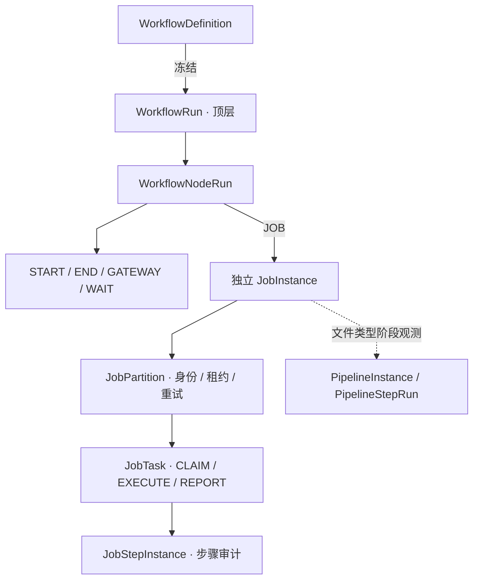
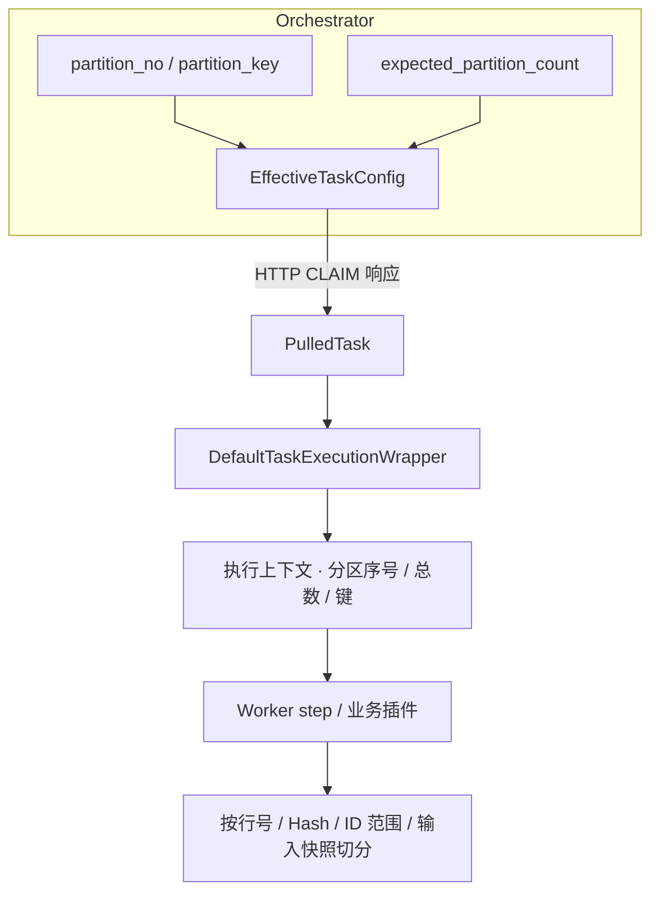

# 核心模型统一口径

> 本文档是批量调度平台的**单一权威模型文档**。
> 它统一定义四组最容易被分散理解的概念：**统一实例模型、统一状态模型、统一上下文模型、统一恢复模型**。
>  
> 阅读顺序建议：先看 [architecture-truth.md](./architecture-truth.md)，再看本文档，最后回看 [engineering-maturity-roadmap.md](engineering-maturity-roadmap.md) 和 [production-capacity-governance.md](../runbook/production-capacity-governance.md)。

## 1. 这份文档解决什么问题

当前项目里，核心概念分散在多个地方：
- `architecture-truth.md` 讲系统事实
- `maturity-assessment.md` 讲落地状态与成熟度
- `scalability-assessment.md` 讲承载力差距和改造路线
- ADR 讲局部决策

问题不在于信息少，而在于**同一个词在不同文档里容易被不同团队理解成不同东西**。  
本文档要做的是：
- 把名词统一
- 把边界统一
- 把状态和恢复语义统一
- 把“什么是实体、什么是属性、什么是上下文、什么是动作”说清楚

### 1.1 当前决议摘要

已定稿：
- `ExecutionContext` 是统一上下文主名；`PipelineContext` 只保留为历史检索词
- `jobCode` 是统一主名；`pipelineCode` / `flowCode` 只保留兼容口径，少量兼容访问器 / 兼容读取不视为漏改
- `retry_count` / `attemptNo` / `publishAttempt` / `run_seq` 已按层级分开
- `run_mode` 已作为运行时上下文意图落地，不进入主状态表；当前查询面继续由命令 / 审计承接，如需筛选 / 报表再单独评估写入数据库
- `workerId` / `workerCode` / `workerGroup` 已明确职责边界
- `Step` / `Stage` 的语义边界已定稿
- `CompensationSubmitCommand` / `ApprovalCommand` 的命令边界已定稿
- 当前运行模型采用 ADR-048（替代 ADR-047） 的 Workflow 根与全新数据库切换；物理字段以迁移和 Mapper 为准，残留历史列不定义新业务关系

## 2. 四个模型总览

| 模型 | 关注点 | 统一结论 |
|---|---|---|
| 统一实例模型 | 哪些对象算“执行实例” | WorkflowRun 是顶层根；NodeRun 关联按需创建的 JobInstance，再展开 partition/task/step；文件 Pipeline 保留阶段执行观测 |
| 统一状态模型 | 状态值怎么解释 | 状态只描述当前生命周期位置，不承载恢复语义；终态不能直接回到非终态 |
| 统一上下文模型 | 运行时信息怎么传递 | 上下文分成“稳定主键 + 可变 attributes bag”；`run_mode` 是上下文意图，不是状态 |
| 统一恢复模型 | retry / rerun / recover / compensate 怎么区分 | 这四个词必须分开：系统重试、人工重跑、故障恢复、业务补偿是四种不同动作 |

---

## 3. 统一实例模型

### 3.1 实例层级

当前开发分支按 ADR-048（替代 ADR-047） 采用 Workflow 顶层运行。所有顶层请求显式指定 `workflowDefinitionId`；受管单作业与组合图使用同一主链。

| 对象 | 原语与身份 | 职责边界 |
|---|---|---|
| `workflow_run` | 租户下某次已接纳请求的顶层运行 | 保存 Workflow 身份、业务日、区间、冻结图与有效配置；不依赖旧的根 JobInstance |
| `workflow_node_run` | WorkflowRun + nodeCode + runSeq | 保存节点状态、输出、等待与来源；同一 Job 被两个节点引用时有独立节点身份 |
| `job_instance` | JOB 节点实际启动的作业执行 | 保存有效 Job 参数和执行策略，关联所属 Workflow/节点；不是日切时预建的作业清单 |
| `job_partition` | 作业内分区身份 | 分区计划、Worker 归属、lease/invocation、自动重试与 checkpoint 的控制边界 |
| `job_task` | Worker 执行工作项 | 经 Outbox/Kafka 投递，再 CLAIM、执行和 REPORT；不等同于 DAG 节点 |
| `job_step_instance` | 任务/分区关联的步骤记录 | 步骤进度、状态及审计；不能替代 WorkflowNodeRun 或 Pipeline 阶段定义 |
| `pipeline_instance` / `pipeline_step_run` | 文件类 Job 的内部执行观测 | 系统 Pipeline code/version 与阶段运行明细；不是另一套顶层调度入口 |

`START`、`END`、`GATEWAY` 和 `WAIT` 有持久化节点记录，但不创建空的 Worker Job/Task 来模拟控制语义。JOB 的子请求仍经既有接纳链，节点唯一关联其 JobInstance；新模型不使用父虚拟 partition/task 等待，也不把旧 `job_type=WORKFLOW` 包装作业解释成子 Workflow。`TASK` 仍在枚举中保留，但缺少旧根 JobInstance 的新根派发明确拒绝；枚举保留不表示新图可使用旧 TASK 直接执行路径。

### 3.2 统一原则

1. 顶层运行事实是 WorkflowRun；JobInstance 是节点执行事实，二者各自使用自己的状态机。
2. 每日开日创建 BatchDay 与预期义务，不预建当天全部 JobInstance。请求接纳后准备 WorkflowRun，JOB 节点达到依赖及资源准入条件时才创建作业执行。
3. 单作业使用受管 `START → JOB → END` 图；组合图是同一层 DAG。当前不支持 Workflow 嵌套，不把持久化对象的关联层级当成可配置子流程树。
4. 同一 Job、同一业务日可以因不同节点或显式重放产生多次合法执行；不能仅按 jobCode/bizDate 合并身份。
5. 冻结的业务日、数据区间和版本随延期、重试与恢复继承；跨日映射必须显式解析并保留证据。
6. Orchestrator 是运行状态主机；数据库为事实源。Quartz、Kafka、Redis 和 ShedLock 不代替唯一约束、CAS 或终态保护。

### 3.2.1 系统原语与资产分类

| 类别 | 当前资产 / 原语 | 不应混淆的对象 |
|---|---|---|
| 定义资产 | Workflow、Job、日历、模板、通道、执行策略 | 定义的在线修改不回写已启动运行的冻结配置 |
| 系统执行资产 | `SystemPipelineCatalog` 固定类型/版本、插件及执行器 | 不提供租户自定义阶段顺序；插件扩展不等于新增通用编排引擎 |
| 计划与义务 | scheduled occurrence、expected work occurrence、覆盖进度、BatchDay | 机会、输入已到、请求已派发与业务成功是不同事实 |
| 输入与业务资产 | `file_record`、到达组/manifest、`data_asset`、`asset_partition` | 平台保存身份、就绪及版本证据，不接管企业全域数据目录 |
| 结果与消费证据 | `result_version`、冻结跨日结果、依赖选择快照 | Job 结果有效不等于整个 Workflow 成功；观察快照不自动证明外部 SQL 实际消费 |
| 运行事实 | WorkflowRun/NodeRun、JobInstance/Partition/Task、阶段记录 | 层级关联不是 Workflow 嵌套，也不是开日预建的静态树 |
| 治理与恢复记录 | Replay Operation、审批、重放 session、终态通知及投递审计 | 操作状态、运行状态、告警和投递状态分别收敛，不能互相冒充 |

文件束按 manifest 展开异构分区，Worker 批量 claim/report 是传输优化；二者均保留逐节点/逐任务身份与幂等边界。文件类与束类型的固定 Pipeline 选择以 `SystemPipelineCatalog` 为准，GENERAL/ATOMIC 不创建文件 Pipeline。

### 3.3 attempt 不是一等实体

`attempt` 在当前系统里应该被视为**执行次数或尝试序号**，而不是独立的核心业务实体。

当前代码里，尝试次数分散在不同层：
- `retry_count`
- `publishAttempt`
- `run_seq`
- `attemptNo`

这些字段可以表达“第几次”，但不能代表“一个独立业务对象”。

这里需要区分两层：
- 在主运行态模型里，`attempt` 不是 `job_instance`、`job_partition`、`job_task`、`job_step_instance` 之外的另一层核心对象。
- 在 outbox / delivery 运维审计层，可以存在附属记录来描述某次发布或投递尝试，例如 `event_outbox_retry`、`event_delivery_log`。

换句话说：
- `attempt` 不参与主运行态建模，不作为调度、执行、补偿的核心聚合。
- `attempt` 允许作为附属日志或审计记录存在，用来追踪发布/投递过程中的“第几次”及结果。

### 3.4 三层联动的正确理解

所谓 `step-partition-task` 联动，正确口径不是“三个平行实体”，而是：

1. `job_step_instance` 表示“业务上这个步骤执行到什么位置”
2. `job_partition` 表示“这一步被拆成哪些派发单元”
3. `job_task` 表示“worker 实际拿到的工作项”

换句话说：
- `step` 负责语义
- `partition` 负责并发与路由
- `task` 负责落地执行

### 3.5 代码对照

当前代码中已经存在这些实体：
- [`JobInstanceEntity.java`](../../batch-orchestrator/src/main/java/io/github/pinpols/batch/orchestrator/domain/entity/JobInstanceEntity.java)
- [`WorkflowRunEntity.java`](../../batch-common/src/main/java/io/github/pinpols/batch/common/persistence/entity/WorkflowRunEntity.java)
- [`JobPartitionEntity.java`](../../batch-orchestrator/src/main/java/io/github/pinpols/batch/orchestrator/domain/entity/JobPartitionEntity.java)
- [`JobTaskEntity.java`](../../batch-orchestrator/src/main/java/io/github/pinpols/batch/orchestrator/domain/entity/JobTaskEntity.java)
- [`JobStepInstanceEntity.java`](../../batch-orchestrator/src/main/java/io/github/pinpols/batch/orchestrator/domain/entity/JobStepInstanceEntity.java)
- [`WorkflowNodeRunEntity.java`](../../batch-orchestrator/src/main/java/io/github/pinpols/batch/orchestrator/domain/entity/WorkflowNodeRunEntity.java)

### 3.6 Partition 切分契约（orchestrator → worker）

**机制 vs 策略分离**：orchestrator 决定"派多少 partition + 给每个 partition 一个号牌"，worker 决定"我拿到号牌后干哪部分"（按文件行 / 按字节 range / 按业务键 hash / 按机构号等）。平台不强加切分维度——这是有意识的"机制（数量决策 + lease + 重试 + 状态机）vs 策略（怎么读 / 怎么过滤）"分离，与 K8s scheduler / Spring Batch Partitioner 同构。

#### 3.6.1 三个运行时字段的端到端流向

**字段语义**（`PipelineRuntimeKeys`）：

| Key | 类型 | 含义 |
|---|---|---|
| `PARTITION_NO` | Integer (1-based) | 当前 task 的分区序号；不分片场景为 `1` |
| `PARTITION_COUNT` | Integer | 本次 job_instance 的分区总数；`<= 1` 视为不分片 |
| `PARTITION_KEY` | String | 业务标识，默认 `jobCode:bizDate:partitionNo`，业务可在 plan-build 时覆盖为机构号 / hash 桶等 |
| `PARTITION_INVOCATION_ID` | String | Orchestrator 为当前分区 claim 分配的 invocation 身份；PROCESS 每个阶段在执行业务副作用前持有与 reclaim 共用的平台实例 advisory lock，并校验 task、partition、worker 和当前 invocation。此围栏覆盖 PROCESS 阶段执行入口，不授权 staging 自动清理，也不保护绕开该入口的直接 SQL/维护路径 |

#### 3.6.2 默认 ParseStep 行 mod 切分

`batch-worker-import` 的 `ParseStep` 默认 partition-aware：format parser 写完 NDJSON staging 后，post-filter 按 `lineNo % PARTITION_COUNT == PARTITION_NO - 1` 流式重写，下游 VALIDATE/LOAD 只看本 partition 数据。

- **开关**：`template_config.partition_aware_parse=false` 关闭（默认开）
- **统计口径**：`totalCount` = 文件原始行数（不变，全 partition 视角）；`parsedCount` = 本 partition 实际处理行数（切分时变小）
- **零侵入回退**：`PARTITION_COUNT <= 1` / 字段缺失 / 开关关闭 / `partitionNo` 越界 → 直通，与历史行为等价

#### 3.6.3 业务自定义切分维度

需要按机构号 / 业务键 / 数据范围切时：

1. **plan-build 阶段**覆盖 `partition_key`：在 `DefaultSchedulePlanBuilder` 自定义 partition_key 生成（默认 `jobCode:bizDate:partitionNo`，可写成 `branchCode=BJ` / `range=[10000,19999]` 等）
2. **partition 创建时**写 `input_snapshot JSONB`（`job_partition.input_snapshot`）：`{"branchCode":"BJ","dateRange":"2026-04"}`
3. **worker step**自定义 plugin 读 `PARTITION_KEY` / `input_snapshot` 自行路由数据范围；关闭默认行 mod 切分（`partition_aware_parse=false`）

**反例**：不要在 `PartitionCountResolver` 里塞业务切分逻辑——它只决定数量，不决定字段。详见 [`ADR-005-partition-count-resolver-chain.md`](./adr/ADR-005-partition-count-resolver-chain.md)。

#### 3.6.4 作业依赖结果引用

Orchestrator 在启动依赖闸门记录它观察到的上游 `businessKey`、结果版本号/ID、来源实例和对齐业务日，并在 Worker CLAIM 的 `EffectiveTaskConfig.dependencyResultSnapshot` 返回。内置 Worker core 将该列表放入 `PipelineRuntimeKeys.DEPENDENCY_RESULT_SNAPSHOT`，供自定义步骤读取。它是启动时的判定证据，可包含同日或前一业务日对齐，不包含冻结业务载荷，也不会锁住业务表或平台结果版本。消费者若要求版本一致，必须显式按版本 ID 读取或在执行期间校验引用；任意业务 SQL 和 SDK handler 不能仅因收到此字段就宣称已有实际消费 lineage。

Workflow 的 `crossDay` 是独立的冻结业务载荷契约；Java SDK handler 通过 `ctx.crossDayResults(alias)` 读取选定版本的只读 `INLINE_JSON` 数据，不重新查询最新版本。它的传递与恢复证据不覆盖未追踪的外部业务表查询；`EXTERNAL_REF` / `FILE_RECORD` 在解析阶段失败关闭，读取、授权和保留契约未完成前不提供隐式回退。

### 3.7 Step / Stage 边界

`Step` 和 `Stage` 不是同义词，不能互换。

推荐口径如下：

| 术语 | 角色 | 典型对象 | 责任 |
|---|---|---|---|
| `Step` | 领域步骤定义 | orchestrator 的 `StepDefinition`、`StepResult`、`JobStepInstance` | 描述业务处理链路中的逻辑步骤，偏编排和审计 |
| `Stage` | Worker 执行阶段 | worker-core 的 `ImportStage`、`ExportStage`、`DispatchStage`、`StageExecutionResult` | 描述单个 worker 内部的执行阶段，偏实现和运行时 |

约束：

1. `Step` 偏 orchestrator 的编排视角，不负责 worker 内部如何拆分执行。
2. `Stage` 偏 worker 的执行视角，不承担 DAG 拓扑或编排规则。
3. `job_step_instance` 记录的是 `Step` 级审计镜像，不是 `Stage` 的持久化替身。
4. `stage_code` 只是 worker 侧执行阶段枚举，不要把它上升成新的业务实体名。
5. 文档和代码评审里如果同时出现 `Step` 和 `Stage`，必须先确认语境是“编排”还是“执行”，不能默认等价。

---

## 4. 统一状态模型

### 4.1 状态只描述生命周期位置

状态模型只回答一个问题：

> 这个对象现在处于生命周期的哪一段？

状态**不**回答这些问题：
- 为什么重试
- 谁触发恢复
- 是否需要补偿
- 业务语义是否变更

恢复语义、触发者、原因、审批信息应放在：
- command 表
- audit 表
- metadata
- trace / context

### 4.2 当前统一状态口径

下列值表由 `scripts/ci/check-terminology-doc-sync.py` 与 Java enum 对照；不要手工增加代码里不存在的状态。

#### JobInstanceStatus

<!-- enum-sync:JobInstanceStatus:start -->
`CREATED`, `WAITING`, `READY`, `RUNNING`, `PAUSED`, `PARTIAL_FAILED`, `SUCCESS`, `FAILED`, `CANCELLED`, `TERMINATED`, `SUCCESS_DRY_RUN`, `FAILED_DRY_RUN`
<!-- enum-sync:JobInstanceStatus:end -->

`PAUSED` 是可恢复的非终态；dry-run 使用独立成功/失败终态，不能进入正式结果版本的 EFFECTIVE 链。 对已有任务写入 `run_mode` 再派发时，任务载荷必须是 JSON 对象，且父作业、任务和载荷的演练标记必须一致；不一致时整次状态复位和出箱写入回滚，需先核查并修复原始状态。

#### WorkflowRunStatus

<!-- enum-sync:WorkflowRunStatus:start -->
`CREATED`, `RUNNING`, `PAUSED`, `SUCCESS`, `FAILED`, `TERMINATED`, `SUCCESS_DRY_RUN`, `FAILED_DRY_RUN`
<!-- enum-sync:WorkflowRunStatus:end -->

workflow_run 没有 WAITING / READY；等待依赖属于节点运行状态。`PAUSED` 是停止推进新节点的可恢复非终态。

#### WorkflowNodeRunStatus

<!-- enum-sync:WorkflowNodeRunStatus:start -->
`READY`, `WAITING_DEPENDENCY`, `RUNNING`, `SUCCESS`, `FAILED`, `SKIPPED`
<!-- enum-sync:WorkflowNodeRunStatus:end -->

`WAITING_DEPENDENCY` 表示所声明的依赖未齐（包括跨日结果或跨运行条件）；`SKIPPED` 是 DAG 条件分支的成功式终结，不等于任务失败。

#### PartitionStatus

<!-- enum-sync:PartitionStatus:start -->
`CREATED`, `WAITING`, `READY`, `RUNNING`, `SUCCESS`, `FAILED`, `RETRYING`, `CANCELLED`, `TERMINATED`
<!-- enum-sync:PartitionStatus:end -->

partition 承载 lease 和调度重试；`RETRYING` 是非终态。

#### StepInstanceStatus

<!-- enum-sync:StepInstanceStatus:start -->
`CREATED`, `WAITING`, `READY`, `RUNNING`, `RETRYING`, `SUCCESS`, `FAILED`, `CANCELLED`, `TERMINATED`
<!-- enum-sync:StepInstanceStatus:end -->

step instance 是步骤审计镜像；它的 RETRYING 不能外推为 task 或 workflow_run 也有同名状态。

#### TaskStatus

<!-- enum-sync:TaskStatus:start -->
`CREATED`, `READY`, `RUNNING`, `SUCCESS`, `FAILED`, `CANCELLED`, `TERMINATED`
<!-- enum-sync:TaskStatus:end -->

task 没有 WAITING / RETRYING；重试等待由 partition、step 或 retry_schedule 表达，新的执行尝试再进入 task 生命周期。

### 4.3 状态迁移原则

1. 终态不直接回到非终态。
2. `PAUSED`、`WAITING_DEPENDENCY` 和 `RETRYING` 都不是终态，但只属于各自定义它们的层级。
3. 状态变更必须有前置条件，不能“看起来像对就写进去”。
4. `workflow_run`、`step_instance`、`task` 三层状态不能随意共用同一枚举值的业务含义。
5. 不要把恢复动作伪装成状态回滚。

### 4.4 迁移与恢复的边界

状态迁移只处理某一层级内的生命周期推进，例如：
- task：`READY -> RUNNING -> SUCCESS / FAILED`
- partition / step：失败后可进入 `RETRYING`，再按各自 CAS 规则推进
- job_instance / workflow_run：`RUNNING <-> PAUSED`，终结后不得复活
- 支持取消的层级：活动态可进入 `CANCELLED / TERMINATED`

如果是“重新做一遍”，那已经不是普通状态迁移，而是恢复模型的一部分。

---

## 5. 统一上下文模型

### 5.1 上下文是什么

上下文是运行时输入，不是状态。

统一上下文应该由两部分组成：
- **稳定主键字段**
- **可变 attributes bag**

### 5.2 当前代码里的上下文形态

运行时上下文统一由 Worker core 的
[`ExecutionContext`](../../batch-worker/core/src/main/java/io/github/pinpols/batch/worker/core/support/ExecutionContext.java)
承载；Orchestrator 只负责编排、路由和状态推进，不再维护重复的执行上下文模型。旧名 `PipelineContext`
仅保留为兼容语义和历史检索词，仓库里不再新增该类型。

该上下文携带 tenant / job / worker 等基础信息，并通过可变属性袋传递阶段间数据。

命名约束：
- 新文档、新 DTO、新接口说明统一使用 `ExecutionContext`
- `PipelineContext` 只用于检索旧资料或解释历史改动，不再作为新的类型名或字段名
- 新代码和新文档默认使用 `jobCode`；少量 `pipelineCode` 兼容访问器或兼容读取只用于承接历史调用和旧 payload，不再继续扩散

兼容层说明：
- 当前仍保留少量 `pipelineCode` 兼容入口，这是刻意保留的兼容层，不视为漏改
- 执行上下文和步骤执行统一落在 worker-core；控制面曾存在的无调用 `PipelineExecutor`/`StepRegistry` 第二套抽象已删除，避免把配置模型误当成本地执行引擎
- 典型落点见 [`ExecutionContext.java`](../../batch-worker/core/src/main/java/io/github/pinpols/batch/worker/core/support/ExecutionContext.java)、[`AbstractPipelineStepExecutionAdapter.java`](../../batch-worker/core/src/main/java/io/github/pinpols/batch/worker/core/support/AbstractPipelineStepExecutionAdapter.java)

### 5.3 统一上下文的推荐结构

建议把上下文理解成这三层：

| 层级 | 内容 | 是否稳定 |
|---|---|---|
| 请求头 | tenantId、jobCode、traceId、bizDate、requestId | 稳定 |
| 执行标识 | jobInstanceId、workflowRunId、partitionId、taskId、workerId | 稳定 |
| attributes | fileId、templateConfig、channelConfig、stepDefinitions、snapshot 等 | 可变 |

### 5.4 `run_mode` 的统一定义

`run_mode` 目前不是一等实体字段，建议把它定义为**上下文意图**，而不是状态。

推荐取值：
- `NORMAL`：正常执行
- `RETRY`：系统重试
- `RERUN`：人工重跑
- `RECOVER`：故障恢复
- `COMPENSATE`：业务补偿

推荐规则：
- `run_mode` 只出现在请求上下文、命令、审计里
- `run_mode` 不要写进主状态字段
- `run_mode` 不能用来替代 `status`

当前实现：
- 运行时上下文统一使用键 `run_mode`
- 兼容读取旧别名 `runMode`，但新 payload / context 一律写 `run_mode`
- Launch / retry / recover / compensate 链路都会把 `run_mode` 写入 payload 和 worker context
- 应用日志通过 MDC 输出 `runMode` 字段，便于在 Loki / ELK 中直接检索运行意图
- 当前不新增数据库字段；只有在需要按 `run_mode` 查询、统计、审计时才评估写入数据库

数据库层面的当前决议：
- 本轮继续维持 deferred，不把 `run_mode` 扩散进 `job_instance`、`job_task` 这类主状态表。
- 当前真正已有查询面是命令侧，不是主运行态；例如 `approval_command` 已可承接控制台查询和审计检索。
- 临时排查优先使用命令载荷或审计 JSON，不为一次性检索提前加列。
- 只有当控制台 / API 明确需要按 `run_mode` 做筛选、统计、报表或审计检索时，才进入正式写入数据库评估。
- 如果未来需要写入数据库，优先落在命令表或审计表，不优先落在主状态表。
- 物理列统一重命名不属于本轮目标，保持现有 schema 兼容，不顺手把数据库拉进当前命名收敛。

### 5.5 上下文继承规则

1. 上下文可以向下传递，但不要把子阶段的临时值回写成父级稳定字段。
2. `attributes` 是可变袋，但键名必须受控，统一由 `PipelineRuntimeKeys` 承载。
3. 新增键时要优先复用公共 key，不要各模块自己发明同义键。
4. 任何可审计信息都应该同时进入日志、command 或 audit，而不是只放在内存上下文里。

### 5.6 代码对照

- [`PipelineRuntimeKeys.java`](../../batch-worker/core/src/main/java/io/github/pinpols/batch/worker/core/infrastructure/PipelineRuntimeKeys.java)
- [`AbstractPipelineStepExecutionAdapter.java`](../../batch-worker/core/src/main/java/io/github/pinpols/batch/worker/core/support/AbstractPipelineStepExecutionAdapter.java)
- [`AbstractStageExecutor.java`](../../batch-worker/core/src/main/java/io/github/pinpols/batch/worker/core/support/AbstractStageExecutor.java)

---

## 6. 统一恢复模型

### 6.1 四个词必须分开

| 词 | 含义 | 谁触发 | 是否改变业务语义 |
|---|---|---|---|
| retry | 系统对同一执行单元再次尝试 | 系统 | 不改变 |
| rerun | 人工对同一业务范围重新跑一遍 | 人工 / 控制台 | 可能不改变，也可能重算 |
| recover | 从故障/中断中继续推进 | 系统 | 不改变 |
| compensate | 对已发生结果做纠正或反向操作 | 人工 / 审批 / 规则引擎 | 会改变 |

### 6.2 推荐定义

#### retry

- 同一业务意图下的再次执行
- 典型对象：`job_task`、`job_partition`、`retry_schedule`
- 典型驱动：网络抖动、临时依赖不可用、可重试业务错误
- 特点：自动、受上限控制、最终会进入 `dead_letter_task` 或成功

#### rerun

- 对某个范围做一次显式重跑，创建带来源的新顶层运行或精确节点执行，不复活旧终态
- 典型对象：`job_instance`、`job_partition`、`job_step_instance`
- 典型驱动：人工修正输入数据、重新评估规则、重新生成产物
- 特点：是“再跑一遍”，不等于“简单重试”

#### recover

- 从系统中断点恢复运行
- 典型对象：worker 心跳、lease、outbox、drain、未完成任务的接管
- 典型驱动：进程重启、节点漂移、短时故障、leader 切换
- 特点：恢复的是执行连续性，不是业务结论

#### compensate

- 对已经提交的业务结果做纠正
- 典型对象：`compensation_command`、`approval_command`
- 典型驱动：人工审批、业务撤销、纠偏、审计要求
- 特点：必须可审计，通常比 retry / recover 更重

#### compensation submit / approval

`CompensationSubmitCommand` 和 `ApprovalCommand` 不是状态字段，也不是运行态实体。它们是两类命令：

- `CompensationSubmitCommand`：表达“我要发起一次补偿”的意图，记录触发人、目标范围、原因和上下文
- `ApprovalCommand`：表达“我批准或拒绝这次补偿”的决策，记录审批人、结论和审批意见

约束：

1. 命令对象只描述一次动作请求，不承载生命周期状态。
2. 审批结果和执行结果应分别进入审计或命令表，不要塞回命令 DTO 当作持久状态。
3. 如果要表达“已提交”“已审批”“已执行”，应在状态模型或审计模型里单独建模，不能靠命令字段隐式表达。
4. 这两个命令的职责是可追溯、可重放、可审计，不是可运行的 worker 输入模型。

### 6.3 推荐决策树

1. 如果只是同一执行单元失败后再次尝试，选 `retry`。
2. 如果是运营人员或控制台明确要求整段重跑，选 `rerun`。
3. 如果只是进程/网络/租约恢复，选 `recover`。
4. 如果要改变既有业务结果，选 `compensate`。

### 6.4 代码和表的映射

这一节只用于帮助定位实现，不代表同一行里的实现天然语义等价。实现上即使复用了同一服务，领域边界仍以上文定义为准。

| 模型 | 主要表 / 代码 |
|---|---|
| retry | `retry_schedule`、`dead_letter_task`、`DefaultRetryGovernanceService` |
| rerun / replay | `replay_operation`、WorkflowRun/NodeRun 来源快照、审批与现有补偿/启动服务；范围按 ADR-049 区分 |
| recover | worker lease / outbox / drain / heartbeat 相关代码 |
| compensate | `compensation_command`、`ApprovalWorkflowService`、`DefaultCompensationService` |

### 6.5 不要混用的反例

- 不要把 `retry` 和 `rerun` 当成同义词
- 不要把 `recover` 写成一个新的状态值
- 不要把 `compensate` 实现成普通重试
- 不要把“恢复成功”理解成“业务成功”

---

## 7. 统一术语表

| 术语 | 推荐解释 |
|---|---|
| instance | 具体运行实体的统称；必须指出 WorkflowRun、JobInstance、Partition 或 Task，不能默认顶层为 JobInstance |
| run | WorkflowRun 为顶层运行，WorkflowNodeRun 为节点事实；不再将其解释为旧根 Job 的可选镜像 |
| partition | 调度并发单元，通常指 `job_partition` |
| task | worker 执行单元，通常指 `job_task` |
| step instance | 步骤审计镜像，通常指 `job_step_instance` |
| attempt | 尝试序号，不是一等实体 |
| context | 运行时输入 + attributes bag |
| mode | 执行意图，不是状态；值以 `RunMode` 为准 |
| retry | 系统重试 |
| rerun | 人工重跑 |
| recover | 故障恢复 |
| compensate | 业务补偿 |

---

## 8. 统一口径要求

1. 新增设计、接口、表结构时，优先沿用本文档术语。
2. 看到 `attempt` 时，默认先问是“次数”还是“实体”。
3. 看到 `run_mode` 时，默认先问它是不是上下文意图，而不是状态。
4. 看到 `retry / rerun / recover / compensate` 时，必须先区分动作归属，再决定写入数据库表和审计路径。
5. 如果后续文档与本文档冲突，以本文档为准；如果代码与本文档冲突，以代码为准，但要补文档回写。

---

## 9. 需要同步阅读的文档

- [architecture-truth.md](./architecture-truth.md)
- [engineering-maturity-roadmap.md](engineering-maturity-roadmap.md)
- [production-capacity-governance.md](../runbook/production-capacity-governance.md)
- [runtime-module-communication.md](./runtime-module-communication.md)
- [adr/README.md](./adr/README.md)
