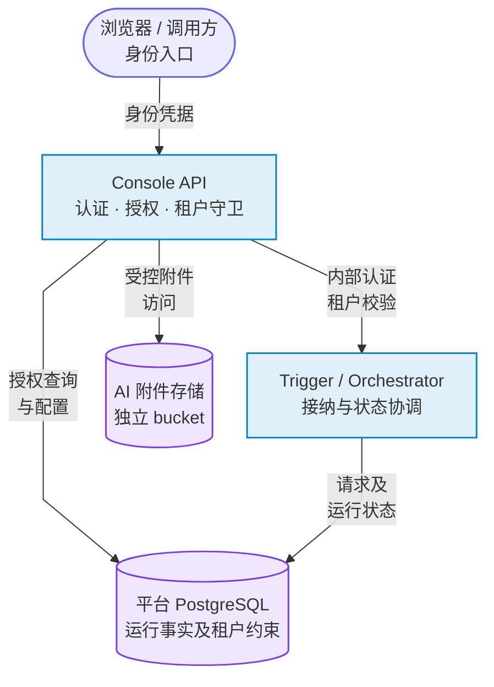
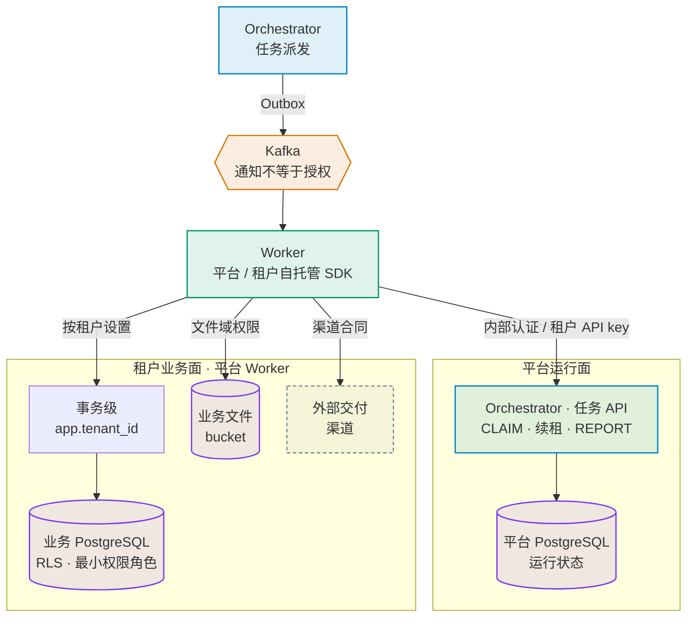

# 系统安全模型

> **Workflow 新根的安全边界**：顶层请求必须携带目标 Workflow 身份并经租户/权限校验；JOB 节点执行继承已冻结的图、日期和配置，内部关联字段不能由外部请求伪造。Replay 预览/审批绑定持久化快照与版本，批准后不重读当前定义替换执行目标。外部副作用结果未知、能力声明缺失或不匹配时失败关闭，不能自动再次执行。操作审批、租户暂停、密钥撤销等实时策略仍在执行边界校验。

## 定位

本文提供稳定的信任边界和威胁入口，避免专项审计各自建立互相漂移的安全模型。具体实现仍以代码、ADR、OpenAPI、迁移和 Runbook 为准。

## 关键资产

| 资产 | 主要风险 | 主要控制 |
|---|---|---|
| 租户配置、凭据和审批 | 越权读取、明文泄漏、未审计修改 | Console 鉴权、租户守卫、Secret 注入、操作审计 |
| 作业/任务/分片运行态 | 重复执行、终态复活、跨租户更新 | DB 约束、CAS、幂等键、lease/fence、RLS |
| 业务文件和对象 | 路径遍历、篡改、半成品误用 | `PathSanitizer`、沙箱、checksum、sidecar、对象存储策略 |
| Kafka 事件和 Outbox | 重放、乱序、丢失、伪造 | transactional outbox、幂等消费、schema/契约、最小 ACL |
| Worker 插件和外部执行 | RCE、SSRF、凭据扩散、资源耗尽 | Atomic 隔离、allowlist、响应上限、超时、独立身份和网络策略 |
| CI、依赖和发布制品 | 恶意 Action/依赖、构建篡改、来源不明 | SHA pin、Dependabot、CodeQL、SBOM、许可证、provenance 目标 |

## 信任边界

1. **浏览器/调用方 → Console API**：所有身份、角色、租户和幂等约束在服务端校验；前端隐藏按钮不是授权控制。
2. **Console API → Orchestrator/Trigger**：内部 API 仍需鉴别调用方、校验租户和输入；不能因网络位于集群内而默认可信。
3. **Kafka/HTTP → Worker**：claim、lease、fence、签名和幂等共同决定任务是否可执行；消息到达本身不构成授权。
4. **Worker → 业务 PG/文件/对象存储/外部渠道**：动态 SQL、路径、URL、凭据和输出大小均是不可信输入；按 worker 类型隔离身份和网络。
5. **平台 PG/Redis/Kafka/MinIO**：基础设施故障与攻击都可能表现为超时、重复和乱序；正确性不能只依赖单次网络成功。
6. **源码/PR → CI → 制品 → 部署**：PR 检查、Action 固定、依赖扫描、SBOM、签名和 provenance 构成供应链，不把本机构建当作发布证明。

### 租户与执行信任边界图

本图表示逻辑信任边界，不是所有连接或实际网络拓扑。具体访问路径和启用的隔离由 Worker 类型、配置和部署环境决定；跨租户查询仍需相应授权与审计。

**访问与租户边界**

**执行与数据边界**

图中的任务派发与任务 API 是同一个 Orchestrator 服务的不同职责；Worker 访问路径按类型、权限和配置生效，并不表示每类 Worker 都访问所有依赖。

租户身份由服务端认证和授权确定；RLS 上下文使用数据库事务变量，不存放在 Redis。平台 Worker 只在各自受权的路径访问业务数据与平台文件元数据；自托管 Worker 通过协议接入，不获得平台库全局写权限。内建平台 Worker 默认仍沿用共享平台库账号；部署方可按 [Worker 平台库最小授权](../../scripts/db/README.md) 为每类 Worker 建立独立角色：权限由 Worker 的 Mapper XML 与内联 SQL 生成，Orchestrator 所有的 `job_instance`、`job_partition`、`workflow_run`、`outbox_event` 等表不授予写权限，`job_task` 只授予登记列的列级 UPDATE。Helm 用 `<worker>.platformDb.credentialsSecretName` 为每类 Worker 注入独立凭据。Console/Trigger/Orchestrator 同样可改用由各自 SQL 生成的运行时角色：Console 与 Trigger 对 Orchestrator 所有的运行状态表只读，三者都不持有 DDL 权限；Trigger/Orchestrator 的 Flyway 迁移改由 `BATCH_PLATFORM_FLYWAY_USERNAME` 指定的 owner 账号执行。目标环境是否已切换，需以该环境的授权核查为准。ATOMIC 的受控执行器需要独立身份、网络策略和部署隔离。不同业务文件与 AI 附件 bucket 属于逻辑隔离；它们可以复用客户端及存储集群，**独立 bucket 不等于独立物理故障域**。具体访问和凭据见[业务分片路由](../runbook/biz-tenant-routing.md)与[存储域边界](../runbook/object-storage-s3-backends.md)。

## 攻击者与失效假设

- 未认证互联网调用者、合法但恶意的租户用户、凭据泄漏后的调用者；
- 被攻陷或实现错误的自托管 Worker/插件；
- 恶意依赖、Action、构建脚本或被篡改制品；
- 具有部分运维权限的内部人员；
- PG/Kafka/Redis/对象存储短时不可用、网络分区、进程崩溃、时钟偏移和资源耗尽。

系统不假设 exactly-once 由 Kafka 或网络自动提供；依赖数据库约束、幂等、fence 和最终一致性恢复共同保证业务语义。

## 关键验证入口

| 边界 | 验证入口 |
|---|---|
| 认证、租户、RLS | `docs/runbook/multi-tenant-rls.md`、安全 ArchTest、跨租户 IT |
| Worker 与文件链路 | `docs/verifications/worker-business-scenario-matrix-2026-06-08.md`、五类 Worker E2E/sim |
| CI 与依赖 | `docs/runbook/security-scan.md`、`docs/runbook/ci.md`、`docs/standards/open-source-governance.md` |
| 故障恢复 | `docs/runbook/ha-readiness.md`、DR/故障注入脚本和 staging 证据 |
| API 和 SDK | OpenAPI drift/breaking gate、多语言 conformance 和真实 transport 验证 |

## 已知边界

- 扫描无告警不等于无漏洞；业务授权、状态机和租户隔离仍需对抗性审查与真实数据测试；
- 本地 Docker 演练不等于生产同构的 HA/DR 证据；
- Scorecard、Sonar 和 SAST 是发现工具，不替代代码审查、运行时隔离或供应链签名；
- 自托管 Worker 属于受约束但不完全可信的执行域，不能获得平台数据库全局权限；
- 系统不承担通用数据治理、通用实时流处理或自研容器调度职责。

## 变更要求

新增信任边界、执行能力、认证方式、外部协议或安全旁路时，必须同步更新本文，并按
[`../standards/open-source-governance.md`](../standards/open-source-governance.md) 判断是否需要 BEP 和生产就绪评审。
