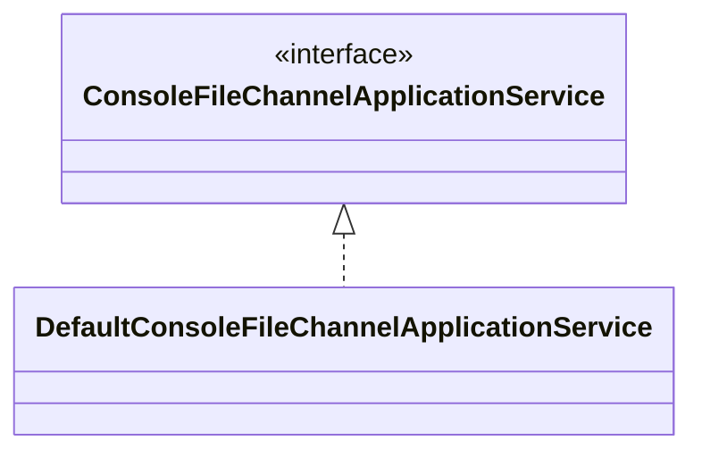
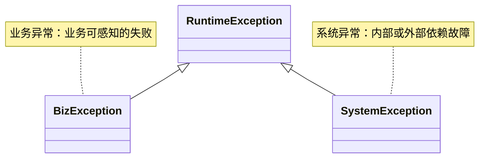
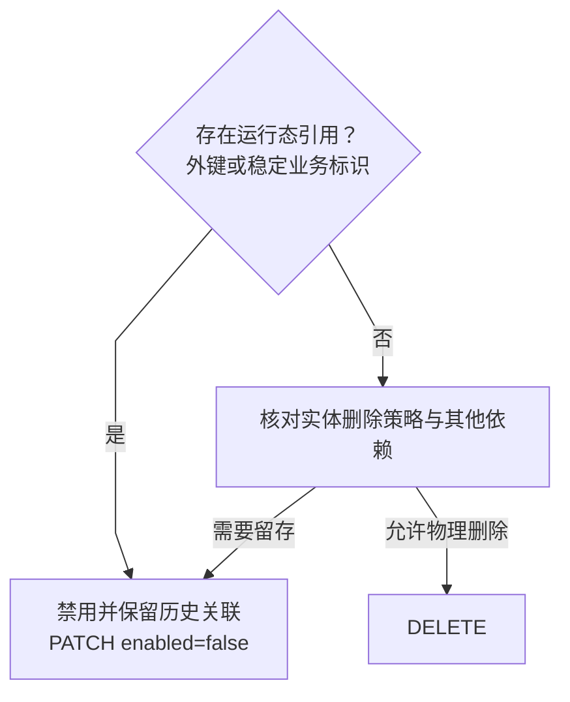

# file-batch-system 编码规约

> 本文档总结项目中实际遵循的编码规范与设计约定，供团队成员参考。

## 0. Java 格式化工具

Java 源码统一由根目录 `pom.xml` 中的 Spotless 执行 **Palantir Java Format 2.92.0**，采用
Google 风格兼容模式和 120 列布局。CI、Git Hook 和本地命令必须使用 Spotless，不以 IDE 的
个人格式化配置作为项目规范。

```bash
make spotless       # 检查
make spotless-fix   # 自动修复
```

格式化变更必须与业务逻辑分开提交。IDE 只负责调用项目 formatter 或导入兼容的 Palantir
Java Format 插件，不能自行改用 IntelliJ/Eclipse 格式化后提交。

### 0.1 多语言 SDK 与脚本格式化

各语言使用官方或事实标准 formatter，不能把 Java 的 120 列规则直接套到其他语言：

| 范围 | 工具与约定 | CI 门禁 |
| --- | --- | --- |
| Go SDK | `gofmt`，使用 Go 默认 tab 缩进 | `sdk-contract-parity` 的 Go contract job |
| Rust SDK | `rustfmt`，使用 Cargo 默认配置 | `sdk-contract-parity` 的 Rust contract job |
| Python SDK | Ruff formatter，100 列、4 空格 | `sdk-python` 的 `ruff format --check` |
| TypeScript SDK | Prettier 3.6.2，100 列、2 空格、LF、分号 | `sdk-contract-parity` 的 TypeScript contract job |
| Shell / Workflow | ShellCheck + actionlint；脚本保留 `set -euo pipefail` | `workflow-lint` 与脚本安全门禁 |
| SQL / YAML / XML | 由 EditorConfig 约束编码、换行、缩进；迁移和 fixture 不使用会重排语义的全量 formatter | 结构、安全及边界检查 |

格式化命令：

```bash
gofmt -w sdk/go
cargo fmt --manifest-path sdk/rust/Cargo.toml --all
(cd sdk/python && ruff format src tests)
(cd sdk/typescript && npm run format)
```

提交前使用对应的 `--check` / `format:check` 命令；纯格式化变更必须与业务逻辑分开提交。

### 0.2 多行字符串与文本块

具有固定结构或特殊排版的多行内容优先使用 Java text block，包括 SQL、JSON、XML、YAML、Lua、Shell、Markdown、提示词和测试 fixture：

```java
String payload = """
    {
      "tenantId": "t1",
      "jobCode": "IMPORT_DAILY"
    }
    """;
```

不要为了使用新语法而机械替换签名串、canonical request、协议拼接、Redis key、metric name、
header、错误码、短日志模板、循环生成的 CSV/Mermaid/PEM、含有意义行尾空格或字节布局的定长文件 fixture，
或已经由 `String.join("\n", ...)`
清晰表达的聚合。动态值优先用 `.formatted()`；需要正确转义或构造复杂对象时使用 JSON/YAML 序列化器，
不要手工拼接字段。纯文本动态消息不属于固定排版模板，可保留字符串拼接。

文本块的结束 `"""` 必须独立占一行；如果需要保持旧字符串“没有末尾换行”的语义，可以使用
`.stripTrailing()`。文本块仍交给 Spotless / palantir-java-format 排版，不和 formatter 对抗。

`check-java-structured-string-concat.py` 对新增 Java 代码执行增量检查：识别跨多行拼接且具有 JSON、
XML、YAML、SQL、Markdown、CSV、PEM、INI、properties、Lua 或 Shell 脚本结构特征的字符串模板。存量表达式以目标分支为基线，不要求一次性改写；
签名/协议字符串、普通动态消息和生成式内容不在强制范围内。门禁是有针对性的静态检测，不能替代代码审查。

---

## 1. 方法参数约束


| 参数数量 | 要求                                       |
| ---- | ---------------------------------------- |
| ≤ 4  | 允许直接传参                                   |
| = 5  | 一般方法建议封装；Mapper 公共方法 **必须** 封装     |
| = 6  | 建议封装；Mapper 公共方法和 Service 公共接口 **必须** 封装 |
| ≥ 7  | **必须** 封装为参数对象                           |

Mapper 公共方法的 5 个及以上参数应使用一个具名参数对象，不再通过多个 `@Param` 暴露位置性参数。简单 CRUD 也遵循该边界；参数对象应只包含该 SQL 所需字段，不得扩张为通用查询上下文。


**封装类型选择：**

- 私有/内部方法 → `private record`（嵌套在使用类内部）
- 公共接口 → 独立 `Command` / `Param` / `Context` / `Request` 类

```java
// 公共接口参数对象
public record CompensationSubmitCommand(String tenantId, String jobCode, ...) {}

// 私有内部参数对象
private record BadRecordContext(ImportJobContext context, ImportStage stage, Long recordNo, ...) {}
```

**豁免场景：** 构造器（record、DTO、Response、data holder、Spring DI 注入）不受此约束。

### 1.1 调用方约束（inline build 提取）

方法签名压缩到参数对象后,调用现场如果写成 `f(XxxParam.builder().a()...build())` 一长串 fluent 链,
参数臃肿就从签名搬到调用处了。判定线按链长度 `.xxx()` 调用数:

| chain 长度 | 处理 |
|---|---|
| ≤ 3 | 单行 inline,**禁提取**(业界 builder 标准写法) |
| 4-6 | 单行或 2 行 fluent,**禁提取** |
| 7-9 | 看场景:在短工厂方法(`static foo() { return X.builder()...build(); }`,整体 ≤ 8 行) → inline;在长函数中间 → 可考虑提取 |
| ≥ 10 | **必须提取**为局部变量再 return / 传参 |

**正确写法(chain ≥ 10)**：

```java
// ✅ 调用方提取局部变量,return / 传参语义一眼可读
LaunchRequest launchRequest =
    LaunchRequest.builder()
        .tenantId(request.tenantId())
        .jobCode(request.jobCode())
        ...11 个字段...
        .build();
return launchRequest;
```

**禁用写法**：

```java
// ❌ return 语句被 builder 链淹没,在 if 分支里嵌套时尤其难读
return LaunchRequest.builder()
    .tenantId(request.tenantId())
    .jobCode(request.jobCode())
    ...11 个字段...
    .build();
```

**合理 inline 场景(短链不该提取)**：

```java
// SDK args(MinIO/AWS),链 ≤ 5,单行即读完 — 不提取
minioClient.getObject(GetObjectArgs.builder().bucket(bucket).object(name).build());

// 短工厂方法,工厂本身就是"避免调用方写长链"的封装 — 内部 inline 是惯例
public static DryRunFinding pass(String code, String scope, String message) {
  return DryRunFinding.builder()
      .code(code).severity(Severity.PASS).scope(scope).message(message)
      .build();
}
```

**豁免**：
- 声明式注册类(`ConsoleMenuRegistry` / `*SchemaRegistry`):inline new 是声明式数据结构的标准写法
- test fixture:test-as-spec 模式,inline 让测试可读性更高

**守护**：`PositionalArgsConventionTest` 拦白名单(`GUARDED_TYPES`,当前 51 个类型)的方法实参 inline build;
return 位置因每个项目语义不同(短工厂方法合理 inline),不全局守护,靠 review 按上述判定线手工把关。

### 1.2 API DTO 与动态 Map 边界

- Controller、Application Service 的固定请求/响应字段必须使用独立 `record` / DTO；新增字段应先修改 DTO，再同步 OpenAPI 和前端类型。
- `Map<String, Object>` 只允许出现在确实动态的边界：插件参数、用户自定义 metadata、状态名作为 key 的聚合维度、透传的外部扩展字段。
- MyBatis 临时行映射可以阶段性使用 Map，但不得直接作为 Console 固定响应或核心服务契约；迁移时在 mapper 与 DTO 之间增加 typed view。
- 行映射迁移为不可变 `record` 时，用显式 `<resultMap>` + `<constructor>`（`<idArg>` / `<arg column=... javaType=...>`）声明构造器参数，不依赖列序或参数名自动映射；`resultType="map"` 只保留在尚未迁移的查询上。
- 兼容历史 wire 的 `from(Map)` 转换器可以保留，但生产调用链应优先使用 typed view，兼容入口只由旧数据/旧测试使用。

### 1.3 长方法与参数密度

- 不用机械行数作为唯一门槛；当一个方法同时包含校验、路由、持久化、状态推进或外部调用时，按业务阶段提取私有方法或内部 `Context` / `Command`。
- 公共方法达到 6 个相关参数时，优先封装为不可变 `Command` / `Param` / `Context`；调用方也不得用超长 builder 链把复杂度重新搬回现场。
- 提取必须保持事务边界、异常语义、日志上下文和幂等键不变；结构重构与行为变更分开提交，并用原有契约测试锁定 JSON 和状态机语义。

### 1.4 命令与上下文的调用现场

- 生产代码中，方法实参或 `return` 表达式若嵌套了较长的构造器、builder 或普通方法调用，并因此遮住业务含义，应先以语义明确的局部变量承接，再传给目标方法或返回。
- 判断依据是阅读成本，而不是语法类型或固定嵌套层数：当读者需要反复配对括号、向内追踪多个调用才能看清传入值/返回值的来源，或表达式混合了多个业务字段、转换和决策时，应提取；单一、短小且读起来连贯的调用保持 inline。
- 有意义的中间值使用能说明业务角色的名称；只为拆括号而引入 `value`、`result` 等无信息变量没有帮助。多个参数分别有复杂来源时，可分别命名，避免将整个调用改写成大量临时变量。
- 提取前后必须保持求值顺序、调用次数、短路行为、异常时机和副作用；时间、随机数、可变状态或外部 I/O 调用尤其不能因提取而提前、重复或延后执行。
- 简短的返回值工厂、简单 DTO/record 映射、构造器内部的紧凑组合、枚举/注册表中的声明式配置，以及 test fixture 可以保留 inline；安全扫描步骤目录中的 `ExternalCommand` 属于声明式配置，适用同一例外。
- 不新增公共方法、辅助类或仅服务于一次局部表达式的抽象来替代局部变量。只有表达式本身形成可复用的领域操作或独立职责时，才考虑方法/类型抽取。

```java
// 多个嵌套转换时，先命名中间业务值，再传入调用
ApprovalCommand command = toApprovalCommand(request);
ApprovalContext context = resolveApprovalContext(command);
return approvalService.submit(command, context);

// 短小且含义直接的表达式无需拆分
return Optional.ofNullable(value).map(String::trim).orElse("");
```

此约定适用于构造器、builder 和普通方法调用的实参及返回表达式，不限定为 `Command` / `Context` / `Param`。审查和统计工具用于发现候选，不以嵌套调用数量作为自动改写标准；按业务含义逐处判断，并通过针对性测试确认语义未变。

`PositionalArgsConventionTest` 对当前 PR 相对目标分支新增/修改的生产 Java 行执行 AST 候选门禁：方法实参或 `return` 表达式中出现至少 3 层连续方法/构造调用时阻断。短 fluent receiver 链和 lambda 函数体不计入；测试代码和未变更的历史候选不扫描。它只判断嵌套深度，不强制如何命名或拆分，调用语义仍需在评审中确认。

### 1.5 复合条件与命名布尔

- 当 3 个及以上判断共同表达业务状态、准入规则或状态机分支时，先用方法内局部 `boolean` 说明该事实，再进入 `if`；例如 `canAssociateCatchUpRequest`、`onlyTerminalChildStateResidual`。
- 变量名必须说明条件成立时的业务含义，禁止 `isOk`、`flag`、`valid` 等脱离上下文的泛化名称；只会使用一次的条件不应因此抽成私有方法。
- null guard、类型匹配、范围/位运算、白名单枚举、短路防御和简单的两项条件保持 inline。不得按 `&&` / `||` 数量机械提取，以免把相邻校验拆成难以追踪的临时变量。
- 同一复合规则在多个调用点重复出现时，再抽取为具名谓词或领域方法；抽取不得改变短路顺序、异常时机、外部调用次数或事务边界。

### 1.6 多个 null 与参数对象合法状态

- 公共方法不得用多个 nullable 参数的不同组合选择运行模式，例如 `settle(reservation, provider, null, null)`。不同业务模式使用具名入口、命令类型或判别字段表达，例如 `settleMeasured(reservation, usage)` 与 `settleReserved(reservation)`。
- 参数对象的必填字段必须在构造边界校验；Lombok `@Builder` 不能被当成必填约束。无法用 Java 类型系统直接表达时，在构造器或静态工厂中 fail-fast，并为每个必填字段补负向测试。
- 参数对象存在互斥状态或不同必填字段集合时，优先使用私有构造器 + 具名静态工厂；不得同时暴露通用 Builder 或公共全参构造器，使调用方重新以 `null` 拼出任意组合。工厂签名应直接展示该状态真正需要的参数。
- 可选字段只有“缺失时保留原值”等单一、明确语义时才允许为 null；同一字段在不同调用点代表“保留”“清空”“自动计算”等多种含义时，改用独立 command、显式操作枚举或值对象。
- 参数对象应只允许领域合法状态。不要为了减少签名参数，把互斥模式和无关字段合并成所有字段都 nullable 的万能对象。
- 框架 DTO、数据库 nullable 行、外部兼容协议可以保留 nullable 边界；进入应用/领域逻辑时尽早转换为明确类型，不把兼容性空值向内部扩散。
- 已有具名工厂可以在内部补齐缺省字段；不为清零 null 数量，把清晰的模式入口改成允许任意组合的通用 Builder。不可变行快照的同构更新可沿用 `toBuilder()`，只设置变化字段，并保持原 record 字段、兼容构造器和 Mapper 映射。

---

## 2. 全限定类名（FQN）禁令

**禁止在代码中使用全限定类名** —— 必须通过 `import` 导入后使用短名。

```java
// ✅ 正确
import java.util.concurrent.TimeUnit;
TimeUnit.SECONDS.sleep(1);

// ❌ 错误
java.util.concurrent.TimeUnit.SECONDS.sleep(1);
```

注解同理：写 `@MockitoSettings` 而非 `@org.mockito.junit.jupiter.MockitoSettings`。

---

## 3. 依赖注入

### 3.1 唯一方式：构造器注入

项目统一使用 **Lombok `@RequiredArgsConstructor` + `final` 字段** 实现构造器注入。需要自定义校验、
派生字段初始化或测试构造入口时，可以保留显式构造器；注入方式仍必须是构造器注入。

```java
@Service
@RequiredArgsConstructor
@Slf4j
public class DefaultTriggerService implements TriggerService {
    private final TriggerRequestRepository triggerRequestRepository;
    private final TransactionTemplate transactionTemplate;
    // 无需手写构造器，Lombok 自动生成
}
```

### 3.2 禁止

- **禁止** `@Autowired` 字段注入
- **禁止** setter 或其他方法注入
- **禁止** `@Inject` / `@Resource` 字段或方法注入
- **禁止** 在非 `@Configuration` 类中使用 `@Bean` 方法注入

唯一构造器不需要 `@Autowired`；存在多个构造器且需指定 Spring 注入入口时，必须在选定构造器上
显式标注。新增/变更生产 Java 文件由增量门禁检查字段与方法注入；存量全量基线由 Full Gate 检查。

### 3.3 @Configuration 类

配置类统一使用 `proxyBeanMethods = false` 以提升启动性能：

```java
@Configuration(proxyBeanMethods = false)
class ConsoleKafkaConfiguration {
    @Bean
    KafkaAdmin kafkaAdmin(@Value("${spring.kafka.bootstrap-servers}") String bootstrapServers) {
        return new KafkaAdmin(Map.of(AdminClientConfig.BOOTSTRAP_SERVERS_CONFIG, bootstrapServers));
    }
}
```

---

## 4. 设计模式

### 4.1 接口-默认实现（Interface-Default）

核心服务均采用 `XxxService` 接口 + `DefaultXxxService` 实现的分离模式：



实际命名示例：

- `TriggerService` → `DefaultTriggerService`
- `HeartbeatService` → `DefaultHeartbeatService`
- `WorkerRegistryService` → `DefaultWorkerRegistryService`

#### 4.1.1 Service 层职责与入口约定

- Service/ApplicationService 承载用例编排、事务边界和领域策略调用；Controller 只做协议适配、校验触发与响应映射，Mapper 只负责持久化语句。
- 一个 Service 可以协调多个 Mapper/Port；不要仅因类行数、依赖数量或方法数量达到固定阈值拆分。出现可独立描述和测试的策略、协议适配、查询投影或资源生命周期时，才按该职责拆分，并保持事务/幂等边界不变。
- 对外公共入口校验调用方可控的必填对象/标识；允许空值的查询条件应保留其明确语义。不能以“文件任意位置有 null 判断”作为入口已校验的证据；校验应位于入口或其明确调用的校验方法。
- 业务失败使用项目业务异常/结果类型；不得用裸 `NullPointerException` 表达业务拒绝。基础设施异常按边界保留 cause，日志按日志治理规范处理。
- Service 接口只有在存在应用端口边界、多个实现/替换需求或测试隔离价值时才要求抽象；新代码不为满足命名模板机械新增空接口。既有 `XxxService`/`DefaultXxxService` 配对沿用，不借治理改动顺带重构调用图。

Orchestrator 已有核心入口的空值策略由 `ServiceEntryGuardArchTest` 按入口语义精确守护：Launch 校验拒绝空请求，BatchDay gate 对缺失上下文采取 fail-safe allow。新增核心入口应在测试中明确拒绝还是 fail-safe，而不是复制某一种统一策略。

### 4.2 策略模式（Strategy）

通过 Registry 管理多策略实现，运行时按 key 选择：

```java
// 策略接口
public interface ExportFormatStrategy { ... }

// 注册表
@Component
public class ExportFormatStrategyRegistry {
    private final Map<String, ExportFormatStrategy> strategies;
    // Spring 自动注入所有实现
}
```

### 4.3 模板方法（Template Method）

Worker 执行链使用 Pipeline Step 模板：

```java
public record PipelineStepDefinitionParam(...) {}  // 步骤定义
public record StepExecutionRequest(...)  {}         // 步骤执行请求
public record StageExecutionContext(...) {}         // 阶段上下文
```

### 4.4 门面模式（Facade）

Worker 运行时通过 `WorkerRuntimeFacade` 统一对外暴露能力，屏蔽内部细节。

---

## 4.5 SQL 与配置放置边界

SQL 和配置不能随意混进 shell / service 代码。按以下边界执行：

| 类型 | 放置位置 |
|---|---|
| schema / 版本迁移 | `db/migration/*.sql` |
| 稳定业务 CRUD / 查询 | MyBatis Mapper XML 或 repository |
| sim / e2e fixture | `test-data/sim/` 中的 SQL / JSON / YAML；配置包样本放 `test-data/tenant-config-packages/` |
| load-test 准备、清理、报表 SQL | `load-tests/sql/*.sql` |
| local 验证辅助 SQL | `scripts/local/sql/*.sql` |
| ops inspect / heal SQL | `scripts/ops/sql/*.sql` |
| import/export/process/atomic 动态 SQL 引擎 | Java `SqlBuilder` / `SqlValidator` / plugin executor |

禁止新增：

- shell 中大段 `<<SQL` heredoc。
- shell 中内联 `jsonb_build_object` 组装 step_params。
- service 层新增大段 `jdbc.update("DELETE ...")` / cascade cleanup SQL。
- JSON 配置嵌套在 SQL 再嵌套在 shell 中。

允许例外：

- 动态 SQL 引擎本身需要在 Java 中生成 SQL，但必须集中在 builder / validator / executor，不能散落到业务 service。
- 历史脚本 SQL 命中基线保存在 `scripts/ci/baselines/sql-inline-baseline.tsv`，由 `scripts/ci/check-sql-config-boundaries.sh` 校验。扫描大小写不敏感，并识别 `psql -c/-tAc/-Atc`、SQL heredoc 及嵌入式 Python/Java SQL；基线只允许减少，不允许新增文件或提高计数，迁出内联 SQL 后必须同步下调或删除对应行。

---

## 5. 异常体系

### 5.1 异常层次



两者均携带 `ResultCode` 枚举：

```java
public class BizException extends RuntimeException {
    private final ResultCode code;
    public BizException(ResultCode code, String message) { ... }
}
```

### 5.2 ResultCode 枚举


| 枚举值                       | HTTP 状态码 | 含义     |
| ------------------------- | -------- | ------ |
| `SUCCESS`                 | 200      | 成功     |
| `INVALID_ARGUMENT`        | 400      | 参数非法   |
| `VALIDATION_ERROR`        | 400      | 参数校验失败 |
| `MISSING_IDEMPOTENCY_KEY` | 400      | 缺少幂等键  |
| `UNAUTHORIZED`            | 401      | 未授权    |
| `FORBIDDEN`               | 403      | 禁止访问   |
| `NOT_FOUND`               | 404      | 资源不存在  |
| `CONFLICT`                | 409      | 资源冲突   |
| `STATE_CONFLICT`          | 409      | 状态冲突   |
| `RATE_LIMITED`            | 429      | 请求过于频繁 |
| `BUSINESS_ERROR`          | 422      | 通用业务错误 |
| `NOT_IMPLEMENTED`         | 501      | 未实现    |
| `SYSTEM_ERROR`            | 500      | 系统错误   |


### 5.3 全局异常处理

每个服务模块有独立的 `@RestControllerAdvice` 异常处理器：

- `ConsoleApiExceptionHandler`（console-api）
- `OrchestratorApiExceptionHandler`（orchestrator）
- `TriggerApiExceptionHandler`（trigger）

处理链：`BizException` → `SystemException` → `MethodArgumentNotValidException` → `ConstraintViolationException` → ... → `Exception`（回退）

---

## 6. API 响应规范

### 6.1 统一响应包装

`batch-console-api` 的对外 Console API 统一返回 `CommonResponse<T>`。`/internal/**` 是服务间协议边界，按已登记的 DTO / Map 协议返回，不额外套 Console envelope；否则会破坏 Worker、Trigger、SDK 的既有协议兼容性：

```java
public record CommonResponse<T>(
    ResultCode code,
    String message,
    T data,
    ResponseMeta meta
) {
    public static <T> CommonResponse<T> success(T data) { ... }
    public static <T> CommonResponse<T> failure(ResultCode code, String message) { ... }
}
```

### 6.2 Console Controller 写法

```java
@GetMapping("/jobs")
public CommonResponse<List<JobDefinitionDto>> listJobs(...) {
    return CommonResponse.success(service.list(...));
}
```

### 6.3 Controller 层边界与审核清单

- Controller 是 HTTP 适配层：只负责绑定路径/查询/请求 DTO、触发参数校验、调用一个明确的应用用例并映射 HTTP 响应；业务决策、跨资源编排、事务和重试归 Application Service。
- Controller 的公开方法不得把 `domain.entity` 持久化模型作为请求或响应类型（包括 `CommonResponse<Entity>`、集合/分页/可选值等泛型嵌套）。读写模型使用职责清晰的 request/response DTO；响应 DTO 不得因复用方便而暴露数据库内部字段。
- Controller 不得直接依赖 Mapper、Repository 或基础设施实现；通过 Application Service / 用例接口访问业务能力。确需流式下载、协议级状态码或纯 HTTP 头处理时，保留在 Controller，并确保不夹带业务策略。
- Controller 不重复实现 Service 已负责的领域校验、状态机、租户隔离或权限判断；边界授权/租户上下文解析可以在入口触发，但权威检查须由应用/领域入口保证，避免绕过其他调用路径。
- 审核新增/修改端点时，检查：DTO 与 OpenAPI 是否同步；调用方反序列化和兼容性是否核实；敏感字段是否排除；校验与授权是否覆盖；错误码/HTTP 状态是否稳定；是否有针对成功、无效输入及关键拒绝路径的契约测试。
- 内部 API 也按真实契约治理：`internal` 只描述访问范围，不代表可以把 Entity 当 DTO。迁移历史契约时保持既有 JSON 字段和语义，除非明确批准契约变更。

---

## 7. REST 删除规范

> 完整设计说明见 [docs/design/delete-strategy.md](./design/delete-strategy.md)。

### 7.1 两类删除与 HTTP 方法


| 操作         | HTTP 方法        | 适用场景            |
| ---------- | -------------- | --------------- |
| 物理删除       | `DELETE /{id}` | 经依赖和留存策略核对后允许删除的实体 |
| 软删除（禁用/启用） | `PATCH /{id}`  | 存在运行态外键或稳定业务标识引用的配置实体 |
| 批量软删除/启用   | `PATCH /batch` | 同上，批量版本         |


**核心规则：`DELETE` 方法只用于物理删除，绝不用于软删除。**

### 7.2 判断是否需要软删除

新增删除功能时先检查 DDL：如果有其他表通过 `REFERENCES` 外键引用该表主键，**必须使用软删除**，否则硬删除会导致历史运行记录孤儿化。



### 7.3 软删除的 Request 复用

软删除统一复用以下两个请求类，禁止为各实体单独创建 toggle 请求类：

```java
EnabledPatchRequest         // 单条：tenantId + enabled
BatchEnabledPatchRequest    // 批量：tenantId + enabled + ids（max 200）
```

### 7.4 列表查询默认过滤

软删除实体的 `XxxQueryRequest` 中，`enabled` 字段**默认值必须为 `true`**：

```java
private Boolean enabled = true;  // 不传时只返回启用记录
```

前端传 `?enabled=false` 可查看禁用记录（运维场景）。

### 7.5 物理删除 Controller 参数

物理删除不使用请求体，参数通过 path（id）和 query（tenantId、可选 reason）传递：

```java
@DeleteMapping("/{id}")
public CommonResponse<...> delete(
        @RequestHeader(...) String idempotencyKey,
        @PathVariable Long id,
        @RequestParam("tenantId") String tenantId,
        @RequestParam(required = false) String reason) { ... }
```

### 7.6 Mapper XML 标签约定

MyBatis Mapper 的 SQL 写在对应 XML 中；Java 接口保留方法签名和参数绑定，不使用 `@Select`、`@Insert`、`@Update`、`@Delete` 或对应 Provider 注解承载 SQL。独立运维 SQL、迁移和动态 SQL 引擎仍遵循 §4.5 的各自边界。

| 操作              | XML 标签     |
| --------------- | ---------- |
| 物理删除            | `<delete>` |
| 软删除（修改 enabled） | `<update>` |


---

## 8. 数据传输对象


| 用途          | 类型                | 命名                                     |
| ----------- | ----------------- | -------------------------------------- |
| API 响应体     | `record`          | `XxxDto` / `XxxResponse`               |
| API 请求体     | `class` + `@Data` | `XxxRequest`                           |
| 查询参数        | `class` + `@Data` | `XxxQueryRequest`                      |
| 内部命令        | `record`          | `XxxCommand`                           |
| 参数聚合        | `record`          | `XxxParam` / `XxxContext`              |
| DB 投影 / 列表行 | `record`          | `XxxView`（MyBatis `resultType` / 查询投影） |


请求类使用 `@Data`（Lombok）以支持 Spring MVC 参数绑定；响应/命令类使用 `record` 以保证不可变性。

### 8.1 Query Record 工厂方法规约

Query record 字段数 ≥ 5 时，**内部调用者常常只传 1–3 个字段、其余传 null**。此时必须在 record 内定义静态工厂方法，禁止在调用处写出 null 参数。

**命名约定：**


| 工厂方法签名                                                               | 语义             |
| -------------------------------------------------------------------- | -------------- |
| `ofTenant(String tenantId, PageRequest page)`                        | 按租户查全量         |
| `ofDefinition(Long definitionId, PageRequest page)`                  | 按定义 ID 查关联记录   |
| `ofDefinition(String tenantId, Long definitionId, PageRequest page)` | 租户 + 定义 ID 双约束 |


**实现示例（WorkflowNodeQuery）：**

```java
public record WorkflowNodeQuery(
        String tenantId,
        Long workflowDefinitionId,
        String workflowCode,
        String nodeCode,
        String nodeType,
        Boolean enabled,
        PageRequest pageRequest) {

    public static WorkflowNodeQuery ofDefinition(Long workflowDefinitionId, PageRequest pageRequest) {
        return new WorkflowNodeQuery(null, workflowDefinitionId, null, null, null, null, pageRequest);
    }

    public static WorkflowNodeQuery ofDefinition(String tenantId, Long workflowDefinitionId, PageRequest pageRequest) {
        return new WorkflowNodeQuery(tenantId, workflowDefinitionId, null, null, null, null, pageRequest);
    }
}
```

**调用侧对比：**

```java
// ❌ 禁止：null 参数暴露在调用处，可读性差且易出错
nodeMapper.selectByQuery(new WorkflowNodeQuery(tenantId, def.getId(), null, null, null, null, pageReq));

// ✅ 正确：工厂方法隐藏无关字段
nodeMapper.selectByQuery(WorkflowNodeQuery.ofDefinition(tenantId, def.getId(), pageReq));
```

**已有工厂方法的 Query 类：**`JobDefinitionQuery.ofTenant`、`WorkflowDefinitionQuery.ofTenant`、`WorkflowNodeQuery.ofDefinition`、`WorkflowEdgeQuery.ofDefinition`

`PositionalArgsConventionTest` 对已治理 Query 的生产调用侧执行高精度守护：Query 自身可在具名工厂内部组装 nullable 筛选字段，其他生产类不得再用两个及以上字面量 `null` 直接位置构造这些 Query。该规则不扩展到任意 DTO 或任意单个 `null`，避免误拦数据库 nullable 行、兼容协议和 JDK/SDK API。

### 8.2 Domain 子包与代码风格（按职责）

各业务模块的 `io.github.pinpols.batch.<module>.domain`（及_worker 模块的 `.../domain` 单包）承载**领域侧数据结构**，与 `controller` / `service` / `mapper` 分层正交。以下按**子目录**约定形态、命名与 Refactor 方向；若与上文总表冲突，以本节 **domain 落位** 为准。

#### 8.2.1 总原则


| 原则                     | 说明                                                                                                     |
| ---------------------- | ------------------------------------------------------------------------------------------------------ |
| **包即词汇表**              | `entity` / `query` / `command`一眼可读；不要把 API 的 `*Request` / `*Dto` 写入 `domain`（除非明确是跨层复用的查询契约）。          |
| **禁止 `*Record` 表映射后缀** | 表行一律 `*Entity`；Java `record` 关键字仍可用于 **非表** 的不可变 DTO。                                                  |
| **单向依赖**               | `command` / `query` → 可依赖 `common`；**避免** `entity` 依赖 `command`；子域模型（`pipeline`）尽量只吃 JDK + `common`。   |
| **与 §1 参数规约衔接**        | 对外 `Command` 若构造字段很多，按 docs/agent-baseline.md：`argc > 6` 须 `@Builder` 且调用方先赋变量再传入；`domain.param` 中 Mapper 单次写入参数同理。 |


#### 8.2.2 `domain/entity` — 表行映射（MyBatis 主类型）


| 项          | 约定                                                                                                              |
| ---------- | --------------------------------------------------------------------------------------------------------------- |
| **命名**     | `XxxEntity`，与表含义对应，不缩写业务词。                                                                                      |
| **形态**     | **默认** `class` + `@Data`，运行态大行、多 null 更新、`version` 乐观锁时更合适。                                                     |
| **Lombok** | 需 MyBatis 无参构造时：`@NoArgsConstructor` + `@AllArgsConstructor`；若加 `@Builder`，三连回退（与 docs/agent-baseline.md 「Builder 与反射路径」一致）。 |
| **可变边界**   | 仅在编排内核、状态推进路径上允许对 Entity 做「读完—改字段—写回」；不要在 Controller 层持有可变 Entity 横穿多层。                                         |
| **可选：不可变** | 少数只读/窄表可用 `record` + XML `resultMap`/`<constructor>`；新代码无必要时优先与大多数字段对齐用 `@Data` class。                          |
| **接口混入**   | 实现 `Stateful`、`LocalizedErrorCarrier` 等横切接口时保持类在 `entity` 内，不为此单独开包。                                            |


**治理**：`domain` 根下零散的 `*Entity`（如历史遗留）应**迁入** `domain/entity`，保持「表映射只此一包」。

#### 8.2.3 `domain/query` — 列表/分页查询条件


| 项        | 约定                                                                           |
| -------- | ---------------------------------------------------------------------------- |
| **命名**   | `XxxQuery`（不叫 `XxxQueryParam` 以免与 `param` 混淆）。                               |
| **形态**   | `**record` 优先**：不可变、线程安全、适合拼条件。                                              |
| **工厂方法** | 字段数 ≥ 5 且常见调用只带少数维度时，**必须**提供 `ofTenant` / `ofDefinition` 等静态工厂（见 **§8.1**）。 |
| **分页**   | 统一携带 `PageRequest`（或模块内等价的分页值对象），命名字段建议 `pageRequest`。                       |


#### 8.2.4 `domain/command` — 用例级输入（编排 / 触发 / 控制台动作）


| 项      | 约定                                                                                                                                          |
| ------ | ------------------------------------------------------------------------------------------------------------------------------------------- |
| **命名** | `XxxCommand`，表达一次业务动作（提交补偿、治理任务等）。                                                                                                          |
| **形态** | `**record` 优先**；字段多、调用方需按需缺省时用 `**@Builder` + record**（Java 16+ record 可用 `@Builder` on record 按项目统一风格，与现有 `CompensationSubmitCommand` 一致）。 |
| **边界** | 从 Controller / Listener 入参组装为 Command，在 ApplicationService 入口消费；**不**直接下传到 Mapper。                                                          |


#### 8.2.5 `domain/param` — 单次持久化/领域操作参数束


| 项                | 约定                                                                                                                       |
| ---------------- | ------------------------------------------------------------------------------------------------------------------------ |
| **命名**           | `XxxParam`（如 `FinishTaskParam`、`XxxUpsertParam`）。                                                                        |
| **形态**           | `**class` + `@Getter` + `private final` + `@Builder`** 为主，便于实现 `LocalizedErrorCarrier` 等接口、且与 MyBatis `@Param` 属性映射习惯一致。 |
| **与 Command 区别** | **Command** = 用例边界；**Param** = **单次** `update`/`insert`/领域方法参数聚合，字段更贴近 SQL 列或存储过程语义。                                     |
| **不可变**          | 字段 `final`，无 setter；禁止在 Mapper 调用返回后再改 Param 实例。                                                                         |


#### 8.2.6 `domain/view` — 只读查询投影（Console 等）


| 项      | 约定                                                                 |
| ------ | ------------------------------------------------------------------ |
| **命名** | `XxxView`，按业务场景分子包（如 `view/dashboard`、`view/cluster`、`view/meta`）。 |
| **形态** | `**record` 优先**；MyBatis `resultType`/Constructor 映射简单。             |
| **边界** | 不写回业务表；不含业务方法，仅承载展示/报表列。                                           |


#### 8.2.7 Orchestrator 专有子域（可长期保留在 `domain` 下）


| 子包                 | 用途                     | 形态建议                                                                                                |
| ------------------ | ---------------------- | --------------------------------------------------------------------------------------------------- |
| `**scheduler`**    | 资源调度决策、配额策略            | 决策对象多为「多字段、逐步填空」：`@Data class` 更常见；策略枚举/纯函数放 `common` 若跨模块复用。                                       |
| `**statemachine**` | 生命周期事件映射、类型化状态迁移表      | **迁移边、小事件**：`record`；只有真正校验「起态 + 事件 + 终态」矩阵的组件才命名为 StateMachine。                                  |
| `**value`**        | DB 语义包装（如 JSONB 原始串）   | `**final class**` + 静态 `of` + 正确 `equals`/`hashCode`，避免与 `String` 混用语义。                             |


#### 8.2.8 Worker 模块 `.../domain`（非多子包时）


| 项       | 约定                                                      |
| ------- | ------------------------------------------------------- |
| **命名**  | 阶段/步骤结果：`XxxStageResult`、`XxxStepContext` 等，后缀表达生命周期阶段。 |
| **形态**  | `**record` 优先**（Worker 热路径短生命周期对象）。                     |
| **膨胀时** | 再行拆 `domain/step` / `domain/model` 子包，避免单文件堆积。          |


#### 8.2.9 自检清单（PR / 重构）

- 新业务表映射类是否落在 `domain/entity` 且以 `Entity` 结尾？
- `domain/query` 宽表条件是否已有工厂方法，避免调用处一长串 `null`？
- Application **Command** 与 Mapper **Param** 是否未混在同一类型里？
- `domain/view` 是否保持无写模型逻辑、无对 `entity` 的回写依赖？
- 新增 `*Record` **类名**仅用于非持久化语义时，是否避免与「表行」误命名冲突（表行请用 `Entity`）？

#### 8.2.10 Entity 与 Mapper 投影的边界

- `domain/entity` 只放持久化表行主类型，且命名为 `XxxEntity`。查询聚合、Mapper 投影、候选行、跨 Mapper 装载上下文分别放在 `query`、`view` 或职责子包；不得因“由 Mapper 返回”就命名为 Entity。
- `domain/entity` 不保留历史非表模型；查询/视图、值对象、命令和上下文分别放入表达职责的包。门禁要求该包顶层类型全部以 `Entity` 结尾。
- Controller（包括内部 HTTP Controller）不得把持久化 Entity 作为请求或响应契约。通过稳定 request/response DTO 投影；改造已有内部 API 时要同步 OpenAPI、消费者反序列化和契约测试，保持 JSON 行为及敏感字段排除规则。
- Application/Service 可以在事务和用例内部使用 Entity；跨 HTTP、SDK 或前后端边界不得泄露 Entity。Mapper 专用投影不是 Entity，必须有准确的查询/视图语义名称。

---

## 9. 持久层规范

### 9.1 技术选型


| 场景                      | 技术                                     | 说明                                                                            |
| ----------------------- | -------------------------------------- | ----------------------------------------------------------------------------- |
| 业务表 CRUD / CAS / 复杂 SQL | **MyBatis**                            | `mapper/*.java` + `resources/mapper/*.xml`                                    |
| 锁表、极薄支撑查询               | `JdbcTemplate`                         | 非默认业务持久化手段                                                                    |
| **禁止**                  | JPA / Hibernate / **Spring Data JDBC** | 不得 `spring-boot-starter-data-jdbc`、`@EnableJdbcRepositories`、`CrudRepository` |


### 9.2 实体与命名

- 表行映射类型放在 `domain/entity`，类名 `***Entity` 后缀**（与 docs/agent-baseline.md / ADR-001 一致）。
- 可为不可变 `**record`**（配合 `resultMap` + `<constructor>`）或 `**@Data` class**（可变运行态行）；**禁止**再用 `*Record` 后缀区分「配置态」。
- **同一表、同一写路径**只能有一个主入口：禁止 **Mapper 写 + 自建 Repository 写** 或历史意义上的 **Repository + Mapper 双写**。

### 9.3 MyBatis 约定

- Mapper XML 放在 `classpath:mapper/*.xml`（或模块约定路径）
- `type-aliases-package` 指向 domain 包
- Mapper 参数采用“少量简单值直接传、成组业务条件/写入意图使用语义对象”的混合规则，不要求每个方法都包一层对象：
  - 单个 `id`、实体、集合或已定义的 `XxxQuery` / `XxxParam` 直接传入；总数不超过 4 个且语义单一的条件允许多个具名 `@Param`。
  - Mapper 公共方法达到 5 个参数时必须封装为一个 `XxxQuery` 或 `XxxParam`；6 个参数的 Service 公共接口也必须封装，7 个及以上的任何方法必须封装。多个参数表达同一筛选条件、在 `select/count` 等方法间重复，或包含多个可空字段/业务模式时，即使不足阈值也应优先封装。
  - 列表/分页筛选使用 `domain/query` 下的 `XxxQuery`，多个筛选方法共享同一口径时复用该 Query；查询条件不得用无名 `Map` 表达。
  - 单次 `insert/update/CAS` 的字段组合使用 `domain/param` 下不可变 `XxxParam`，字段贴近该次 SQL 操作。完整行写入可直接接收 `XxxEntity`；不要仅为统一签名再复制一份同构 Param。
  - XML 需要同时绑定多个简单参数时，每个参数显式标注 `@Param`，且仅适用于少于 5 个参数；5 个及以上改用单一具名参数对象。单个对象参数通常直接按对象属性映射，若 SQL 需要稳定的命名根节点，可显式使用 `@Param("query")` / `@Param("param")` 并在 XML 同步使用该前缀。
- 参数对象只收纳一次操作真实需要的字段，不做跨 Mapper 的万能条件包。必填字段在构造边界校验；nullable 字段仅表示 SQL 允许缺省的数据，不用多个 `null` 组合选择业务模式。模式不同用具名 Mapper 方法、受控工厂或明确的判别字段表达。
- 固定字段契约不得使用 `Map<String, Object>` 作为 Mapper 入参；仅在 JSONB、插件扩展字段或有意透传的动态键值边界保留 Map。Map 出参规则见 §1.2。
- 状态转换应保留操作语义：业务调用方使用 `approve`、`markGiveUp`、`pause` 等具名方法；具名方法在 Java 侧从权威枚举或领域有限状态类型组装目标状态和允许来源集合，再委托参数化 Mapper 语句执行 CAS。不得把 `targetStatus` / `expectedStatuses` 直接开放给 Controller 或无约束的业务调用方。
- Mapper XML 写语句的 `SET`（包括 `UPDATE SET` 和 `ON CONFLICT ... DO UPDATE SET`）不得固定写入状态字面量；目标状态由 Java 语义方法传入，`MapperStatusWriteConventionTest` 对全仓 Mapper XML 阻断回退。INSERT 的默认状态同样优先由实体、Param 或 Java 默认方法传入；数据库默认值和 SQL 派生状态确有所有权时应保留明确语义。
- `WHERE` / `SELECT` 中的状态集合按业务口径治理：共享生命周期分类（活跃、终态、成功终态、非成功终态）应与权威枚举派生集合建立精确 Mapper 契约测试；SLA 纳入、失败筛选、正式成功、dry-run 隔离和恢复候选等专项策略保留明确 SQL 集合及专项测试。不得为了消除字面量把不同业务策略合并成一个通用状态参数。
- 本规则优先约束新增和因相邻业务变更而修改的 Mapper 方法。历史宽参数及固定结构 Map 按重复条件、nullable 模式、状态语义和调用方数量分批处理；不为统计归零而机械改写简单 CRUD，也不在本轮顺带改变 SQL、事务或并发语义。

### 9.4 公共 SQL 片段(`CommonFragments.xml`)

`batch-common/.../mapper/CommonFragments.xml` 提供跨表复用片段,避免每个 mapper 重复同样 5 行。

| 片段 ID | 用途 | 参数要求 |
|---|---|---|
| `offsetPageClause` | offset 分页 limit/offset bind | 顶层有 `pageRequest`(PageRequest) |
| `tenantPredicate` | 租户隔离 `AND tenant_id = #{tenantId}` | 顶层有 `tenantId` |
| `activePredicate` | 软删除过滤 `AND is_deleted = false` | 表含 `is_deleted` 列(opt-in) |
| `orderByUpdatedDesc` | `ORDER BY updated_at DESC, id DESC` | 表含 `updated_at` 列 |
| `orderByCreatedDesc` | `ORDER BY created_at DESC, id DESC` | 表含 `created_at` 列 |

用法:
```xml
<select id="...">
  SELECT ... FROM xxx WHERE 1=1
  <include refid="io.github.pinpols.batch.common.mapper.CommonFragments.tenantPredicate"/>
  <include refid="io.github.pinpols.batch.common.mapper.CommonFragments.activePredicate"/>
  <include refid="io.github.pinpols.batch.common.mapper.CommonFragments.orderByUpdatedDesc"/>
  <include refid="io.github.pinpols.batch.common.mapper.CommonFragments.offsetPageClause"/>
</select>
```

### 9.5 审计字段自动填充(`AuditFieldsInterceptor`)

`batch-common/.../persistence/mybatis/AuditFieldsInterceptor` 拦截 `Executor.update`,反射写 entity 的 `createdAt` / `updatedAt` / `createdBy` / `updatedBy` / `tenantId`:

- **INSERT**:字段为 null 才填(用户显式赋值优先)
- **UPDATE**:`updatedAt` / `updatedBy` 强制刷新最新,`createdAt` / `createdBy` 不动
- 当前值从 MDC 读(`OPERATOR_ID` / `TENANT_ID`),Console-api 由 `ConsoleRequestContextFilter` 灌入;worker / trigger 后台路径 MDC 空时审计字段保留 null
- 关闭走配置:`batch.mybatis.audit.enabled=false`

新表设计**不需要**在 Mapper XML 里显式 `#{createdAt}` / `#{updatedAt}`,interceptor 自动注入。

### 9.6 软删除约定(opt-in)

现有表全部物理删除。新表需要软删除时,按以下 4 步:

1. Flyway migration 加 `is_deleted boolean NOT NULL DEFAULT false`
2. SELECT / UPDATE 谓词 `<include refid="...activePredicate"/>`
3. 删除路径改成 `UPDATE ... SET is_deleted = true WHERE ...`(不要 DELETE)
4. 在 `ArchiveSchemaDriftCheck.ARCHIVED_TABLES` 同步加列(如果该表入归档)

**不做全表迁移** —— 收益(可恢复 / 软回滚)< 成本(全表 schema 改 + 谓词补漏风险)。按需 opt-in。

---

## 10. 事务管理

### 10.1 声明式事务

```java
@Transactional
public void submitApproval(...) {
    // 状态写入 + outbox_event 在同一事务内
}
```

### 10.2 编程式事务

复杂场景使用 `TransactionTemplate`：

```java
@RequiredArgsConstructor
public class DefaultTriggerService {
    private final TransactionTemplate transactionTemplate;

    public void process() {
        transactionTemplate.executeWithoutResult(status -> {
            // 事务逻辑
        });
    }
}
```

### 10.3 硬约束

- `outbox_event` 必须与任务状态写入处于同一事务
- Orchestrator 是唯一状态主机；Worker 不能直接改写 `job_instance` / `workflow_run` / `workflow_node_run`

---


### 10.4 只读事务与异步上下文的选择

查询是否需要 `@Transactional(readOnly = true)` 由一致性快照、连接生命周期和主从路由决定；不为统一注解给所有 MyBatis/JdbcTemplate 查询机械开启事务。新增事务必须说明连接占用及调用边界。

租户、RLS、MDC 和路由提示具有线程或事务作用域。跨线程回调按现有上下文传播器显式绑定并在结束时释放；不得假设 `ThreadLocal`、事务或 `@RouteToPrimary` 自动跨线程。结构整理不得改变 after-commit、重试代理和状态/Outbox 同事务边界。

## 11. 参数校验

### 11.1 Jakarta Validation（JSR-380）

Controller 层使用 `@Valid` / `@Validated` 触发校验：

```java
@PostMapping("/jobs")
public CommonResponse<?> createJob(@Valid @RequestBody CreateJobRequest request) { ... }
```

Request 类上使用标准注解：

```java
@Data
public class CreateJobRequest {
    @NotBlank(message = "jobCode 不能为空")
    private String jobCode;

    @Size(max = 200, message = "描述不能超过 200 字")
    private String description;
}
```

### 11.2 路径/查询参数校验

Controller 类标注 `@Validated`，方法参数使用约束注解：

```java
@RestController
@Validated
public class ConsoleJobController {
    @GetMapping("/jobs/{jobCode}")
    public CommonResponse<?> getJob(@PathVariable @NotBlank String jobCode) { ... }
}
```

---

## 11.4 分布式锁的两种用法

**注解式 `@DistributedLock`(batch-common/lock):业务方法级,acquire-execute-release**

- 适合:防止并发重复执行的业务方法(RERUN / 资源占用 / 防双 submit)
- SpEL key 解析方法参数,失败降级方法签名回退
- 抢锁失败按 `throwOnFailure` 决定抛 `DistributedLockAcquireException` 或静默跳过
- 配置开关:`batch.lock.distributed.enabled`

**手写 `LockingTaskExecutor.executeWithLock`:scheduler poll 循环,custom error handling**

- 现有 3 处(OutboxPollScheduler / WebhookDeliveryRelay / TriggerOutboxRelay)**保留手写**:
  - 锁外 `AtomicBoolean running` CAS 防重叠(锁内只是单实例并发,锁外是单实例自身轮询重叠)
  - 三层 catch:`DataAccessException → WARN`(瞬时,自动退避) / `OOM → rethrow` / `Throwable → ERROR`
  - `finally` 重置 running flag,确保下轮能继续
- 这些是 infrastructure 调度器,注解化会丢失语义。**不要**为了「统一」强迁

## 11.5 Micrometer 指标命名规范

**命名格式**:`batch.<module>.<area>.<metric>.<unit>`(参见 `batch-common/.../observability/BatchMetricsNames`)

- `<module>` = `trigger / orchestrator / worker / console`
- `<area>` = 业务域(job / outbox / quartz / wheel / dispatch / process / audit)
- `<metric>` = 计量项(total / duration / failure / lag / count)
- `<unit>` = Timer / Histogram **必须**带 seconds / ms / bytes;Counter / Gauge 可省

**tag 命名**:全部 snake_case;优先用 `BatchMetricsNames.TAG_*` 标准 tag 常量(tenant_id / job_type / status / error_code / module / worker_type)。

**禁止高基数 tag**:不要把 jobInstanceId / requestId / traceId 当 tag 打(会导致 cardinality 失控)。这些走 MDC 日志关联,不走 metrics。

**null/空值处理**:tag value 空 / null 必须 fallback 到字符串 `"unknown"`(`JobLifecycleMetrics#safe` 示范),保持 Grafana 维度可枚举。

## 11.6 业务指标集中常量(`BatchMetricsNames`)

跨模块共享的指标名(job 生命周期 / outbox 共用 / claim 链路)集中常量,避免散落字面量漂移。模块私有指标在各自 Metrics 类自管(如 `WheelMetrics` / `ProcessMetrics`)。

`JobLifecycleMetrics`(orchestrator):job_instance 走到终态时调 `recordCompletion(tenantId, jobType, status, duration)` 记录端到端时长 + 完成计数;失败路径额外 `recordFailure(tenantId, jobType, errorCode)`。Histogram percentile 自动启用。

---

## 12. 日志规范

### 12.1 日志框架

统一使用 **SLF4J + Lombok `@Slf4j`**：

```java
@Slf4j
public class DefaultTriggerService {
    public void process() {
        log.info("trigger processed: jobCode={}, tenantId={}", jobCode, tenantId);
    }
}
```

### 12.2 MDC 结构化日志

关键上下文通过 MDC 传递（tenantId、traceId 等），供日志平台检索。

普通生产类统一使用 Lombok `@Slf4j`。仅以下场景允许直接 `LoggerFactory`：

- 日志工具类内部需要按调用方 `Class<?>` 获取 logger（如 `SwallowedExceptionLogger`）。
- 独立命名 logger 需要被 logback 单独路由（如 `audit.console.approval`）。
- 抽象基类需要按运行时子类输出 logger 名。

门禁按精确文件路径、调用形式和数量保留以上例外；新增例外需要同步更新规约和门禁登记。不要在 Lombok 已生成
getter/setter 的类中再写同语义的样板访问器；有派生值、别名映射、验证逻辑、接口契约或框架回调时，
手写访问器属于显式行为，不应机械改成 Lombok。

生产服务代码禁止 `System.out/err` 和 `printStackTrace()`；CLI 工具、benchmark 输出和测试诊断输出可以保留标准输出。

异常日志按控制流分两类：

- 未预期故障需要排障时，将 `Throwable` 作为 SLF4J 最后一个参数传入，保留完整堆栈；不要再同时拼接异常 message。
- 预期 fallback、周期重试或明确吞异常时，使用 `SwallowedExceptionLogger` 输出异常类型和安全单行摘要，避免周期任务重复打印整栈。

生产日志不得直接使用异常 `getMessage()` / `toString()`。统一摘要会移除控制字符、遮蔽常见凭据并限制长度；
Java SDK 因 ADR-035 不依赖 `batch-common`，使用 SDK 内部 `ExceptionLogSummary` 保持同等语义。

### 12.3 日志级别约定


| 级别      | 场景           |
| ------- | ------------ |
| `ERROR` | 系统异常、不可恢复错误  |
| `WARN`  | 业务异常、可恢复的告警  |
| `INFO`  | 关键业务事件、状态变更  |
| `DEBUG` | 调试信息（生产环境关闭） |


---

## 13. 配置管理

### 13.1 @ConfigurationProperties

外部化配置使用类型安全绑定：

```java
@ConfigurationProperties(prefix = "batch.worker.lease")
public record WorkerLeaseProperties(Duration renewInterval, Duration timeout) {}
```

启动类使用 `@ConfigurationPropertiesScan` 自动扫描。

### 13.2 配置嵌套

```java
@ConfigurationProperties(prefix = "batch.console")
public record ConsoleProperties(
    String instanceId,
    SecurityProperties security,
    AiProperties ai
) {
    public record SecurityProperties(boolean enabled, String sharedSecret, ...) {}
    public record AiProperties(boolean enabled, String model, ...) {}
}
```

### 13.3 配置归属决策（yml / DB / 环境变量 / 配置中心）

每个新增的可调参数，落地前先回答一个问题：**改这个值，业务/运维期望什么时候生效？**

**决策树**：

1. 运行时改 + 立即生效（不重启）→ **DB 表 + Redis cache**
2. 改完接受滚动重启 → `**@ConfigurationProperties` + yml**
3. 跨环境差异化（dev/test/prod 取值不同）→ **环境变量 + yml 占位符** `${VAR:default}`
4. 秘钥/凭证（不能进 git）→ **环境变量 / k8s Secret / 部署平台注入**
5. 多机房/多 region 下发不同配置 + 频繁审计 → 等场景真出现再评估配置中心，**当前阶段不引入**

**三层归属边界**：


| 配置去处                             | 适合                                            | 不适合                                      | 现存例子                                                                                                          |
| -------------------------------- | --------------------------------------------- | ---------------------------------------- | ------------------------------------------------------------------------------------------------------------- |
| `@ConfigurationProperties` + yml | 启动期注入的静态参数：超时、池大小、开关、阈值、重试次数、表达式格式约束          | 频繁变更的业务规则、租户级差异化、秘钥                      | `BatchSecurityProperties` / `ReadReplicaProperties` / `MqRoutingProperties`（共 133 个，以 `python3 scripts/ci/check-config-governance.py` 输出为准）                          |
| PostgreSQL 表 + Redis cache       | 动态业务规则、多租户 / 多 job 维度差异化、需要审计版本、Console UI 可改 | 启动期就需要的基础设施配置（DB url、Kafka bootstrap）、秘钥 | `tenant_config` / `default_params` / `tenant_quota_policy` / `business_calendar` / `job_definition.default_params.systemPipelineStepParams` |
| 环境变量（`${VAR:default}`）           | 跨环境差异化：URL、端口、profile、秘钥、规模参数（pool size）      | 业务逻辑规则、多租户参数                             | `BATCH_CONSOLE_READ_REPLICA_ENABLED` / `BATCH_SECURITY_BYPASS_MODE` / DB 密码                                   |


**反模式（PR 评审拒绝）**：

- ❌ 把租户级差异化参数塞 yml（如 `tenant.acme.quota=1000`）→ 应进 `tenant_quota_policy` 表
- ❌ 秘钥固化在 yml 且无环境变量占位符 → 必须 `${VAR:fallback-only-for-local}`
- ❌ 基础设施 URL 固化在 yml 不留 env 占位符 → 跨环境部署受限
- ❌ 给 yml 字段加 `@RefreshScope` 期望热更新但下游不监听失效 → 多实例配置漂移；动态需求一律走 §13.3 标准链路
- ❌ 业务方临时提"改这个参数立即生效"，直接把 yml 字段 promote 成"运行时可改"→ 必须先评估是否该建表；**yml 字段一旦发布就只能滚动重启改**

**动态配置标准链路**（任何"运行时改 + 立即生效"需求按此串）：

1. DB 表（权威源）
2. MyBatis Mapper 读取
3. 应用内 cache（自建 Redis cache 或 `@Cacheable`）
4. Console UI / Ops 端点改 DB → 调 `/api/console/ops/cache/evict-`* 触发 Redis pub/sub
5. 多实例订阅 channel，本地 cache 失效后下次读重新加载

参考实现：`ConsoleConfigCacheController` / `OrchestratorConfigCacheService`。

**为什么当前不引入配置中心**：


| 配置中心能力        | 当前替代                             |
| ------------- | -------------------------------- |
| 静态参数运行时改 + 推送 | 静态参数本来就低频改，滚动重启可接受               |
| 多环境集中管理       | Spring Profile + `.env.`* 三件套    |
| 配置版本/审计       | git（yml 在仓库；DB 配置变更走 Console 审计） |
| 灰度/分实例下发      | 当前 worker 同质化，无此需求               |
| 秘钥集中管理        | k8s Secret / 部署平台环境变量注入          |
| 动态业务规则        | DB + Redis cache（已落地）            |


**触发时机**（满足任意 2 项再立项评估，否则不引入）：

- 部署 region / 集群数 ≥ 3
- 业务方提"线上无重启修改 yml 参数"需求 ≥ 月度
- 合规要求配置变更可审计 + 任意版本回滚
- 微服务模块数翻倍（≥ 16 个）

**当前阶段不要做的"预埋"**：禁止为了"以后好迁"在 yml 字段上加 `@RefreshScope` / Nacos 注解 / Apollo 客户端依赖。真要迁时按 `prefix` 一一映射到外部 namespace，工作量 ≈ 1-2 周；预埋只会徒增复杂度。

---

## 14. 测试规范

### 14.1 技术栈

- JUnit 5 + Mockito + AssertJ
- Spring Boot Test（集成测试）
- 集成测试统一继承 `AbstractIntegrationTest`（`batch-test-support/src/main/.../testing/`），在同一测试 JVM 内共享 Testcontainers PG / Kafka / Valkey / MinIO；**禁** 各自 `@Testcontainers @SpringBootTest`。默认不跨测试运行复用，测试 fork 退出后由 Ryuk 清理；本地性能调试可显式使用 `./mvnw -Plocal-testcontainers-reuse ...`，仅 Valkey/MinIO 会跨运行复用且带 `io.github.pinpols.batch.testcontainers.reuse=local-opt-in` 标签。启用后可能保留数据；CI 不得激活该 profile。

### 14.2 Mock 初始化（强约束）

✅ **新单测一律声明式**：

```java
@ExtendWith(MockitoExtension.class)
class XxxServiceTest {
    @Mock private FooMapper fooMapper;
    @Mock private BarPublisher barPublisher;
    @InjectMocks private XxxService service;

    @Test
    void shouldXxx_whenYyy() { ... }
}
```

❌ **禁** 以下两种写法（旧代码改动时顺带迁）：

```java
// 命令式 openMocks
@BeforeEach
void setUp() { MockitoAnnotations.openMocks(this); }

// 字段直 mock
private FooMapper fooMapper = Mockito.mock(FooMapper.class);
```

构造器有循环引用（`@Lazy self`）的，`@InjectMocks` 后在 `@BeforeEach` 补 `ReflectionTestUtils.setField(service, "self", service);` 一行。

### 14.3 Mock strictness

默认 strict（`MockitoExtension` 自带），**禁** `@MockitoSettings(strictness = Strictness.LENIENT)` 当模板拷贝带入。

只有「跨方法共享 stub 且部分方法不触达全部 stub」时才允许，**必须**在注解上方加中文注释说明原因，例如：

```java
// LENIENT 原因:setUp 预置了 STEP_NOT_FOUND/PIPELINE_STEP_MISSING 等场景共享 stub,
// backoffSeconds 静态用例不触达全部 stub,strict 模式会误报。
@MockitoSettings(strictness = Strictness.LENIENT)
```

### 14.4 命名约定

```java
class ConsoleQueryControllerTest {
    @Test
    void listJobs_shouldReturnPagedResult() { ... }

    @Test
    void createJob_whenCodeExists_shouldReturn409() { ... }
}
```

**只接受两种形状**：`shouldXxx_whenYyy`（首选）或 `方法名_条件_预期结果`（下划线结构，省略 `should` 也可）。
**禁** `testXxx` / `test1` / `test_xxx` / `xxx_test` / 全 snake_case 无语义结构。

守护：`scripts/ci/check-test-conventions.py`（PR Gate `PR_TEST_CONVENTIONS`）—— 禁用形状**直接失败**
（存量 0 处）；非首选形状（纯 camelCase，存量 2,308 处）按
`docs/governance/test-conventions-baseline.txt` 增量拦截：改动存量测试类时，**新加/改名的方法必须是两种形状之一**。

### 14.5 `@DisplayName`

**全项目统一为中文 `@DisplayName`，类级与方法级都要。**

| 层级 | 要求 |
|---|---|
| 测试类 | 每个含测试方法的类**必须**有类级 `@DisplayName`，写明被测对象与验证范围 |
| 测试方法 | 每个 `@Test` / `@ParameterizedTest` / `@RepeatedTest` / `@TestFactory` 方法**必须**有方法级 `@DisplayName` |
| 文本内容 | **必须含中文**；描述**业务意图或验收点**，不是方法名直译（反例：`@DisplayName("shouldPauseWhenPermitsExhausted")`、`@DisplayName("XxxController")`） |

写法：类级写明**被测对象 + 验证范围**，方法级写明**该用例的验收点**；一条用例覆盖多个断言点时用
`;` / `+` 串起；标点沿用半角 `,` `:`，与仓库存量多数写法一致。描述里**不要内嵌代码片段或 API 调用名**
（例如不要写 `ZoneId.systemDefault()`）——既更好读，也避免触发按新增行扫描的红线条与契约关键词守护
（`pre-push` 的 `ZoneId`/`Charset` 红线、`check-readiness-doc-sync.py` 的触点匹配）。

**存量与增量**：2026-10-07 起口径由「复杂用例才推荐」收紧为「**全量必填**」——终态是每个测试类都有
类级、每个测试方法都有方法级中文 `@DisplayName`，基线文件归零。`docs/governance/test-conventions-baseline.txt`
只是分批实施的顺序装置：守护只拦截**相对基线新增**的缺口（改动存量测试类时新加的方法必须带
`@DisplayName`），历史缺口按模块分批补齐，补齐后重跑 `--write-baseline` 收敛基线。
覆盖范围：`src/test/java` 下的 Java 测试；配对前端仓库另有其约定。

### 14.6 断言风格

统一使用 AssertJ 流式断言：

```java
assertThat(result.code()).isEqualTo(ResultCode.SUCCESS);
assertThat(list).hasSize(3).extracting("jobCode").contains("JOB_A");
assertThatThrownBy(() -> service.doSth()).isInstanceOf(BizException.class);
```

❌ **禁** JUnit Jupiter `Assertions.assertEquals / assertTrue / assertThrows`（`security-scan` 模块的 legacy 文件除外，下次改动时一并迁移）。

❌ **禁** 反模式 `assertThat(x.equals(y)).isTrue()` —— 直接 `assertThat(x).isEqualTo(y)`。

### 14.7 集成测试 fixture

`*MutationIntegrationTest` 类的 `WebTestClient` 构造与请求体构造由公共基类 / Fixture 提供：

- `AbstractMutationIntegrationTest`（继承 `AbstractIntegrationTest`）统一 `WebTestClient.bindToServer().baseUrl("http://localhost:" + port).responseTimeout(60s).build()`
- 请求体优先使用 Request DTO + `ObjectMapper.writeValueAsString()`；不要在每个测试类各自维护 `private String body(...)` 字符串拼接

### 14.8 测试数据与配置事实来源

- 测试输入依赖平台已有定义时，优先复用生产 DTO、枚举、配置属性、公共 fixture 或 `batch-test-support`，避免重复维护平台已经提供的值。跨模块共享的测试 profile 默认配置统一放在 `batch-test-support/src/main/resources/batch-test-defaults.yml`；模块专属配置和场景覆盖留在对应模块的 `src/test/resources/application-test.yml` 或测试类。
- 多个集成测试共享的 Spring 属性应优先由 `AbstractIntegrationTest`、测试 profile 配置或共享测试资源提供；不要在每个 `@SpringBootTest(properties = ...)` 重复声明相同默认值。单个测试确需覆盖属性时保留本地声明，并说明被验证的配置差异。
- 测试与验收脚本访问平台服务时，应加载 `scripts/lib/env-common.sh` 并使用其中的环境变量；不得在脚本内重复定义平台端口、容器或基础设施默认值。脚本专属的场景参数可保留为可覆盖变量；真实服务端口、凭据等不得与平台配置事实源分叉。门禁只检查已知共享配置边界，不禁止业务样例、独立契约预期或场景专属参数字面量。
- 共享测试资源只能通过 test scope 使用，不得让测试默认值进入应用运行时配置或生产依赖。新增共享 fixture 时核对模块依赖方向和打包范围。
- 契约回归测试应保留独立预期值：例如对外 API/序列化字段、公开配置默认值、权限边界，以及 MyBatis XML 状态分类与领域状态集合的对照。不要让被测实现和预期断言引用同一常量，否则常量变化会同时改写两边而漏掉漂移。
- 不把所有状态、角色、租户标识、JSON 字段或测试参数机械集中到全局常量类。只抽取语义稳定、确有多处复用且所有权明确的值；业务策略不同的值保持局部表达，并用专项测试说明口径。
- fixture/mock 只能证明其模拟边界内的行为。事务、SQL、并发和租户隔离按风险使用真实数据库集成测试；消息传输、调度和浏览器链路按风险选择集成或端到端验证，并区分 mock、容器与真实环境证据。
- `scripts/ci/check-test-config-sources.py` 校验各模块的 `application-test.yml` 已导入共享配置，且未重复声明共享配置项；它不禁止 Java 测试为验证行为而显式覆盖配置。修改共享测试配置、模块测试 profile 或该门禁时，应运行其自测和全量扫描。
- E2E 需要建立或核对数据库状态时，使用 `JdbcTemplate` 对真实测试数据库做场景准备与持久化结果回读；主业务动作仍通过被测 API、调度或 Worker 链路执行，不得直接 SQL 改状态来替代业务行为。Mapper SQL 本身应由真实数据库 Mapper 集成测试覆盖。
- Java 测试中的 `JdbcTemplate` SQL 应先赋给语义明确的局部变量（如 `selectJobInstanceSql`），再传入 `update`、`query`、`execute` 等调用；多行 SQL 使用 Java text block，避免把 SQL 直接嵌在断言/调用参数中或用字符串拼接组装。动态表名、角色名等无法使用绑定参数的片段，应在调用点附近单独构造具名 SQL，并保持原有求值时机。
- JDBC 查询结果和写入行数也应先用准确类型的具名局部变量承接，再进行断言。`untilAsserted`、事务和异常回调中的查询应保留在原回调内；不得为了提取变量而提前执行查询、缓存轮询结果或改变异常时机。需要固定数据库会话身份、显式事务或锁竞争窗口的故障探针保留其专用连接生命周期，普通场景准备与状态回读仍使用 `JdbcTemplate`。

---

## 15. 命名规范

### 15.1 类命名


| 角色                                      | 命名模式                     | 示例                           |
| --------------------------------------- | ------------------------ | ---------------------------- |
| 接口                                      | `XxxService`             | `TriggerService`             |
| 默认实现                                    | `DefaultXxxService`      | `DefaultTriggerService`      |
| Controller                              | `XxxController`          | `ConsoleJobController`       |
| MyBatis Mapper                          | `XxxMapper`              | `JobInstanceMapper`          |
| 自研仓储（**非** Spring Data `Repository` 接口） | `XxxRepository`          | `FileGovernanceRepository`   |
| 配置类                                     | `XxxConfiguration`       | `ConsoleKafkaConfiguration`  |
| Properties                              | `XxxProperties`          | `WorkerLeaseProperties`      |
| 异常处理器                                   | `XxxApiExceptionHandler` | `ConsoleApiExceptionHandler` |


### 15.2 方法命名


| 操作   | 动词                   | 示例                               |
| ---- | -------------------- | -------------------------------- |
| 查询单个 | `get` / `find`       | `getJob()`, `findByCode()`       |
| 查询列表 | `list` / `query`     | `listJobs()`, `queryInstances()` |
| 创建   | `create`             | `createJobDefinition()`          |
| 更新   | `update`             | `updateJobStatus()`              |
| 删除   | `delete` / `remove`  | `deleteJob()`                    |
| 统计   | `count`              | `countJobDefinitions()`          |
| 校验   | `validate` / `check` | `validateTenant()`               |


---

## 16. 架构硬约束

1. **任务分发主链**：`DB → Outbox → Kafka → CLAIM → EXECUTE → REPORT`
2. **Orchestrator 是唯一状态主机**；Worker 不能直接改写 `job_instance` / `workflow_run` / `workflow_node_run`
3. **outbox_event 必须与任务状态写入处于同一事务**
4. **Worker 执行前必须先 CLAIM**，不能绕过
5. **禁止 JPA/Hibernate** 与 **Spring Data JDBC**；持久层 **统一 MyBatis**（同一写路径禁止双入口，见 §9）

---

## 17. 模块边界

模块结构固定，**不可擅自增删**：

```
batch-common            ← 公共基础（异常、枚举、DTO、工具类）
batch-trigger           ← 触发器服务
batch-orchestrator      ← 编排调度服务（唯一状态主机）
batch-worker-core       ← Worker 公共核心
batch-worker-import     ← 文件导入 Worker
batch-worker-export     ← 文件导出 Worker
batch-worker-process    ← 文件加工 Worker
batch-worker-dispatch   ← 文件分发 Worker
batch-worker-atomic     ← 原子任务 Worker（ADR-029：shell/sql/stored-proc/http）
batch-console-api       ← 控制台 BFF（面向前端）
```

---

## 18. 领域数据字典

所有枚举值定义在 `batch-common/.../enums/` 下，**字段值必须使用枚举 `.code()`，禁止硬编码字符串**。

### 18.1 配置域（Console / 定义态）


| 字段                                  | 枚举类                   | 允许值                                                              |
| ----------------------------------- | --------------------- | ---------------------------------------------------------------- |
| `job_definition.job_type`           | `JobType`             | <!-- enum-sync:JobType:start -->`GENERAL`, `IMPORT`, `EXPORT`, `PROCESS`, `DISPATCH`, `ATOMIC`, `BUNDLE_IMPORT`, `BUNDLE_EXPORT`, `BUNDLE_DISPATCH`<!-- enum-sync:JobType:end --> |
| `job_definition.schedule_type`      | `ScheduleType`        | <!-- enum-sync:ScheduleType:start -->`CRON`, `FIXED_RATE`, `MANUAL`<!-- enum-sync:ScheduleType:end --> |
| `job_definition.retry_policy`       | `RetryPolicyType`     | <!-- enum-sync:RetryPolicyType:start -->`NONE`, `FIXED`, `EXPONENTIAL`<!-- enum-sync:RetryPolicyType:end --> |
| `job_definition.catch_up_policy`    | `CatchUpPolicyType`   | <!-- enum-sync:CatchUpPolicyType:start -->`NONE`, `AUTO`, `MANUAL_APPROVAL`<!-- enum-sync:CatchUpPolicyType:end --> |
| `workflow_definition.workflow_type` | `WorkflowType`        | <!-- enum-sync:WorkflowType:start -->`DAG`, `PIPELINE`, `MIXED`<!-- enum-sync:WorkflowType:end --> |
| `workflow_node.node_type`           | `WorkflowNodeType`    | <!-- enum-sync:WorkflowNodeType:start -->`TASK`, `GATEWAY`, `START`, `END`, `JOB`, `WAIT`<!-- enum-sync:WorkflowNodeType:end --> |
| `workflow_edge.edge_type`           | `WorkflowEdgeType`    | <!-- enum-sync:WorkflowEdgeType:start -->`SUCCESS`, `FAILURE`, `CONDITION`, `ALWAYS`<!-- enum-sync:WorkflowEdgeType:end --> |
| `file_channel_config.channel_type`  | `FileChannelType`     | <!-- enum-sync:FileChannelType:start -->`SFTP`, `API`, `API_PUSH`, `EMAIL`, `NAS`, `OSS`, `LOCAL`<!-- enum-sync:FileChannelType:end --> |
| `file_channel_config.auth_type`     | `FileChannelAuthType` | <!-- enum-sync:FileChannelAuthType:start -->`NONE`, `PASSWORD`, `KEY_PAIR`, `TOKEN`, `OAUTH2`, `CUSTOM`<!-- enum-sync:FileChannelAuthType:end --> |


### 18.2 运行域（Orchestrator / 运行态）


| 字段                             | 枚举类                   | 允许值                                                                                                                                         |
| ------------------------------ | --------------------- | ------------------------------------------------------------------------------------------------------------------------------------------- |
| `outbox_event.publish_status`      | `OutboxPublishStatus` | <!-- enum-sync:OutboxPublishStatus:start -->`NEW`, `PUBLISHING`, `PUBLISHED`, `FAILED`, `GIVE_UP`<!-- enum-sync:OutboxPublishStatus:end --> |
| `trigger_request.trigger_type`     | `TriggerType`         | <!-- enum-sync:TriggerType:start -->`API`, `MANUAL`, `EVENT`, `CATCH_UP`, `SCHEDULED`, `RERUN`<!-- enum-sync:TriggerType:end --> |
| `trigger_request.request_status`   | `TriggerRequestStatus` | <!-- enum-sync:TriggerRequestStatus:start -->`PENDING`, `PROCESSING`, `ACCEPTED`, `WAITING`, `LAUNCHED`, `REJECTED`, `DUPLICATE`, `FORWARD_FAILED`, `GIVE_UP`<!-- enum-sync:TriggerRequestStatus:end --> |
| `job_instance.instance_status`     | `JobInstanceStatus`   | <!-- enum-sync:JobInstanceStatus:start -->`CREATED`, `WAITING`, `READY`, `RUNNING`, `PAUSED`, `PARTIAL_FAILED`, `SUCCESS`, `FAILED`, `CANCELLED`, `TERMINATED`, `SUCCESS_DRY_RUN`, `FAILED_DRY_RUN`<!-- enum-sync:JobInstanceStatus:end --> |
| `workflow_run.run_status`          | `WorkflowRunStatus`   | <!-- enum-sync:WorkflowRunStatus:start -->`CREATED`, `RUNNING`, `PAUSED`, `SUCCESS`, `FAILED`, `TERMINATED`, `SUCCESS_DRY_RUN`, `FAILED_DRY_RUN`<!-- enum-sync:WorkflowRunStatus:end --> |
| `file_record.file_status`          | `FileStatus`          | <!-- enum-sync:FileStatus:start -->`RECEIVED`, `PARSING`, `PARSED`, `VALIDATED`, `LOADED`, `GENERATED`, `DISPATCHING`, `DISPATCHED`, `ARCHIVED`, `FAILED`, `DELETED`<!-- enum-sync:FileStatus:end --> |


---

## 19. 注释规范

### 19.1 原则

**只注释 WHY，不注释 WHAT。** 代码本身说明做什么；注释说明为什么这样做——隐藏约束、反直觉决策、特定 bug 的绕过方案、业务语义。

说明性注释统一使用简体中文，保留必要的 API 名称、协议字段、状态常量和标准术语。许可证文本、编译器/分析器指令、生成标记以及可执行代码示例保持原样。新增注释应简洁完整，解释约束或原因，不逐行翻译代码。

Shell/Python 使用 `#`，SQL/Flyway 使用 `--`。解释性注释单独成行，不写行尾自然语言注释。Flyway 文件头按“迁移目的、关键约束/执行注意事项”的顺序分段；无额外注意事项时只保留目的说明，不添加空洞的 `Notes:` 标题。修改已提交迁移会改变 Flyway checksum；本项目部署从全新空库开始，不支持旧库原位升级。静态校验只放行有效 SQL 未变化的注释修改（包括 `COMMENT ON` 元数据），其他改动必须追加新版本迁移。SQL 示例保持可复制执行，注释与语句之间空一行。

`scripts/ci/check-comment-language.py --staged` 由本地 pre-commit 对暂存改动做增量检查；存量目录可手动扫描。Flyway 文件结构/checksum 校验与 diff-only 迁移安全 lint 在 PR CI 对应文件域阻断。机器指令和代码示例按检查器规则豁免，不得用豁免标记绕过自然语言注释要求。


| 应写注释                    | 不应写注释                              |
| ----------------------- | ---------------------------------- |
| 算法选择原因（如为何用 AES/GCM）    | 重复方法名含义（`// 获取用户` 在 `getUser()` 上） |
| 状态机转换的业务含义              | 解释自解释变量名                           |
| 看似多余但有原因的代码（防御性写法、幂等保护） | 每个参数的 `@param` 描述（参数名已表达）          |
| 跨事务、跨服务的协议约定            | 枚举/接口成员的字面描述                       |


### 19.2 类级 Javadoc

复杂 Service / Executor / Handler 类必须有类级 Javadoc，说明：

- 该类在链路中的角色与职责边界
- 状态机或关键流程（必要时附简要流程说明）
- 与相邻类的协议约定（如事务边界、并发安全假设）

接口、简单 DTO / record、枚举不需要 Javadoc。应用入口及标注 `@Configuration`、`@AutoConfiguration`、`@ConfigurationProperties` 的 Spring 配置类型，应以简短类级 Javadoc 说明架构职责；由 `check-required-java-docs.sh` 守护。

### 19.3 方法级注释

以下场景需要在方法内写内联注释或方法级 Javadoc：

- 方法体内存在非显而易见的分支决策（如 half-open 探针放行、bizDate=null 跳过语义）
- 有顺序约束的多步操作（如"先 deactivate 再 insert"保证单活版本）
- 隐式常量或限制值的来源（如 `MAX_PROBE_CHANNEL_BATCH = 1000` 防 DB 扫描）
- 与线格式、协议字节序相关的编解码逻辑

辅助方法（名称已自解释的 `toXxx` / `resolveXxx` / `buildXxx` / `parseXxx`）不需要注释。

### 19.4 历史覆盖基线（2026-04-18）

对各模块核心逻辑类（Service / Executor / Handler 实现）的逻辑方法（≥3 行方法体）扫描结果：


| 模块                    | 核心类                                      | 逻辑方法数   | 有注释    | 覆盖率              |
| --------------------- | ---------------------------------------- | ------- | ------ | ---------------- |
| batch-common          | `BatchObjectCryptoService`               | 9       | 6      | 67%              |
| batch-trigger         | `DefaultTriggerService`                  | 13      | 9      | 69%              |
| batch-trigger         | `DefaultLaunchAdapterService`            | 3       | 3      | 100%             |
| batch-orchestrator    | `DefaultTaskOutcomeService`              | 35      | 14     | 40%              |
| batch-orchestrator    | `DefaultTaskExecutionService`            | 1       | 1      | 100%（全 delegate） |
| batch-worker-core     | `DefaultWorkerLifecycleManager`          | 3       | 2      | 67%              |
| batch-worker-import   | `DefaultImportStageExecutor`             | 12      | 6      | 50%              |
| batch-worker-export   | `DefaultExportStageExecutor`             | 13      | 6      | 46%              |
| batch-worker-dispatch | `DefaultDispatchStageExecutor`           | 13      | 7      | 54%              |
| batch-console-api     | `DefaultConsoleJobApplicationService`    | 0       | 0      | N/A（全 facade）    |
| batch-console-api     | `DefaultConsoleConfigApplicationService` | 22      | 10     | 45%              |
| **全局**                |                                          | **124** | **64** | **52%**          |


> 未覆盖的 48% 基本为命名自解释的辅助方法（`resolveXxx` / `toXxx` / `buildXxx` 等），
> 不应为追求覆盖率而添加无效注释。**52% 是当前合理的目标终态。**

该表是 2026-04-18 的扫描快照，不用于判断当前类规模。2026-07-18 完成职责拆分后，相关代码按下表归属；后续规模、注释和架构扫描必须扫描主类及承接类，不能只统计原主类。

### 19.5 职责拆分后的代码归属（2026-07-18）

> 下表类名和行数为职责拆分时的快照。2026-10-24 退役租户 Pipeline 定义表后，`PlatformPipelineDefinitionRepository` 已替换为仅查询文件模板的 `PlatformFileTemplateRepository`；系统阶段来自 `SystemPipelineCatalog`，不再有旧定义表回退。当前类规模应重新扫描源码，不沿用快照行数。

| 模块 | 主类（快照行数） | 承接类（快照行数） | 职责边界 |
| --- | --- | --- | --- |
| batch-worker-core | `PlatformFileRuntimeRepository`（179） | `PlatformFileRecordRepository`（219）、`PlatformPipelineRunRepository`（252）、`PlatformPipelineDefinitionRepository`（167）、`PlatformFileAuditRepository`（105）、`PlatformRuntimeValues`（82） | 主类只保留兼容门面；记录、运行实例、定义、审计和运行时值分别维护 |
| batch-orchestrator | `DefaultDryRunPlanService`（375） | `DryRunEndpointProbe`（138）、`DryRunObjectStorageProbe`（97）、`DryRunSqlProbe`（125） | 计划编排与 HTTP、对象存储、SQL 探测分离 |
| batch-orchestrator | `FileGovernanceScheduler`（557） | `FileGovernanceStorageMaintenance`（311） | 调度与对象存储清理执行分离，调度锁仍由 Scheduler 持有 |
| batch-orchestrator | `DefaultTaskOutcomeService`（1027） | `TaskOutcomeStatePolicy`（126） | 应用编排保留在主服务；无副作用的状态判定集中到策略类 |
| batch-console-api | `SubscriptionRuleWebhookDispatcher`（453） | `SubscriptionRuleDispatchPolicy`（217） | Webhook 投递与订阅规则匹配、事件构造分离 |
| batch-console-api | `TenantConfigInitApplyHandlers`（585） | `TenantFileConfigApplySupport`（117）、`TenantOperationalConfigApplySupport`（171） | 初始化编排与文件配置、运行配置写入分离 |

行数用于定位规模变化，不是硬性质量指标。后续继续拆分时必须同时满足：公开契约不变、事务与 ShedLock 边界不外移、状态写入顺序不变，并更新本表。


### 19.5 自动化脚本的头注释与说明

Shell 与 Python 自动化脚本必须在第一段可执行代码之前各保留一条完整字段；shebang 保持第一行，Python 编码声明保持解释器要求的位置：

```bash
#!/usr/bin/env bash
# 用途：核对部署后 Worker 状态并采集运行证据。
# 用法：NAMESPACE=<目标命名空间> WORKER_DEPLOYMENTS=<名称列表> bash scripts/ops/verify-worker-rolling-upgrade.sh
```

```python
#!/usr/bin/env python3
# 用途：检查脚本头注释及脚本、CI 索引的一致性。
# 用法：在仓库根目录执行 python3 scripts/ci/check-script-governance.py。
```

- 必填字段固定为 `# 用途：`、`# 用法：`；不得留空、使用 TODO 或只写文件名。用途明确目标与职责，用法给出有效命令、必填参数/环境或调用来源。复杂脚本继续在下方说明参数、依赖、产物、退出码与写入边界。
- 公共 Shell 库写 source 的方式；Python 公共模块写导入方与公共能力；测试辅助脚本写实际测试命令；容器初始化脚本写容器调用来源。不能给无 CLI 的模块编造直接运行方式，不能假设所有脚本都支持 --help。
- 内部说明性注释及 Python 模块/类/函数文档字符串使用简体中文，重点解释顺序、隔离、并发、失败传播、资源释放与非显然约束。不机械逐行加注释。命令、API/协议字段、状态常量、分析器指令、许可证与可执行示例保持原值。
- 守卫覆盖仓库 Shell、Git hooks，以及 scripts/、load-tests/ 和各语言 scripts/ 下的 Python 自动化。SDK 的 Python 业务源码不按自动化脚本头处理。测试源也检查头注释；测试代码由测试入口发现，不逐项混入操作脚本索引。
- `check-script-governance.py` 全量核对格式、脚本说明语言和目录索引；PR、Full CI 与本地 pre-commit 执行同一守卫，并运行其正反例测试。静态检查可发现缺字段、漏索引与部分英文说明，不能证明操作命令在真实环境可用，语义与安全边界仍需审查。
- SQL/Flyway 保持各自规范，本条不改写其文件头或正文；其现有路径只在所属脚本 README 登记。

---

## 20. 日期时间、时区与字符编码

### 20.1 日期时间与时区

**契约：技术时间用 `Instant`，业务/批量日期用 `LocalDate`，所有时区转换必须显式。** 新代码优先依赖 `BatchDateTimeSupport`，不要直接调用 JVM 默认时区或静态 now 方法。

统一入口：

- `BatchDateTimeSupport`：`batch-common/src/main/java/io/github/pinpols/batch/common/time/BatchDateTimeSupport.java`
- `BatchTimezoneProvider`：`batch-common/src/main/java/io/github/pinpols/batch/common/config/BatchTimezoneProvider.java`

类型选择规则：

| 场景 | 推荐类型 | 获取方式 |
| --- | --- | --- |
| 事件发生时间 | `Instant` | `BatchDateTimeSupport.nowInstant()` |
| 创建/更新时间 | `Instant` | `BatchDateTimeSupport.nowInstant()` |
| 锁/租约/超时 | `Instant` | `BatchDateTimeSupport.instantAfter(...)` / `instantAfterSeconds(...)` |
| Webhook/JWT/消息时间 | `Instant` | `BatchDateTimeSupport.nowInstant()` |
| 批量日 | `LocalDate` | `BatchDateTimeSupport.currentBatchDate()`；调度触发链路优先使用 `CalendarBizDateResolver` / 后续 `BusinessDateService` |
| 业务日期 | `LocalDate` | `BatchDateTimeSupport.currentBusinessDate()`；需要节假日/顺延时走 `BusinessCalendarService` |
| Cron 触发计算 | `ZonedDateTime` / `Instant` | 使用作业 `timezone` 或日历时区解析出的 `scheduleZoneId`，结果写入数据库和消息传输转 `Instant` |
| 展示给用户 | `ZonedDateTime` / `String` | `BatchDateTimeSupport.toZonedDateTime(...)` / `formatForDisplay(...)`，时区来自用户、租户或平台默认 |
| 文件名可读时间 | `String` | `BatchDateTimeSupport.formatForFileTimestamp(...)` / `currentFileTimestamp()` |

代码规则：

- **禁止** 业务代码直接使用 `Instant.now()`、`LocalDate.now()`、`LocalDateTime.now()`、`ZonedDateTime.now()`、`OffsetDateTime.now()`。
- **禁止** 业务代码直接使用 `ZoneId.systemDefault()`；平台默认时区只能从 `BatchTimezoneProvider.defaultZone()` 或 `BatchDateTimeSupport.defaultBusinessZone()` 取得。
- 数据库、消息、审计、锁、租约、超时、JWT、Webhook、Outbox 等技术时间字段统一使用 `Instant`。
- `LocalDateTime` 只能表示“外部输入的无时区本地时间”，转为技术时间前必须调用 `BatchDateTimeSupport.interpretLocalDateTimeInDefaultZone(...)` 或显式传入 `ZoneId`。
- `LocalDate` 只承载业务日期或批量日，不承载时间点语义；不要把 `LocalDate` 当成 UTC 零点持久化。
- Cron / fixed-rate 计算必须使用作业配置时区或业务日历时区，缺省时走平台默认业务时区；计算出的 fire time、data interval 起止统一用 `Instant` 传递。
- 用户展示和文件名格式化必须先明确时区，再格式化；禁止依赖 Jackson、JVM default timezone 或操作系统 locale 的隐式格式。
- 前端时间展示统一使用公共 datetime 工具，展示时区按“用户偏好 > `VITE_DISPLAY_TIMEZONE` > 浏览器 IANA 时区”解析；禁止在页面中直接调用 `Date#getHours`、`toLocaleString` 或 `Intl.DateTimeFormat`。
- `batch.timezone.default-zone` 为空时使用平台默认值；配置为非法 IANA 时区必须启动失败，不得静默回退，以免账期边界发生偏移。

批量日补充约定：

- 批量日由业务日历的 `cutoff_time`、时区、节假日规则共同决定；不是简单的自然日。
- 日切后应先打开或确认新批量日实例，再允许新批量日作业进入运行链路。
- 是否要求第二天等待前一天完成，必须作为显式批量日门禁策略表达；不能依赖调度时间或自然日隐式推断。

### 20.2 字符编码

**契约：系统内部全 UTF-8**。系统内部持有、传输、存储的字符串一律 UTF-8；仅两个对外文件边界允许非 UTF-8：

- **导入边界**（外部→系统）：允许 GBK / GB18030 / ISO-8859-1 等，读入时立即转为 UTF-8 内部表示；编码探测是**保守默认**——仅当模板显式 `charset_detect=true` 且未配置 charset 时才尝试「UTF-8 严格解码失败 → GB18030 探测回退」，默认保持 fail-fast（GB18030 是超集，盲目回退会把非 GB 系编码静默解成乱码）。
- **导出边界**（系统→外部）：默认 UTF-8；模板 `target_charset` 可显式配置 UTF-8 / GBK / GB18030 / ISO-8859-1，配合 `with_bom`（仅 UTF-8/UTF-16 有 BOM 约定）与 `line_separator`（`\n` / `\r\n` / `\r`）落地，对接老系统允许 GBK/GB18030 + CRLF。

### 20.3 落地层次


| 层            | 具体约束                                                                                                                                                                                                                      | 代码位置                                                                                    |
| ------------ | ------------------------------------------------------------------------------------------------------------------------------------------------------------------------------------------------------------------------- | --------------------------------------------------------------------------------------- |
| 项目源码 / 构建    | 根 pom `project.build.sourceEncoding=UTF-8` + `maven-compiler-plugin` 显式 `<encoding>UTF-8</encoding>`                                                                                                                      | `pom.xml`                                                                               |
| 运行时容器 locale | `BATCH_LOCALE=C.UTF-8`，并由应用镜像、Compose、Helm 派生 `LANG=C.UTF-8 LC_ALL=C.UTF-8`（Java 21 默认 `file.encoding=UTF-8` via JEP 400，不必再传 `-Dfile.encoding`）；新建 PostgreSQL 集群显式 `--encoding=UTF8`，不强制更改排序规则                                                                                                                                 | `deploy/docker/Dockerfile.app`、`deploy/docker/compose/app.yml`、Helm ConfigMap                         |
| HTTP / i18n  | `server.servlet.encoding.charset=UTF-8` + `force=true`；`spring.messages.encoding=UTF-8`                                                                                                                                   | `batch-common/.../batch-defaults.yml`                                                   |
| 导出（系统→外部）    | 默认 UTF-8；`target_charset` 可配 UTF-8/GBK/GB18030/ISO-8859-1（非法值拒收为 `EXPORT_GENERATE_CONFIG_INVALID`），`with_bom` + `line_separator` 由 GENERATE 落地并在 REGISTER 登记到 file_record.charset / metadata；目标字符集无法表达的字符（如 GBK 遇 emoji）以 `EXPORT_GENERATE_UNMAPPABLE_CHARACTER` 报错并带行号/字段/值                                                                                                                | `batch-worker-export/.../stage/GenerateStep.java`、`format/*ExportFormat.java`、`RegisterStep` |
| 导入（外部→系统）    | `PreprocessStep.resolveCharset()` 按 `payload.targetCharset → template.charset → UTF-8` 三级降级；文本格式统一字节级剥 UTF-8 BOM；仅 `charset_detect=true` 且未配置 charset 时 UTF-8 解码失败才回退 GB18030（写 `detectedCharset`），默认 fail-fast；`invalid_char_policy=FAIL/REPLACE` 控制非法字符处理，解析后全流转均为 UTF-8                                                                                                                | `batch-worker-import/.../PreprocessStep.java`、`ImportPreprocessPipeline`、`ParseStep`    |
| 中间件与测试容器 locale | 基础服务、8 个应用服务、测试及 Sim 的 SFTP/MockServer、Helm 和 Java Testcontainers 均使用 UTF-8 locale；PostgreSQL 新建数据目录用 `--encoding=UTF8`。                                                                                                                                                  | `docker-compose.yml`、`deploy/docker/compose/`、`scripts/sim/compose.yml`、`batch-test-support/.../Test*Containers.java` |
| SDK 协议文本 | 五语言 SDK 源码、配置文本、HTTP/JSON 与 Kafka 协议文本使用 UTF-8；文件导入/导出默认 UTF-8，允许在外部文件边界显式指定合作方字符集。                                                                                                                                                           | `sdk/README.md`、`sdk/{java,python,go,typescript,rust}/`                                          |
| 编码门禁 | PR 对目标分支增量扫描变更文本；提交前扫描暂存文件；Full Gate 全仓扫描。仅登记的 UTF-8 BOM 导入 fixture 例外。                                                                                                                                                                        | `scripts/ci/check-utf8-encoding.py`、`scripts/ci/check-infrastructure-utf8.py`                   |


### 20.4 Java 代码风格

- **禁止** `Charset.forName("UTF-8")` / 字符串字面量 `"UTF-8"`（字符串易拼错、无法静态校验）
- 需要 `Charset` 对象 → `StandardCharsets.UTF_8`
- 需要字符集名（写入 `file_record.charset` 等字段） → `EncodingUtils.UTF_8`
- 需要归一外部输入 → `EncodingUtils.normalize(raw)` / `EncodingUtils.resolve(raw)`
- 需要 GBK / GB18030 的 `Charset` 对象 → `EncodingUtils.GBK` / `EncodingUtils.GB18030`（禁止业务代码散落 `Charset.forName(...)`）
- 导出路径强制断言 → `EncodingUtils.requireUtf8(raw)`
- **禁止** 业务代码自行调用 `Charset.forName(...)`——别名差异（`utf8` / `UTF8` / `utf-8`）和非法值交给 `EncodingUtils` 处理

`EncodingUtils`：`batch-common/src/main/java/io/github/pinpols/batch/common/utils/EncodingUtils.java`

## 21. 配置开关规范

### 21.1 `batch.security.bypass-mode`（全链路安全旁路总开关）

配置键 `batch.security.bypass-mode`（Java 字段 `BatchSecurityProperties.bypassMode`，方法 `isBypassMode()`）。开启后**整条安全链旁路**：认证 / 脱敏 / 加解密 / 审批 / 渠道校验全部放宽。**仅供本地 / 联调 / E2E 使用**。

**默认值分级**（高优先级覆盖低优先级）：


| 层                                           | 默认                                     | 场景                                                                |
| ------------------------------------------- | -------------------------------------- | ----------------------------------------------------------------- |
| Java 字段 `bypassMode`                        | `false`                                | 回退最安全，防未知 profile 意外放开                                            |
| `application-local.yml`（8 个模块）              | `true`                                 | IDE 本地跑默认旁路，开发者调试不受安全链拖累                                          |
| `deploy/docker/compose/app.yml` env                | `${BATCH_SECURITY_BYPASS_MODE:-false}` | docker-compose 起容器默认不旁路，环境形态贴近生产；需要旁路时显式设 env 覆盖                  |
| `.env.local` / `.env.test` / `.env.example` | `false`                                | 跟 compose 对齐                                                      |
| `.env.prod`                                 | `false`                                | 生产显式关                                                             |
| Helm `values.yaml`（生产）                      | `"false"`                              | 默认安全                                                              |
| Helm `examples/values-local-k8s.yaml`       | `"true"`                               | 本地 K8s 演示                                                         |
| prod profile @PostConstruct                 | **强制拒绝 `true`**                        | `BatchSecurityProperties.validateSecuritySettings()` 启动 fail-fast |


**调用规范**：业务代码一律 `batchSecurityProperties.isBypassMode()`。旧 `isTestingOpen()` / `setTestingOpen()` / 旧键 `batch.security.testing-open` 已于 2026-05-01 物理删除（`@Deprecated since=2026-04-19, forRemoval=true` 周期到期）。

---

## 22. 代码模式实战（已落地的消除重复 / 封装策略）

本章记录项目中**实际落地**的消除重复分支、封装策略的具体模式，供新代码参照实现。前面 §1-§21 是规约，本章是规约触发后**怎么改**的样板。

### 22.1 路由表模式（Map<String, Handler>）

**问题：** 按字符串类型分派不同处理器时，if-chain 随业务增长无限膨胀，且新增类型需要修改主干方法。

**规定写法：** 构造期（或静态块）建立一次性路由表，`execute()` 方法只负责查表和调用。

**参照实现：** `DefaultCompensationService`

```java
private final Map<String, CompensationOperation> operationsByType = Map.of(
        "JOB",       this::rerunJob,
        "STEP",      this::rerunStep,
        "PARTITION", this::retryPartition,
        "FILE",      (cmd, cmdNo, traceId, entity) -> reprocessFile(cmd, traceId, entity),
        "BATCH",     this::rerunBatch,
        "DLQ",       this::replayDeadLetter
);

private Map<String, Object> execute(...) {
    CompensationOperation operation = operationsByType.get(compensationType);
    if (operation == null) throw new BizException(...);
    return operation.execute(command, commandNo, traceId, entity);
}
```

**适用条件：** ≥ 3 个分支、分支间逻辑独立、类型值为字符串或可 toString 的枚举。

### 22.2 策略 + 模板方法模式（SpecHandler<T,E>）

**问题：** 同一"查找 → 跳过/更新/创建"三路循环在 N 个方法中逐字重复，每增加一种配置类型就复制一套。

**规定写法：** 定义 `SpecHandler<T,E>` 接口和公共 `applySpecs()` 模板，每种类型只提供一个 handler lambda，消除循环体重复。

**参照实现：** `DefaultConsoleTenantConfigInitApplicationService`

```java
// 公共模板（只写一次）
private <T, E> ItemStats applySpecs(List<T> specs, ApplyContext ctx, SpecHandler<T, E> handler) { ... }

// 7 个 upsertable 类型：insert/update 走同一 upsert 路径
private ItemStats applyFileChannels(List<FileChannelSpec> specs, ApplyContext ctx) {
    return applySpecs(specs, ctx, SpecHandler.upsertable(
            "channel", FileChannelSpec::getChannelCode,
            (tid, s) -> Optional.ofNullable(fileChannelConfigMapper.selectByUniqueKey(tid, s.getChannelCode())),
            (c, s) -> upsertFileChannel(c.tenantId(), s, c.operator())));
}

// 3 个特殊类型：insert/update 行为不同
private ItemStats applyJobDefinitions(List<JobDefinitionSpec> specs, ApplyContext ctx) {
    return applySpecs(specs, ctx, SpecHandler.of(
            "jobDef", JobDefinitionSpec::getJobCode,
            (tid, s) -> Optional.ofNullable(jobDefinitionMapper.selectByUniqueKey(tid, s.getJobCode())),
            (c, s) -> insertJobDefinition(c.tenantId(), s, c.operator()),
            (c, s, existing) -> updateJobDefinition(existing, s, c.operator())));
}
```

**两个工厂：**

- `SpecHandler.upsertable(...)` — insert 和 update 走同一操作（7 种简单类型）
- `SpecHandler.of(...)` — insert 和 update 行为不同（作业定义、工作流定义、流水线定义）

### 22.3 上下文对象替代多参数（ApplyContext / Command record）

**问题：** 同一批参数在 N 个方法间逐个传递，方法签名随需求增长超过 6 个参数上限。

**规定写法：** 将不变量封装为 `private record`（私有场景）或独立 Command/Param 类（公共接口）。

**参照实现：** `DefaultConsoleTenantConfigInitApplicationService.ApplyContext`

```java
private record ApplyContext(String tenantId, InitMode mode, String operator, boolean dryRun) {}

// 调用方只传 ctx，不再传 4 个独立参数
private ItemStats applyFileChannels(List<FileChannelSpec> specs, ApplyContext ctx) { ... }
```

### 22.4 命名方法路由（inline else 超过 10 行时提取）

**问题：** `dispatchNode` 方法的 if-gateway / if-job / else(TASK) 结构中，else 分支体约 85 行，导致主干方法既是路由器又是实现，难以阅读。

**规定写法：** 每个分支体 > 10 行时提取为独立命名方法，主干方法变成纯路由器。

**参照实现：** `DefaultWorkflowNodeDispatchService.dispatchNode`

```java
// 重构前：两个 if + 一个 85 行 inline else
// 重构后：三路对称路由
if (isGatewayNode(workflowNode.getNodeType())) {
    return dispatchGatewayNode(jobInstance, workflowRun, node, sourcePayload);
}
if (isJobNode(workflowNode.getNodeType())) {
    return dispatchJobNode(jobInstance, workflowRun, node, workflowNode, sourcePayload, traceId);
}
return dispatchTaskNode(jobInstance, workflowRun, node, workflowNode, sourcePayload, traceId);
```

### 22.5 共享前提逻辑消除（resolveLeftOperand 委托 resolveLiteralOperand）

**问题：** `resolveLeftOperand` 与 `resolveLiteralOperand` 前 6 个判断分支逐字重复，只有最后一行（`readPath` 还是 `UNRESOLVED`）不同。

**规定写法：** 让共享逻辑收敛到一处，差异以委托方式表达。

**参照实现：** `WorkflowConditionEvaluator`

```java
// 重构前：两个 ~20 行几乎相同的方法
// 重构后：resolveLeftOperand 委托给 resolveLiteralOperand，只处理差异路径
private Object resolveLeftOperand(String token, Map<String, Object> payload) {
    Object literal = resolveLiteralOperand(token, payload);
    if (literal != UNRESOLVED) {
        return literal;
    }
    return readPath(payload, stripOuterParentheses(token.trim()));
}
```

### 22.6 错误结果工厂（failResult / errorResult）

**问题：** 多个 try-catch 块的 catch 部分构造完全相同的失败结果对象，每处复制 3 行。

**规定写法：** 提取 `private static XxxResult failResult(Command command, Exception ex)` 静态工厂。

**参照实现：** `RemoteFilesystemDispatchSupport`

```java
// 重构前：dispatchNas 和 dispatchOss 各自 catch 中重复 3 行
// 重构后：共享工厂
private static DispatchResult failResult(DispatchCommand command, Exception ex) {
    String externalRequestId = resolveExternalRequestId(command);
    String receiptCode = resolveReceiptCode(command, externalRequestId);
    return new DispatchResult(false, externalRequestId, receiptCode, false, false, ex.getMessage(), null);
}
```

### 22.7 CAS-miss 警告辅助方法（warnIfCasMiss）

**问题：** `if (updated <= 0) { log.warn("... CAS miss ...") }` 在同一类中出现 3 次，每次只有上下文字符串不同。

**规定写法：** 提取 `private void warnIfCasMiss(int updated, String context, long id)` 辅助方法。

**参照实现：** `DefaultTaskOutcomeService`

```java
private void warnIfCasMiss(int updated, String context, long partitionId) {
    if (updated <= 0) {
        log.warn("{} CAS miss - concurrent update likely already advanced: partitionId={}", context, partitionId);
    }
}

// 调用方
warnIfCasMiss(partitionUpdated, "partition markStatus(SUCCESS)", partition.getId());
warnIfCasMiss(retryUpdated,    "partition markRetrying",         partition.getId());
warnIfCasMiss(failUpdated,     "partition markStatus(FAILED)",   partition.getId());
```

### 22.8 识别需要重构的信号


| 信号                                                                  | 应用的模式                              |
| ------------------------------------------------------------------- | ---------------------------------- |
| `if (type == A) handleA(); else if (type == B) handleB()...` ≥ 3 分支 | Map 路由表（§22.1）                     |
| 同一"查找→跳过/更新/创建"循环出现 N 次，只有 mapper 调用不同                              | SpecHandler + applySpecs（§22.2）    |
| 一个方法传参 ≥ 5 个，且这些参数一起被传给下游 N 个方法                                     | ApplyContext/Command record（§22.3） |
| 主干方法有 if-A + if-B + inline-else，else 体 > 10 行                       | 命名方法路由（§22.4）                      |
| 两个方法前 N 行相同，最后 1-2 行不同                                              | 委托共享逻辑（§22.5）                      |
| 多个 catch 块构造相同结构的失败对象                                               | failResult 工厂（§22.6）               |
| `if (n <= 0) { log.warn(...) }` 出现 ≥ 3 次                            | warnIfXxx 辅助方法（§22.7）              |
