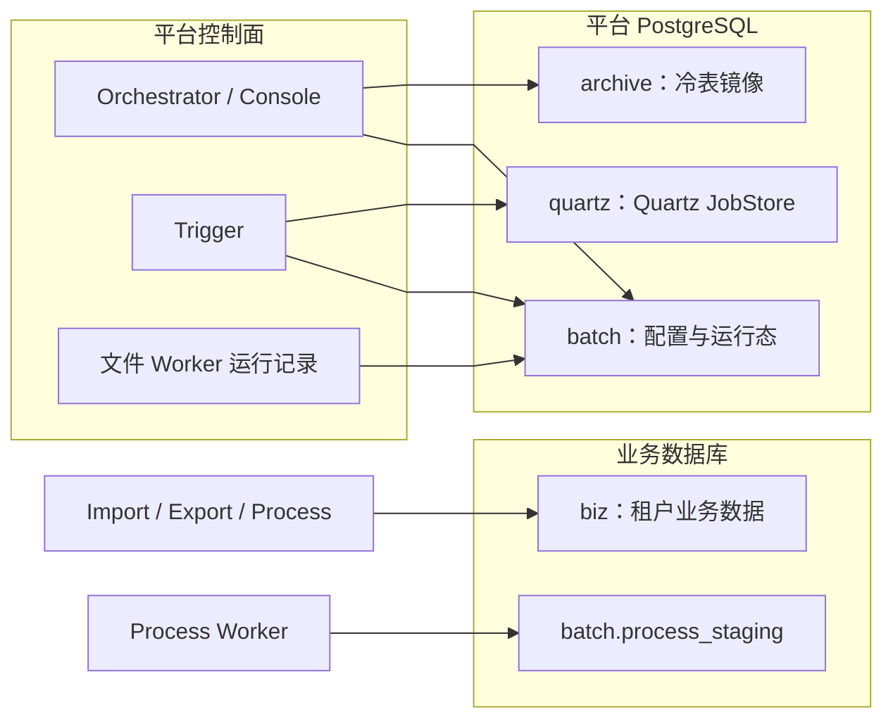
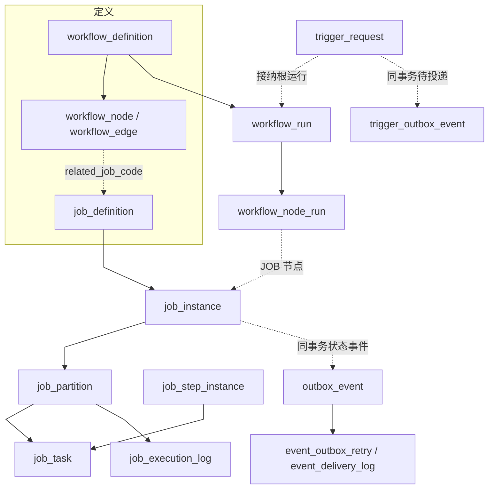
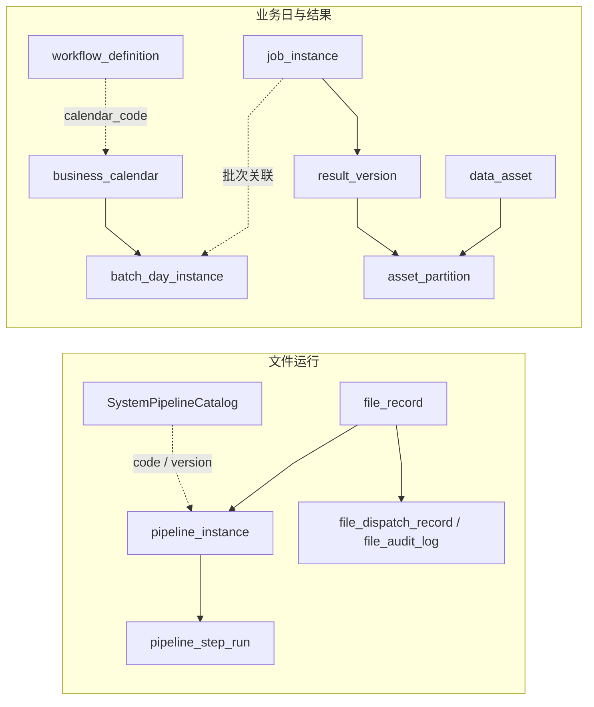

# 数据库表目录与关系总览

本文面向开发、DBA 和排障人员，说明平台数据库与业务数据库的边界、主要表职责及核心关联。它是导航和逻辑模型说明，不代替 PostgreSQL 当前实例的 catalog。

## 1. 权威结构来源

| 数据范围 | 权威来源 | 说明 |
|---|---|---|
| 平台数据库 `batch`、`archive` | [`db/migration/`](../../db/migration) 中已应用的 Flyway migration | 表、字段、约束、索引及迁移顺序以实际目标环境的 Flyway 成功记录为准 |
| 业务数据库 `biz` 与 `batch.process_staging` | [`scripts/db/business/create_biz_tables.sql`](../../scripts/db/business/create_biz_tables.sql) 及同目录后续脚本 | 业务库不由平台库 Flyway 管理；RLS 安装见 [`rls-phase-a.sql`](../../scripts/db/business/rls-phase-a.sql) |
| Quartz 元数据 | Quartz PostgreSQL JobStore schema 脚本与 Quartz 版本 | 框架表由 Quartz 持久化调度器使用，不承载 BFS 业务状态 |
| 表和关键列说明 | 数据库 `COMMENT ON TABLE/COLUMN` migration | 可通过 `psql` 的 `\dt+`、`\d+ schema.table` 查看；对象注释治理见 [`V194`](../../db/migration/V194__complete_database_object_comments.sql) |

历史设计稿 [`data-model-ddl.md`](./data-model-ddl.md) 保留模型演进背景和部分 DDL 示例。新增表或核对现行字段时，应以已应用迁移和目标数据库 catalog 为准，不要将该早期 DDL 草稿当作完整当前 schema。

## 2. 数据库与 schema 边界



`batch` 与 `archive` 位于平台数据库；`biz` 和 `batch.process_staging` 位于业务数据库。两个数据库中的 schema 名可以相同，但它们是不同连接上的对象。Worker 访问业务数据时使用受 RLS 约束的 writer 账号；平台跨租户聚合使用专用管理员账号，详见 [多租户 RLS 手册](../runbook/multi-tenant-rls.md)。

## 3. 核心业务关系

逻辑关系按运行主链、文件与业务结果分开绘制；连线表示归属或业务引用，具体 FK、复合键与分区约束仍以迁移为准。租户隔离贯穿各表组，图中不重复绘制每条 `tenant_id` 连线。



文件与业务结果关系：



其他表组不属于执行主链：外部事件投递由 `external_event_delivery` 与 `external_event_delivery_alias` 关联；Console AI 的 `console_ai_conversation` 与 `console_ai_turn` 使用租户和会话复合外键，审计、月用量、维护状态及 `console_usage_daily` 各自服务控制台治理，详见下方表目录。

### 3.1 调度与执行

| 表 | 职责 |
|---|---|
| `tenant` | 平台租户主数据和隔离根标识 |
| `job_definition` | 可复用作业类型、队列、Worker组、执行策略与类型化参数；顶层日程归Workflow |
| `job_dependency` | 规范化的作业依赖边及 `biz_date_alignment`；V298以 `(tenant_id,upstream_job_code)` NO ACTION FK保护上游定义存在和租户边界，下游定义仍按从属关系级联删除；应用校验依赖环。支持 `SAME_DAY` 与 `PREVIOUS_BIZ_DAY`（使用下游作业日历的假日和工作日覆盖，并在等待快照固定解析日期；未配置日历时按周一至周五兼容）；旧 `depends_on_job_code` 仍作为投影 |
| `job_monitoring_policy` | 租户作业监控阈值；V299以 `(tenant_id,job_definition_id)` 复合 FK绑定同租户 Job，保持 Job 删除时策略级联清理 |
| `job_dependency_waiting_launch` | 作业上游未就绪时持久化原始 LaunchRequest、业务日和依赖规则快照；租户 RLS 下由 Orchestrator reconciler 重放；V294以`(tenant_id,request_id)`外键绑定原请求、删除NO ACTION，终态等待须显式先清 |
| `job_instance` | 一次作业运行及状态机权威记录；参数在创建时快照 |
| `job_instance_dedup_key` | 分区表之外的实例幂等账本 |
| `job_partition` | 实例拆分出的可并行工作单元和领取状态 |
| `job_task` | Worker 执行任务、claim、lease 和结果回报状态 |
| `job_step_instance` | 实例内步骤的运行明细 |
| `job_execution_log` | 执行日志索引；日志正文由日志系统承载 |
| `batch_runtime_default_parameter` | 运行时默认参数目录，与架构默认参数文档保持同步 |
| `resource_queue`、`resource_tag` | 队列容量、公平调度及资源匹配配置 |
| `waiting_partition_scan_cursor` | 等待分片全局扫描的共享位置与并发版本，仅含扫描水位、周期上界、执行模式和版本，无租户业务数据；见 [V363](../../db/migration/V363__waiting_partition_scan_cursor.sql)、[V364](../../db/migration/V364__waiting_partition_scan_cycle.sql)、[V365](../../db/migration/V365__waiting_partition_scan_mode.sql)；[V366](../../db/migration/V366__index_waiting_partition_scan_mode.sql) 为模式及 ID 范围查询提供索引 |
| `tenant_quota_policy`、`quota_runtime_state`、`tenant_scheduler_snapshot` | 租户配额、运行时占用和调度决策快照 |
| `worker_registry`、`worker_report_outbox` | Worker 心跳容量视图及可靠结果回报；V360按租户/任务/执行身份去重并以claim_token保护领取，只用于全新数据库 |
| `retry_schedule`、`dead_letter_task` | 延迟重试计划和受控死信重放 |

### 3.2 Workflow 与 Trigger

| 表 | 职责 |
|---|---|
| `workflow_definition` | Workflow 定义聚合根 |
| `workflow_node`、`workflow_edge` | DAG 节点和控制流边；V293以租户复合FK绑定父定义。JOB业务编码在草稿中可暂未就绪，启用/运行另有应用检查 |
| `workflow_definition_version` | Workflow 定义历史快照 |
| `workflow_run`、`workflow_node_run` | 一次 Workflow 执行及节点运行状态 |
| `trigger_request` | 触发请求幂等记录；[V369](../../db/migration/V369__unique_batch_day_catchup_root.sql) 对批日补跑根请求的租户及业务键建立部分唯一索引，子 Job 可继承同键 |
| `trigger_outbox_event` | Trigger 事务 Outbox，和平台 `outbox_event` 分开；V297以 `(tenant_id,request_id)` `NO ACTION` FK保护来源请求，应用仍负责同事务创建、payload 身份和业务状态校验；[V361](../../db/migration/V361__trigger_outbox_claim_fence.sql) 用领取 token 防止超时回收后旧投递者回写新领取，归档表同步镜像字段 |
| `trigger_request_idempotency_alias` | 将不同 HTTP 幂等键映射到已接纳的 EVENT TriggerRequest；见 [V278](../../db/migration/V278__trigger_request_idempotency_alias.sql) |
| `scheduled_occurrence` | Workflow 计划 fire 的唯一 occurrence 台账和终态；请求号通过 V295 同租户 `NO ACTION` 外键关联原请求；见 [V261](../../db/migration/V261__scheduled_occurrence_ledger.sql)、[V295](../../db/migration/V295__protect_scheduled_expected_request_references.sql) |
| `scheduled_occurrence_fire` | [V374](../../db/migration/V374__record_quartz_actual_fires.sql) 逐次记录 Quartz 实际回调及重试身份；不同于计划 occurrence 或启动成功，历史缺失和记录失败不回填，以租户隔离。未实现自动过期或归档；授权清理仅覆盖指定租户、截止时间前且批次日已结算的记录，Workflow 删除可级联清理 |
| `scheduled_occurrence_coverage` | 记录 occurrence 扫描覆盖水位与配置代际；见 [V262](../../db/migration/V262__scheduled_occurrence_coverage.sql) |
| `scheduled_occurrence_catch_up_audit` | 审计人工补跑的 occurrence 决策；见 [V274](../../db/migration/V274__audit_scheduled_occurrence_catch_up.sql) |
| `scheduled_occurrence_supersession_history` | 保留旧计划 occurrence 被新计划替代的历史；见 [V272](../../db/migration/V272__scheduled_occurrence_supersession_history.sql) |
| `expected_work_occurrence` | 每个业务日的预期工作义务及其来源、身份和终态；请求号通过 V295 同租户 `NO ACTION` 外键关联原请求；见 [V263](../../db/migration/V263__expected_work_occurrence.sql)、[V295](../../db/migration/V295__protect_scheduled_expected_request_references.sql) |
| `file_group_expectation_definition` | 定义按日生成的文件组预期义务；见 [V264](../../db/migration/V264__file_group_expectation_definition.sql) |
| `external_event_expectation_definition` | 定义按日生成并绑定 Workflow 的外部事件预期；见 [V265](../../db/migration/V265__external_event_expectation_definition.sql) |
| `workflow_launch_wait` | 持久化根 Workflow 执行容量等待及原始请求恢复载荷；V293复合FK保护同租户父定义；[V294](../../db/migration/V294__protect_wait_request_retention.sql)将原请求租户FK删除动作由级联改为NO ACTION，保留等待及终态审计；首次定义见 [V280](../../db/migration/V280__workflow_launch_capacity_wait.sql) |
| `replay_operation` | [V339](../../db/migration/V339__persist_replay_operations.sql) 将用户重放请求、审批、冻结快照及汇总状态持久化为审计根；按日 replay session 仍是实际执行单元 |
| `replay_operation_preview_token` | [V339](../../db/migration/V339__persist_replay_operations.sql) 的短期一次性预览凭证；保存令牌摘要、请求与快照指纹，消费后绑定重放操作 |
| `external_event_delivery` | 自动事件路由回执，冻结首次接纳的来源事件载荷、业务日和 Workflow 目标集合；见 [V287](../../db/migration/V287__external_event_delivery_target_snapshot.sql) |
| `external_event_delivery_alias` | 将同一事件回执绑定到不同 HTTP `Idempotency-Key`，用于事件级状态回查；见 [V287](../../db/migration/V287__external_event_delivery_target_snapshot.sql) |
| `trigger_runtime_state`、`trigger_misfire_pending` | 触发器运行位置、misfire 和待审批补跑；V296以 `(tenant_id,catch_up_request_id)` `NO ACTION` FK保护已接纳请求，应用仍校验 Workflow/业务日/状态 |

Workflow 关系和 DAG 配置示例见 [Workflow 依赖指南](../architecture/workflow-dependency-guide.md)；Trigger outbox 的投递边界见 [Outbox 架构说明](../architecture/outbox-architecture.md)。

### 3.3 文件与 Pipeline

| 表 | 职责 |
|---|---|
| `file_record` | 文件身份、到达、校验、对象存储和生命周期权威记录 |
| `file_channel_config`、`file_channel_health` | 文件通道配置和探活结果 |
| `file_template_config` | 文件格式、校验、映射和处理目标配置 |
| 系统固定Pipeline目录 | 文件执行身份和阶段来自 `SystemPipelineCatalog` 及 Job 参数 |
| `pipeline_definition`、`pipeline_step_definition`（已退役） | 旧租户可编辑 Pipeline 定义与步骤；现行运行从系统目录和 Job 参数选取固定阶段，旧定义没有执行消费者。[V347](../../db/migration/V347__retire_unused_platform_tables.sql) 仅在空表时删除两表及运行表的旧定义 ID，不迁移历史数据或保留兼容入口 |
| `pipeline_instance`、`pipeline_step_run`、`pipeline_progress` | 文件链路运行态、步骤结果和续跑位点 |
| `file_dispatch_record`、`file_error_record`、`file_audit_log` | 下游投递回执、坏记录明细和文件治理审计 |

`pipeline_progress` 的热父关系由 [V292](../../db/migration/V292__protect_pipeline_checkpoint_parent_lifecycle.sql) 的租户复合 FK 保护，父删除 RESTRICT。正式归档先锁父及位点、保全并核对冷副本，再显式删热子和父；`archive.pipeline_progress_archive` 保留独立历史身份，不引用热父表。应用位点写入0行必须失败，补偿删除0行仍为幂等；完整语义见 [ADR-038](../architecture/adr/ADR-038-platform-worker-checkpoint-resume.md)。

### 3.4 批量日、日历与数据结果

| 表 | 职责 |
|---|---|
| `business_calendar`、`calendar_group`、`calendar_holiday` | 日历、共享节假日和业务日期输入 |
| `batch_window` | 作业允许运行的时间窗口 |
| `calendar_dependency`、`calendar_dependency_wait`、`disaster_day_override` | 跨日历依赖定义、固定业务日/依赖规则快照的持久化等待事实和灾难日覆盖；等待行由开启调度器恢复重检，超时首次告警由 CAS 认领 |
| `batch_day_instance`、`batch_day_waiting_launch`、`batch_day_open_cursor`、`batch_day_catchup_control`、`batch_day_catchup_control_event` | 批量日权威状态、等待前序闸门的启动意图、原始日期扫描位置、按日历暂停控制及不可变操作审计 |
| `batch_day_replay_session`、`batch_day_replay_entry`、`batch_day_operation_audit` | 批量日重放会话、作业重放结果和操作审计 |
| `batch_day_catchup_operation` | [V367](../../db/migration/V367__persist_batch_day_catchup_operation.sql) 的批量日补跑原请求、冻结候选与对账状态；[V370](../../db/migration/V370__batch_day_catchup_abandon_fence.sql) 增加尚未冻结原键的放弃围栏。与重放会话分开，结果不明时不得按当前候选重新提交。 |
| `result_version` | 同一业务键的结果版本和有效版本裁决 |
| `data_asset`、`asset_partition`、`asset_freshness_policy` | 最小资产目录、结果分区新鲜度读模型及 SLA 规则 |
| `data_quality_rule`、`data_quality_check` | 对账规则和每次实例检查结果 |
| `process_staging` | 业务数据库内 PROCESS 暂存区，支持和目标业务表共享事务 |

### 3.5 Outbox、审计、配置与平台服务

| 表 | 职责 |
|---|---|
| `outbox_event`、`outbox_event_dedup_key` | 平台状态变更与 Kafka 投递之间的事务 Outbox 及幂等账本 |
| `event_outbox_retry`、`event_delivery_log` | Outbox 重试信息和实际投递记录 |
| `archive_policy` | 热表保留和归档策略 |
| `console_operation_audit`、`approval_command`、`compensation_command`、`compensation_checkpoint` | 管理操作、审批和补偿执行审计；[V362](../../db/migration/V362__index_catch_up_latest_approval.sql) 为补跑列表按租户、请求查询最新审批建立部分索引；[V368](../../db/migration/V368__preserve_approval_submission_reason.sql) 分别保留原提交原因和审批决定原因，供同键对账使用（仅空库部署） |
| `config_release`、`config_approval`、`config_change_log`、`config_sync_log` | 配置发布版本、审批、变更审计和同步记录 |
| `config_sync_target_receipt` | [V345](../../db/migration/V345__persist_config_sync_target_receipts.sql) 的逐目标配置导入提交回执；与目标配置同事务保存，聚合审计补录只能据此核对，不得再次导入 |
| `config_batch_operation`、`config_batch_target_receipt` | [V373](../../db/migration/V373__persist_config_batch_operation_receipts.sql) 保存配置复制和作业包操作的原请求身份摘要、目标顺序及逐项确认结果；操作登记以审计租户隔离，目标回执以目标租户隔离。成功回执与目标变更同事务，已确认回滚的失败结果另行登记；重复目标按原序号区分，不保存配置请求正文，也不以回执齐全代替逐项成功；当前无自动过期或归档，暂按租户清理边界保留，双租户级联和回查限制见[配置治理手册](../runbook/config-governance.md#配置同步响应丢失与原请求恢复) |
| `system_parameter`、`batch_runtime_default_parameter` | 系统参数和运行参数基线 |
| `api_key`、`secret_version` | API 凭据元数据及密钥版本；不存放可直接使用的明文密钥 |
| `alert_event`、`alert_routing_config` | 告警事件及路由配置；V357 保存新关闭意图的时刻、原因及公平轮询尝试水位，最终渠道回执另由 `alert_notification_receipt` 保存 |
| `alert_notification_receipt` | V356 告警最终渠道成功回执；按租户、平台指纹和接收渠道去重，分别保留发生/恢复送达证据，复合外键跟随原告警清理并强制 RLS |
| `notification_channel`、`subscription_rule`、`notification_delivery_log` | 通知通道、订阅和投递记录 |
| `webhook_subscription`、`webhook_delivery_log` | Webhook 订阅及投递重试记录 |
| `console_user_account`、`console_push_subscription`、`console_push_approval_notification` | Console 账号、浏览器设备订阅与审批通知记录 |
| `workflow_terminal_notification_receipt`、`console_push_job_delivery` | Job/Workflow 终态的首次消费回执与 Job Push 的首次决定/冻结设备意图；设备投递引用同租户回执并强制 RLS。新库 V330 退役旧 `console_push_job_notification` lookback 去重表，非空旧账本拒绝切换；详见[通知运维说明](../runbook/workflow-terminal-notifications.md) |
| `console_push_job_notification`（已退役） | 旧 Job Push lookback 去重表没有完整终态消费及逐设备投递证据；[V330](../../db/migration/V330__persist_job_push_intents.sql) 仅允许空账本退役，改由终态回执和设备投递表记录身份与结果，不保留旧表兼容入口 |
| `workflow_terminal_notification_receipt_archive` | [V346](../../db/migration/V346__archive_closed_terminal_notification_families.sql) 保存已闭合通知族的首次消费身份；冷存身份持续阻止迟到事件重复展开投递 |
| `webhook_delivery_log_archive`、`notification_delivery_log_archive` | [V346](../../db/migration/V346__archive_closed_terminal_notification_families.sql) 保存已闭合通知族的 Webhook 与订阅规则投递结果，按同租户冷回执关联 |
| `console_push_job_delivery_archive` | [V346](../../db/migration/V346__archive_closed_terminal_notification_families.sql) 保存已闭合 Job Web Push 决定与设备投递结果，保留原记录 ID |
| `console_operation_audit_archive` | [V346](../../db/migration/V346__archive_closed_terminal_notification_families.sql) 保存通知人工操作审计和原重试请求身份，归档后仍防止相同请求重新开启发送预算 |
| `console_ai_audit_log` | AI 请求审计、token 用量、费用估算和内容哈希；审计表与对话正文分离 |
| `console_ai_conversation`、`console_ai_turn` | AI 会话和轮次；复合租户键关联，按配置选择持久化，轮次正文由应用加密后保存并按到期时间清理 |
| `console_ai_monthly_usage` | AI 租户月度 token、已计费用和预算预留台账；不代表供应商最终账单 |
| `alert_escalation_notification_outbox` | 告警升级通知的事务 Outbox，避免通知发布与升级状态写入脱节；生命周期见[告警升级运行手册](../runbook/alert-escalation.md) |
| `console_maintenance_state` | Console 维护模式共享单例（`id=1`）；跨副本事实源，以 `version` 做 CAS |
| `console_usage_daily` | Console 操作使用率派生日聚合；按月分区并强制 RLS，不作为审计、计费或业务结果事实源 |
| `console_usage_daily_default` | `console_usage_daily` 的默认分区；承接未命中已建月份分区的数据，由分区维护流程治理 |
| `console_ai_attachment`、`console_ai_object_cleanup` | AI 对话附件元数据与对象清理队列；文件内容留在对象存储，清理任务记录异步删除状态 |
| `console_user_batch_operation` | Console 批量开户操作及处理结果，不保存初始密码明文 |
| `console_external_identity` | 外部 OIDC 身份与本地用户的关联，按 issuer/subject 建立外部身份映射 |
| `workflow_monitoring_policy` | V353 Workflow 根级软时限策略，与同租户定义复合外键绑定；不自动继承到子 Job |
| `trigger_launch_recovery` | [V348](../../db/migration/V348__trigger_launch_recovery.sql) Kafka 有限重试耗尽后的加密启动意图；按租户与请求去重，有界退避重投并保留拒绝/耗尽状态；[V371](../../db/migration/V371__trigger_launch_recovery_generation.sql) 在重新入队时以恢复轮次隔离旧失败回执 |
| `readiness_wait` | [V351](../../db/migration/V351__readiness_wait.sql) 根 Workflow 等待执行就绪的持久交接；按租户、定义和计划时刻去重，[V352](../../db/migration/V352__readiness_wait_definition_fk.sql) 绑定同租户定义身份; [V359](../../db/migration/V359__readiness_wait_probe_rotation.sql) 支持按探测更新时间轮转 PENDING 扫描, 不新增状态或业务字段 |
| `job_monitoring_policy`、`job_monitoring_alert_claim` | 作业监控策略和告警认领/去重控制；策略语义见 [SLA 与质量设计](./sla-and-quality.md) |
| `batch_day_replay_preview_token` | 批量日重放 Preview/Apply 的短期并发与确认令牌，不是业务幂等键 |
| `tenant_configuration_revision` | 租户配置发布修订栅栏，阻止旧版本配置写入覆盖较新修订 |
| `config_cache_invalidation_outbox` | [V372](../../db/migration/V372__persist_config_cache_invalidation.sql) 配置缓存失效意图，随配置变更提交；Console 投递成功并确认后删除，失败保留重试，不归档且不表示各实例均已应用 |
| `forensic_export_log` | 取证导出元数据 |
| `step_registry`、`atomic_task_config`、`custom_task_type_registry` | Worker 能力登记及可配置任务类型 |
| `biz_table_schema` | Import Worker 启动时覆盖写入业务库 `biz` schema 快照；当前仓库未接入 Console 基于该快照校验目标表或列的读取链路。读取元数据失败保留旧快照，不能保证快照代表当前业务库；消费与去留待核实。 |
| `business_shard_catalog`、`business_tenant_placement` | 业务分片拓扑和租户分片位置映射 |
| `stateful_backend_binding`、`stateful_backend_cutover_history` | 有状态后端绑定及切换审计 |
| `idempotency_record` | 跨业务操作的通用幂等记录 |
| `shedlock` | ShedLock 定时任务分布式锁；框架维护 |

### 3.6 AI、维护与使用率表的边界

- AI 表结构定义在 [V218](../../db/migration/V218__console_ai_conversations_and_cost_usage.sql)：`console_ai_conversation` 与 `console_ai_turn` 通过 `(tenant_id, id)` 复合主外键关联；`console_ai_monthly_usage` 以 `(tenant_id, billing_month)` 为主键。会话、轮次和月度用量表启用并强制 RLS。AI 审计表 `console_ai_audit_log` 独立保留审计元数据，不等同于可恢复的会话记录。
- 维护单例定义在 [V215](../../db/migration/V215__create_console_maintenance_state.sql)，固定只有 `id=1`；`affected_services` 当前仅用于公告展示，不据此动态路由。
- 使用率表定义在 [V216](../../db/migration/V216__create_console_usage_daily.sql)，主键包含统计日和租户/指标维度，按 `stat_date` 月分区并启用强制 RLS。该表是 best-effort 派生统计，不做 archive 镜像，也不能用作审计、计费或审批证据。
- AI 附件元数据和对象清理队列定义在 [V219](../../db/migration/V219__console_ai_image_attachments.sql)；数据库不保存附件字节。批量开户操作记录定义在 [V220](../../db/migration/V220__console_user_batch_provisioning.sql)，外部 OIDC 身份映射定义在 [V222](../../db/migration/V222__console_oidc_external_identity.sql)。
- 作业监控策略及告警认领控制分别定义在 [V224](../../db/migration/V224__job_monitoring_policy_and_alert_claim.sql)；重放预览令牌定义在 [V230](../../db/migration/V230__batch_day_replay_preview_token.sql)；租户配置修订栅栏定义在 [V232](../../db/migration/V232__tenant_configuration_revision_fence.sql)，配置缓存失效意图定义在 [V372](../../db/migration/V372__persist_config_cache_invalidation.sql)。
- 告警升级通知 Outbox 定义在 [V214](../../db/migration/V214__alert_escalation_notification_outbox.sql)，与告警升级状态一同持久化，通知投递可重试；详细投递语义见[运行手册](../runbook/alert-escalation.md)。

### 3.7 归档和 Quartz

Job实例归档按调度轮诊断一次、每批独立事务处理；运行树先复制冷表，再按依赖顺序清理热表。当前对本批清理的 Job 实例、任务、分区、步骤、Pipeline、Workflow、分发、日志、补偿、DQ 检查及 Pipeline checkpoint 执行冷热内容核对，发现缺失或冲突会回滚；复制前锁定本批现有运行树子行，阻止其在核对后被并发更新；Worker 创建关联 Pipeline 时锁定并重新确认父 Job，防止归档后产生悬空关联。共享文件记录不在本批热表清理范围，其他新增关联和共享文件的完整性仍需单独核验。分区引用诊断的JIT编译成本已由代表性积压EXPLAIN确认，归档入口在当前事务内关闭JIT；提交或回滚后连接恢复原设置，不调整全局数据库参数。测量及边界见[本地归档验证](../verifications/wdi-local-closure-2026-10-25.md#归档多批对照)。

文件束分区的 `source_file_id` 和 `target_ref` 是该分区的文件与渠道绑定。启动时移除调用方提供的顶层束绑定字段，派发时仅根据实际分区绑定写入。DISPATCH Worker 优先使用 `bundleSourceFileId` 和 `bundleTargetRef`，仅在束字段缺失或为 null 时回退 `fileId` 和 `channelCode`，字段顺序不改变选择。建任务与结果回写按相同文件选择更新步骤关联，建任务时校验文件所属租户；其他任务类型保留各自文件关联规则。

文件束 `sourceFileId` 的 JSON 输入使用整数或整数文本；浮点表示即使数值看似为整数也不接受，避免 JSON 解析时的舍入改变文件身份。越界或无法精确转换的数值不作为有效文件绑定。


- `archive` schema 保存配置中启用归档的热表历史镜像，常见表包括 `job_instance_archive`、`job_partition_archive`、`job_task_archive`、`outbox_event_archive`、`file_record_archive`、`pipeline_instance_archive` 和 `workflow_run_archive`。V358 为 `workflow_run_archive(tenant_id, trigger_request_id)` 增加部分索引，供 Workflow 软时限候选与自动解除在热 Run 归档后按源请求查回实际运行；不改变归档生命周期或来源状态。主表与归档表的字段同步由迁移和 `ArchiveSchemaDriftCheck` 守护；具体策略见 [删除与归档设计](./delete-strategy.md) 和 [分区运维手册](../runbook/pg-table-partitioning.md)。
- `quartz` schema 的 `qrtz_*` 表由 Quartz JDBC JobStore 管理，包含 job、trigger、fired trigger、scheduler state、lock、calendar 及各类 trigger 明细表。除升级 Quartz schema 外，不应由业务代码直接维护。

## 4. 业务库表

业务库由 [`create_biz_tables.sql`](../../scripts/db/business/create_biz_tables.sql) 提供本地和场景测试基线，实际生产表可因租户业务而异。当前种子模型中的主要表如下：

| 表 | 职责 |
|---|---|
| `biz.customer_account` | 客户账户主数据，按租户分区 |
| `biz.settlement_batch` | 清算批次 |
| `biz.settlement_detail` | 清算明细；复合租户键关联清算批次 |
| `biz.transaction` | 交易事实数据 |
| `biz.risk_score`、`biz.risk_alert` | 风险评分与风险告警 |
| `biz.process_order_event`、`biz.process_account_summary` | PROCESS 示例输入事件与汇总结果 |
| `biz.process_event_copy` | PROCESS 数据复制场景的目标表 |
| `biz.import_stage2c_customer` | Import 分阶段加载示例目标表 |
| `biz.process_stage4_source`、`biz.process_stage4_target` | PROCESS 多阶段读写示例表 |
| `biz.__shard_identity` | 业务分片身份标识，不是租户业务数据 |
| `batch.process_staging` | PROCESS 暂存表，与 `biz` 表处于同一业务数据库 |

`*_p0` 等物理分区子表和 `*_default` 默认分区不重复列为逻辑实体；查询和维护时优先针对分区父表。目标环境的业务 schema 可能不包含上述全部示例表，也可能具有额外业务表。

## 5. 当前实例查询

下列查询直接读取目标数据库 catalog。它们用于确认**当前环境**实际对象，不依赖本文档的静态快照。

```sql
-- 平台库：每个逻辑表一行，排除分区子表
SELECT n.nspname AS schema_name,
       c.relname AS table_name,
       obj_description(c.oid, 'pg_class') AS description,
       c.relrowsecurity AS rls_enabled,
       c.relforcerowsecurity AS rls_forced
FROM pg_class c
JOIN pg_namespace n ON n.oid = c.relnamespace
WHERE c.relkind IN ('r', 'p')
  AND c.relispartition = false
  AND n.nspname IN ('batch', 'archive', 'quartz')
  AND c.relname <> 'flyway_schema_history'
ORDER BY n.nspname, c.relname;

-- 列定义、默认值、索引和约束
SELECT table_schema, table_name, ordinal_position, column_name,
       data_type, is_nullable, column_default, col_description(
         (quote_ident(table_schema) || '.' || quote_ident(table_name))::regclass,
         ordinal_position
       ) AS description
FROM information_schema.columns
WHERE table_schema IN ('batch', 'archive', 'quartz', 'biz')
ORDER BY table_schema, table_name, ordinal_position;

-- 已声明的外键；业务字段编码关联不会出现在本结果中
SELECT conrelid::regclass AS from_table,
       pg_get_constraintdef(oid) AS foreign_key
FROM pg_constraint
WHERE contype = 'f'
ORDER BY conrelid::regclass::text, conname;
```

运行平台库表清点时，先确认 `psql` 连接到正确的 database；业务表清点应连接业务库。分区子表数量随时间和保留策略变化，不能把物理分区数当作业务实体表数量。

## 6. 相关资料

- [完整迁移目录](../../db/migration)
- 日切 catch-up 游标与运维控制：[V239](../../db/migration/V254__batch_day_open_cursor.sql)、[V244](../../db/migration/V259__batch_day_catchup_control.sql)
- Console AI / 维护 / 使用率结构：[V214](../../db/migration/V214__alert_escalation_notification_outbox.sql)、[V215](../../db/migration/V215__create_console_maintenance_state.sql)、[V216](../../db/migration/V216__create_console_usage_daily.sql)、[V218](../../db/migration/V218__console_ai_conversations_and_cost_usage.sql)、[V219](../../db/migration/V219__console_ai_image_attachments.sql)、[V220](../../db/migration/V220__console_user_batch_provisioning.sql)、[V222](../../db/migration/V222__console_oidc_external_identity.sql)、[V224](../../db/migration/V224__job_monitoring_policy_and_alert_claim.sql)、[V230](../../db/migration/V230__batch_day_replay_preview_token.sql)、[V232](../../db/migration/V232__tenant_configuration_revision_fence.sql)
- [数据模型 DDL 与演进背景](./data-model-ddl.md)
- [Outbox 表关系与生命周期](../architecture/outbox-architecture.md)
- [Workflow DAG 关系](../architecture/workflow-dependency-guide.md)
- [备份与 PITR](../runbook/backup-and-pitr.md)
- [数据库迁移检查](../runbook/db-migration-checklist.md)
- [RLS 与租户隔离](../runbook/multi-tenant-rls.md)


## Workflow根、义务与恢复的逻辑模型补充

| 资产组 | 表 / 来源 | 逻辑含义 |
|---|---|---|
| 顶层运行 | workflow_run、workflow_node_run | 请求对应根运行，JOB节点关联按需创建的JobInstance；旧related_job_instance_id列不定义新根 |
| 机会覆盖 | scheduled_occurrence、scheduled_occurrence_coverage、supersession/catch_up审计 | 原计划身份、覆盖边界和处置证据；Quartz本身不是业务义务台账 |
| 输入义务 | file_group_expectation_definition、external_event_expectation_definition、expected_work_occurrence | 由Workflow拥有的定义及逐日发生项，输入到达与业务完成分开 |
| 启动等待 | workflow_launch_wait、job_dependency_waiting_launch、calendar_dependency_wait | 保存各自等待对象及原始日期/规则，不依赖进程内队列恢复 |
| 重放与审批 | replay_operation、preview_token、按日replay session/entry | 冻结来源、预览/审批和目标运行；区间部分失败不回滚其它日期副作用 |
| 终态与送达 | workflow_terminal_notification_receipt、console_push_job_delivery及各渠道投递记录 | 终态事件与通知分开记账；归档以完整通知族及审计保留为单位 |
| 配置交付 | config_sync_target_receipt | 逐目标同步回执，配置同步成功不是运行完成 |

上述为逻辑导航。实际表存在、复合FK、分区键、索引和已应用版本仍以目标库catalog及Flyway成功记录为准；本轮未连接目标数据库重新认证DDL。
