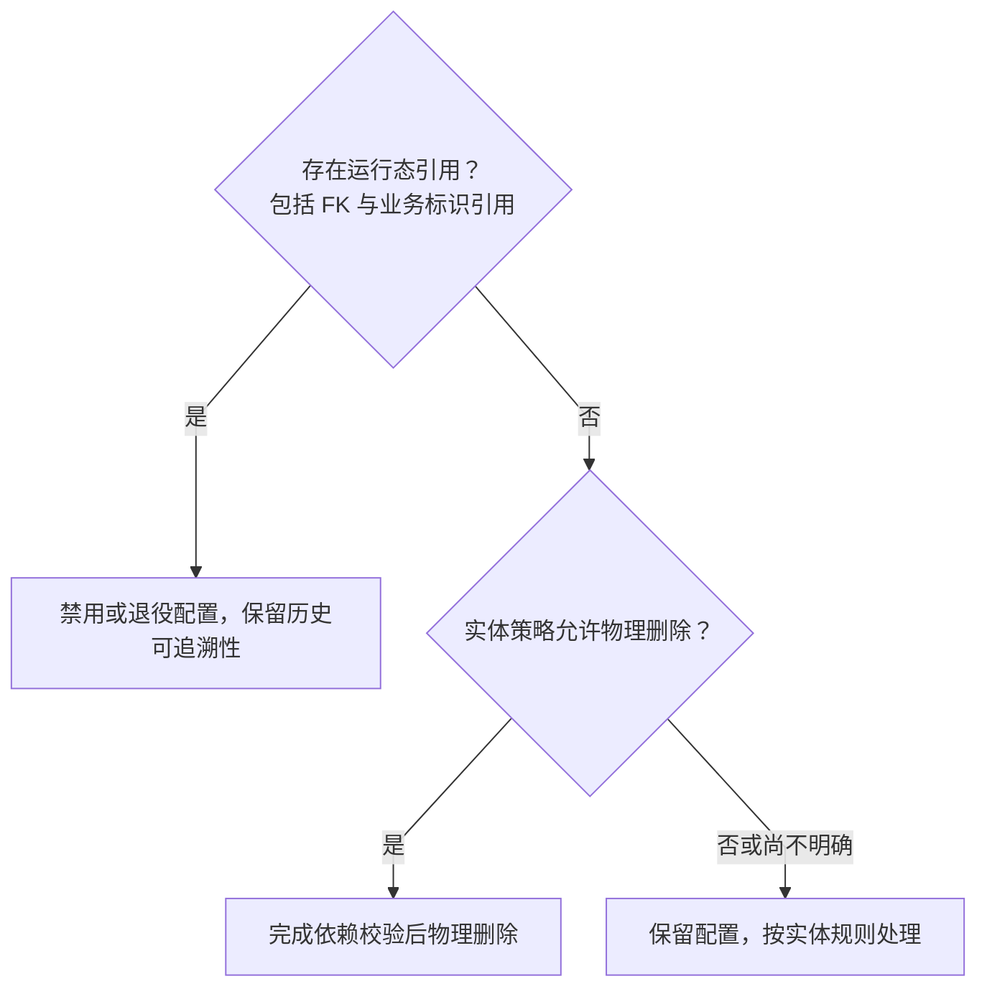

# 删除策略设计

> 本文说明系统中两类删除操作的判断依据、HTTP 映射、实现模式及列表查询默认行为。

---

## 1. 两类删除的定义

| 类型 | 含义 | 数据去向 |
|------|------|---------|
| **物理删除** | 彻底从数据库移除记录 | 行被 `DELETE` 语句删除，不可恢复 |
| **软删除** | 将记录标记为禁用，保留历史数据 | `enabled = false`，行仍存在 |

---

## 2. 判断依据

### 2.1 决策树



### 2.2 各实体策略

| 实体 / 表 | 删除策略 | 原因 |
|-----------|---------|------|
| `job_definition` | **软删除** | `job_instance.job_definition_id` FK 引用 |
| `workflow_definition` | **软删除** | `workflow_run.workflow_definition_id` FK 引用 |
| `file_channel_config` | **软删除** | 运行时文件记录持有 channelCode |
| `file_template_config` | **软删除** | 运行时文件记录持有 templateCode |
| `file_record` | **物理删除** | 叶子节点，无运行时实体以其为主键外键引用 |
| `user_account` | **软删除（disable）** | 审计日志、权限记录持有 userId |

> 旧租户 `pipeline_definition` / `pipeline_step_definition` 及运行表中的定义ID已在 V347 退役，不适用在线软删除策略；当前系统阶段来自代码目录，Job 保存业务参数。

> 新增实体时，同时核对 DDL 外键、稳定业务标识的运行态引用及实体留存策略；没有外键不代表可以直接物理删除。

---

## 3. HTTP 方法映射

| 操作 | HTTP 方法 | 路径 | Request |
|------|----------|------|---------|
| 物理删除 | `DELETE` | `/{id}` | path + query 参数 |
| 软删除（禁用） | `PATCH` | `/{id}` | JSON body: `EnabledPatchRequest` |
| 软删除（启用） | `PATCH` | `/{id}` | JSON body: `EnabledPatchRequest`（`enabled: true`） |
| 批量软删除/启用 | `PATCH` | `/batch` | JSON body: `BatchEnabledPatchRequest` |

**规则：**
- `DELETE` 方法**只用于物理删除**，绝不用于软删除
- 软删除本质是资源的局部状态变更，使用 `PATCH` 语义正确（幂等、局部更新）
- 启用与禁用复用同一 `PATCH /{id}` 端点，由 `enabled` 字段区分，无需两个端点

---

## 4. Request / Response 类型

### 4.1 `EnabledPatchRequest`

```java
@Data
public class EnabledPatchRequest {
    @ValidTenantId
    private String tenantId;

    @NotNull
    private Boolean enabled;
}
```

请求示例（禁用）：
```http
PATCH /api/console/job-definitions/42
Content-Type: application/json

{
  "tenantId": "T001",
  "enabled": false
}
```

### 4.2 `BatchEnabledPatchRequest`

```java
@Data
public class BatchEnabledPatchRequest {
    @ValidTenantId
    private String tenantId;

    @NotNull
    private Boolean enabled;

    @NotEmpty
    @Size(max = 200)
    private List<Long> ids;
}
```

### 4.3 物理删除（以 `file_record` 为例）

```http
DELETE /api/console/files/123?tenantId=T001&reason=过期文件
Idempotency-Key: <uuid>
```

无请求体，参数通过 path 和 query 传递。

---

## 5. Controller 写法对比

### 5.1 物理删除

```java
@DeleteMapping("/{fileId}")
public CommonResponse<ConsoleFileOperationResponse> delete(
        @RequestHeader(CommonConstants.DEFAULT_IDEMPOTENCY_KEY_HEADER) String idempotencyKey,
        @PathVariable Long fileId,
        @RequestParam("tenantId") String tenantId,
        @RequestParam(required = false) String reason) {
    DeleteFileRequest request = new DeleteFileRequest();
    request.setFileId(fileId);
    request.setTenantId(tenantId);
    request.setReason(reason);
    return responseFactory.success(applicationService.delete(request, idempotencyKey));
}
```

### 5.2 软删除（PATCH）

```java
@PatchMapping("/{id}")
public CommonResponse<Void> patch(
        @PathVariable Long id,
        @Valid @RequestBody EnabledPatchRequest request) {
    jobDefinitionApplicationService.toggle(id, request.getTenantId(), request.getEnabled());
    return responseFactory.success(null);
}
```

### 5.3 Mapper XML

物理删除使用 `<delete>` 标签：

```xml
<delete id="deleteById">
    DELETE FROM file_record
    WHERE id = #{id}
      AND tenant_id = #{tenantId}
</delete>
```

软删除使用 `<update>` 标签：

```xml
<update id="toggle">
    UPDATE job_definition
    SET enabled    = #{enabled},
        updated_by = #{updatedBy},
        updated_at = current_timestamp
    WHERE id        = #{id}
      AND tenant_id = #{tenantId}
</update>
```

---

## 6. 列表查询默认过滤行为

### 6.1 规则

软删除实体的 QueryRequest 中，`enabled` 字段**默认值为 `true`**。

```java
@Data
public class JobDefinitionQueryRequest extends PageQueryRequest {
    private Boolean enabled = true;  // 默认只查启用记录
    // ...
}
```

**效果：**

| 前端请求 | 返回结果 |
|---------|---------|
| 不传 `enabled` 参数 | 只返回 `enabled = true` 的记录（日常使用） |
| `?enabled=false` | 只返回已禁用的记录（运维排查） |
| `?enabled=true` | 同默认行为 |

### 6.2 适用实体

| 实体 | QueryRequest | 涉及端点 |
|------|-------------|---------|
| JobDefinition | `JobDefinitionQueryRequest` | `GET /api/console/queries/job-definitions` |
| WorkflowDefinition | `WorkflowDefinitionQueryRequest` | `GET /api/console/queries/workflow-definitions` |
| FileChannelConfig | `FileChannelQueryRequest` | `GET /api/console/file-channels`、`GET /api/console/queries/file-channels` |
| FileTemplateConfig | `FileTemplateQueryRequest` | `GET /api/console/file-templates`、`GET /api/console/queries/file-templates` |

### 6.3 Mapper XML 支持

Mapper 使用可选 `enabled` 过滤，调用方传入值时生效，不传时全量返回（但 QueryRequest 默认保证了调用方总会传 `true`）：

```xml
<if test="enabled != null">
    AND enabled = #{enabled}
</if>
```

---

## 7. 数据库约定

- 软删除实体的表**必须包含** `enabled BOOLEAN NOT NULL DEFAULT TRUE` 字段
- 无需 `deleted_at` / `deleted_by` 时间戳（`updated_at` + `updated_by` 已足够追踪操作人）
- 物理删除实体的表**不需要** `enabled` 字段

---

## 8. 新增接口检查清单

新增涉及"删除"语义的 API 时，逐项确认：

- [ ] 是否存在外键或稳定业务标识的运行态引用？有引用时保留历史关联；无引用时仍需核对实体留存策略及其他依赖。
- [ ] HTTP 方法是否正确：物理删除用 `DELETE`，软删除用 `PATCH`
- [ ] 软删除接口是否复用了 `EnabledPatchRequest` / `BatchEnabledPatchRequest`
- [ ] 对应 QueryRequest 的 `enabled` 字段是否设置了 `= true` 默认值
- [ ] OpenAPI YAML 和 `console-api-protocol.md` 是否同步更新
