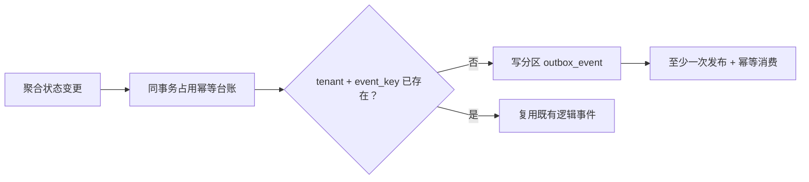

# 分区表与全局幂等身份

当前模型由[V182](../../db/migration/V182__global_idempotency_ledgers.sql)与[Outbox Mapper](../../batch-orchestrator/src/main/resources/mapper/OutboxEventMapper.xml)定义。分区表的唯一键必须带分区维度，因此平台用独立台账承接跨分区幂等，而不是仅依赖NOT EXISTS查询。

- `outbox_event_dedup_key`以tenant/event_key全局唯一；Mapper的claimed_key CTE先占键，仅成功占键者插入事件，两者同事务。
- `job_instance_dedup_key`承接Job执行的跨日期分区幂等。顶层请求、WorkflowRun与JOB节点身份仍由各自规则和约束保护，不能用一个Job键代替所有层级。
- Kafka ACK、重复检测指标和ShedLock不能替代台账唯一性。台账/分区归档清理需保留既定身份保留期，不把删除热分区自动解释为允许重放旧事件。
- 事件幂等只保护同一逻辑事件，不自动保证外部业务副作用恰好一次；Worker仍需CLAIM、invocation、业务幂等与明确的未知结果恢复。

原先“仅用INSERT ... WHERE NOT EXISTS、不建独立dedup表”的2026-06设计已被V182实现取代，不再作为当前写入建议。新增事件类型仍应经过统一发布入口并使用稳定的租户/聚合/意图身份。
