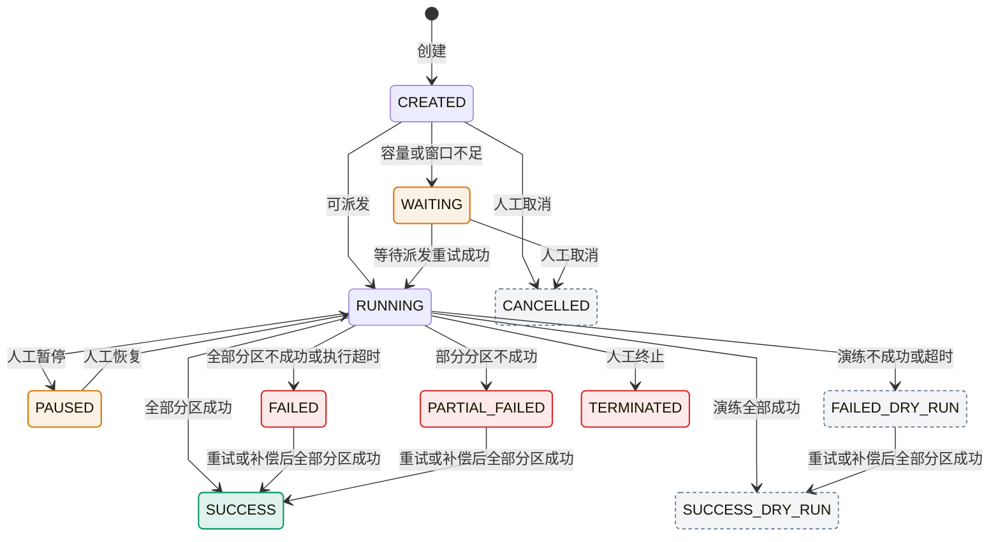
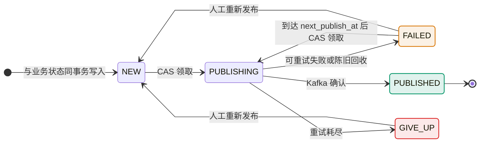
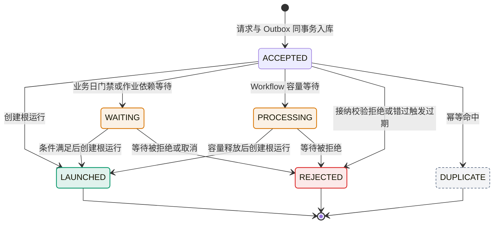

# 状态机汇总

> **状态归属**：WorkflowRun 是整体运行事实，JOB 节点拥有自己的 JobInstance。控制节点不创建 JobInstance；WAIT 的持久化等待不等于 Worker 执行。一个 Job SUCCESS/EFFECTIVE 不代表整图成功，输入 ARRIVED/SATISFIED 也不代表业务结果完成。显式重放创建新运行并保留来源，禁止把旧终态重置为 RUNNING。

> **status**: 持续维护（枚举值由 CI 与 Java 事实源对照）
> **scope**: trigger_request / job_instance / pipeline_instance / workflow_run / workflow_node_run / job_task / job_partition / step / outbox / compensation / worker registry 状态对照

核心生命周期语义以 [core-model.md](../architecture/core-model.md) 为权威；本文补充跨实体对照和差异说明，不把同名状态强行解释成同一业务规则。

## 1. 状态机一览

| 实体 | enum 类 | DB 列 | CHECK 约束 | 状态值 |
|---|---|---|---|---|
| `job_instance.instance_status` | `JobInstanceStatus` | V5 + 后续迁移 | ✓ | <!-- enum-sync:JobInstanceStatus:start -->`CREATED`, `WAITING`, `READY`, `RUNNING`, `PAUSED`, `PARTIAL_FAILED`, `SUCCESS`, `FAILED`, `CANCELLED`, `TERMINATED`, `SUCCESS_DRY_RUN`, `FAILED_DRY_RUN`<!-- enum-sync:JobInstanceStatus:end --> |
| `pipeline_instance.run_status` | `PipelineRunStatus` | V6 | ✓ | <!-- enum-sync:PipelineRunStatus:start -->`CREATED`, `RUNNING`, `SUCCESS`, `FAILED`, `COMPENSATING`, `TERMINATED`<!-- enum-sync:PipelineRunStatus:end --> |
| `workflow_run.run_status` | `WorkflowRunStatus` | V5 + 后续迁移 | ✓ | <!-- enum-sync:WorkflowRunStatus:start -->`CREATED`, `RUNNING`, `PAUSED`, `SUCCESS`, `FAILED`, `TERMINATED`, `SUCCESS_DRY_RUN`, `FAILED_DRY_RUN`<!-- enum-sync:WorkflowRunStatus:end --> |
| `workflow_node_run.node_status` | `WorkflowNodeRunStatus` | V5 + V109 | ✓ | <!-- enum-sync:WorkflowNodeRunStatus:start -->`READY`, `WAITING_DEPENDENCY`, `RUNNING`, `SUCCESS`, `FAILED`, `SKIPPED`<!-- enum-sync:WorkflowNodeRunStatus:end --> |
| `job_task.task_status` | `TaskStatus` | V5 | ✓ | <!-- enum-sync:TaskStatus:start -->`CREATED`, `READY`, `RUNNING`, `SUCCESS`, `FAILED`, `CANCELLED`, `TERMINATED`<!-- enum-sync:TaskStatus:end --> |
| `job_partition.partition_status` | `PartitionStatus` | V5 | ✓ | <!-- enum-sync:PartitionStatus:start -->`CREATED`, `WAITING`, `READY`, `RUNNING`, `SUCCESS`, `FAILED`, `RETRYING`, `CANCELLED`, `TERMINATED`<!-- enum-sync:PartitionStatus:end --> |
| `job_step_instance.step_status` | `StepInstanceStatus` | V13 | ✓ | <!-- enum-sync:StepInstanceStatus:start -->`CREATED`, `WAITING`, `READY`, `RUNNING`, `RETRYING`, `SUCCESS`, `FAILED`, `CANCELLED`, `TERMINATED`<!-- enum-sync:StepInstanceStatus:end --> |
| `outbox_event.publish_status` | `OutboxPublishStatus` | V21 | ✓ | <!-- enum-sync:OutboxPublishStatus:start -->`NEW`, `PUBLISHING`, `PUBLISHED`, `FAILED`, `GIVE_UP`<!-- enum-sync:OutboxPublishStatus:end --> |
| `trigger_outbox_event.publish_status` | `OutboxPublishStatus` | V80 | ✓ | 同上 |
| `event_outbox_retry.retry_status` | `RetryScheduleStatus` | V21 | ✓ | <!-- enum-sync:RetryScheduleStatus:start -->`WAITING`, `RUNNING`, `SUCCESS`, `FAILED`, `EXHAUSTED`, `CANCELLED`<!-- enum-sync:RetryScheduleStatus:end --> |
| `trigger_request.request_status` | `TriggerRequestStatus` | V5 / V39 / V60 / V100 | ✓ | <!-- enum-sync:TriggerRequestStatus:start -->`PENDING`, `PROCESSING`, `ACCEPTED`, `WAITING`, `LAUNCHED`, `REJECTED`, `DUPLICATE`, `FORWARD_FAILED`, `GIVE_UP`<!-- enum-sync:TriggerRequestStatus:end --> |
| `compensation_command.command_status` | `CompensationCommandStatus` | V13 | ✓ | <!-- enum-sync:CompensationCommandStatus:start -->`PENDING`, `RUNNING`, `SUCCESS`, `FAILED`, `CANCELLED`<!-- enum-sync:CompensationCommandStatus:end --> |
| `worker_registry.status` | `WorkerRegistryStatus` | V7 | ✓ | <!-- enum-sync:WorkerRegistryStatus:start -->`ONLINE`, `OFFLINE`, `DRAINING`, `DECOMMISSIONED`<!-- enum-sync:WorkerRegistryStatus:end --> |

## 2. 不一致点（已知 + 是否要统一）

### 2.1 `pipeline_instance` 多了 `COMPENSATING` 态

**事实**：V6 创建 pipeline_instance 时枚举里有 `COMPENSATING`，job_instance / workflow_run 没有。

**⚠️ 实现状态(2026-06-16 审计澄清):`COMPENSATING` 当前是「预留态,未实现」。** 全 worker 代码无任何写 `pipeline_instance.run_status = COMPENSATING` 的路径——pipeline stage 失败**直接落 `FAILED`**,不做 stage 级反向补偿(删 biz / 删 MinIO)。枚举值 + DB CHECK 仅为前向兼容保留。**运维不应假设 pipeline 失败会自动补偿删异常数据。** (注:dispatch 域 `FileDispatchRunStatus.COMPENSATING` 是真实现的,勿混淆。)

**设想语义(若将来实现)**:pipeline 内部 stage 失败触发反向 stage 补偿,需要中间态标识"在补偿中"防止外部误判为 FAILED 终态。job_instance / workflow_run 的补偿走 `compensation_command` 独立表,不需要主状态标记。

**结论**:**保留枚举差异**(语义专属 pipeline 域);但在真正实现 stage 补偿前,文档与运维须按"未实现"对待,不得依赖该态。

### 2.2 `READY` 出现在多张表，但语义微差

| 表 | READY 语义 |
|---|---|
| job_instance | "待 worker 选拔"（DefaultWorkerSelector 还未分配 worker_code） |
| job_task / job_partition | "已分配 worker_code，待 worker CLAIM" |
| job_step_instance | "上游 step 完成，本 step 即将启动" |
| workflow_node_run | "上游 node 完成，本 node 即将启动" |

**结论**：**保持差异**。同名不同义在状态机层面正常，由 `*_status` 列名前缀区分（`instance_status` / `task_status` / `step_status` / `node_status`）。

### 2.3 等待与重试状态按层级表达

`WAITING` 存在于 job_instance、job_partition 和 job_step_instance；workflow_node_run 使用更具体的 `WAITING_DEPENDENCY`。task 没有 WAITING / RETRYING，避免把调度等待误写成 Worker 已领取任务后的状态。

`RETRYING` 只属于 partition 和 step instance；task 的新尝试重新进入自己的生命周期。**结论**：保持层级差异，不为表面对齐扩充状态。

### 2.4 终止与演练终态不是全表共有

job_instance、workflow_run、pipeline_instance、task、partition 和 step instance 支持 `TERMINATED`；workflow_node_run 不定义 TERMINATED，由 workflow_run 终止收口。`SUCCESS_DRY_RUN / FAILED_DRY_RUN` 只属于 job_instance 和 workflow_run，正式结果消费者不得把它们当作 EFFECTIVE 产物。

**结论**：同一状态名在支持它的层级保持终态语义，但不要求所有实体拥有同一组终态。

## 3. 主链路转移图

### 3.1 job_instance 状态机



以上迁移按 2026-11-14 源码核对，状态写入集中在 `JobInstanceMapper.xml`（`markRunning`、`updateLifecycleStatus`、`updateStatus`、`updateStatusWhenTaskRunning`、`updateProgress`），目标状态由调用方决定：

- **创建与派发**：`DefaultLaunchService` 以 `CREATED` 建记录；`DefaultPartitionDispatchService` 可派发时置 `RUNNING`，容量或窗口不足时置 `WAITING`；`WaitingPartitionDispatcher` 把 `WAITING` 推进为 `RUNNING`。
- **结果汇总**：`TaskOutcomeStatePolicy.resolveInstanceEvent` 在全部分区结束后汇总。取消和终止的分区都计为不成功，有成功也有不成功为 `PARTIAL_FAILED`，全部不成功为 `FAILED`；演练实例只落 `SUCCESS_DRY_RUN` 或 `FAILED_DRY_RUN`。
- **超时**：`JobInstanceTimeoutEnforcer` 只处理 `RUNNING` 且仍有运行中任务的超时实例，置 `FAILED`（演练为 `FAILED_DRY_RUN`）。
- **人工操作**（`InstanceManagementApplicationService`）：取消只接受 `CREATED`、`WAITING`、`READY`，直接置 `CANCELLED`；对 `RUNNING` 发起取消不改实例状态，而是请求取消任务，实例随后按结果汇总落到 `FAILED` 或 `PARTIAL_FAILED`。终止只接受 `RUNNING`；暂停只接受 `RUNNING`，恢复只接受 `PAUSED`。
- **终态之间唯一的迁移**：`FAILED`、`PARTIAL_FAILED`、`FAILED_DRY_RUN` 在重试或补偿使全部分区成功后，可改写为 `SUCCESS` 或 `SUCCESS_DRY_RUN`（`TaskOutcomeStatePolicy.shouldPromoteTerminalFailure` 与 SQL 片段 `NotFromTerminalAllowSelfForProgress` 双重限定）。其余终态不再变化，SQL 片段 `NotFromTerminal` 拒绝从终态写入。
- **`READY`**：仍在枚举、CHECK 约束、取消前态和若干查询条件中，但当前代码没有把 job_instance 写成 `READY` 的路径，图中不画为必经状态。
- **待核实**：实例 `PAUSED` 期间，在途分区回报且分区尚未全部结束时，`resolveInstanceEvent` 返回 `RUNNING`，`DefaultLifecycleEventMapper` 与 `updateProgress` 都不阻止从 `PAUSED` 改写，暂停可能被在途回报撤销。图中未画此路径，结论需要集成测试确认，见[图审查与修改计划](../plans/diagram-review-remediation-plan-2026-11-13.md#进度)。

核心模型的[典型状态路径](../architecture/core-model.md#421-各对象的典型状态路径)覆盖 WorkflowRun、WorkflowNodeRun、Partition 与 Task，不含 job_instance；job_instance 的完整迁移以本节为准。

### 3.2 outbox_event 状态机



`PUBLISHING` 超过 `publishing-timeout-seconds` 未确认时由陈旧回收拨回 `FAILED`。运维经 Orchestrator 内部接口重新发布时，只把 `FAILED` 或 `GIVE_UP` 重置为 `NEW`（`OutboxOpsApplicationService`）。`trigger_outbox_event` 由 `TriggerOutboxRelay` 按同一迁移推进，达到最大发布次数后同样进入 `GIVE_UP`。

### 3.3 trigger_request 状态机（ADR-010）

普通新请求在同一事务写入 `ACCEPTED` 与 Trigger Outbox；发布重试由 Outbox 状态机单独承载。以下迁移按 2026-11-14 源码核对：



- **等待**：业务日门禁（`BatchDayGateService`）与作业依赖等待（`JobDependencyWaitingLaunchService`）写 `WAITING`；Workflow 容量等待（`WorkflowLaunchWaitService.defer`）写 `PROCESSING`。两类等待在条件满足后都创建根运行并转为 `LAUNCHED`，等待被拒绝或取消时转为 `REJECTED`。
- **拒绝与重复**：接纳校验不通过、错过触发的补偿请求过期（`TriggerMisfirePendingMapper`）时为 `REJECTED`；幂等命中为 `DUPLICATE`。
- **未写入的枚举值**：`PENDING`、`FORWARD_FAILED`、`GIVE_UP` 仍在枚举与 CHECK 约束中，查询会把它们视为未启动或未接纳，但当前代码没有写入这些状态的路径，图中不画。

## 4. 状态推进的硬约束

来自 docs/agent-baseline.md §架构硬约束：

- **Orchestrator 是唯一状态主机**；Worker 不能直接改写 `job_instance` / `workflow_run` / `workflow_node_run`
- Worker 通过 HTTP `report` 上报（含 i18n 三元组 + ADR-009 节点 outputs），orchestrator 推进状态机
- console-api 不能直接 UPDATE/DELETE outbox_event，运维操作必须经 orchestrator `/internal/outbox/*` 接口
- `outbox_event` 必须与状态变更同事务（保证业务/事件一致性）
- Worker 执行前必须先 CLAIM（job_task READY → RUNNING 由 worker 通过 CLAIM 触发，不能绕过）

## 5. 实现层关键 enum 文件

```
batch-common/src/main/java/io/github/pinpols/batch/common/enums/
  ├─ JobInstanceStatus.java
  ├─ PipelineRunStatus.java
  ├─ WorkflowRunStatus.java
  ├─ WorkflowNodeRunStatus.java
  ├─ TaskStatus.java
  ├─ PartitionStatus.java
  ├─ StepInstanceStatus.java         # 注：类名无 "Job" 前缀
  ├─ OutboxPublishStatus.java
  ├─ TriggerRequestStatus.java
  ├─ RetryScheduleStatus.java
  ├─ CompensationCommandStatus.java
  └─ WorkerRegistryStatus.java
```

所有 enum 实现 `DictEnum` 接口（docs/agent-baseline.md §领域数据字典），提供 `code()` / `label()`，统一通过 `DictEnum.fromCode()` 反查。

## 6. 守护测试

- `ConsoleMetaEnumRegistrationTest` 强制所有面向前端的 enum 必须登记到 `ConsoleMetaQueryService.REGISTRATIONS`
- `*StatusTest`（每个 enum 一个测试）覆盖 fromCode / labels / codes 的反查行为
- 新增 enum 必须同步两层守护，否则 CI 拦截

## 7. 未来工作

- 不引入一个接收任意实体的“万能状态机”。`LifecycleEventMapper` 只负责把受支持事件翻译为候选状态，未知事件快速失败；最终合法前态由各聚合 Mapper 的 expected-status CAS 保证
- 具有完整领域矩阵的状态继续使用类型化实现，例如 `FileStateMachine`；当某个聚合的迁移规则继续增长时，为该聚合单独建立显式转换矩阵
- `pipeline_instance.COMPENSATING` 与 `compensation_command` 的关系建议增强文档（目前两者更新不在一个事务内，靠最终一致性回退）
