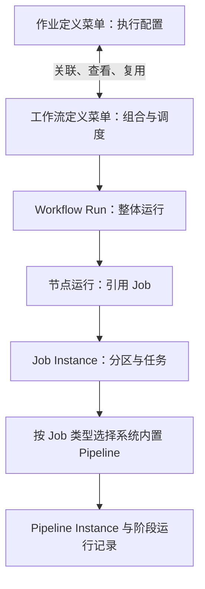

# Workflow 统一运行与 Pipeline 按类型关联实施方案

> 当前执行范围已由用户于 2026-10-14 修订为全新库与单一新模型；以下原状态、计划和证据按来源时点阅读。

> 决策日期：2026-10-14。状态：ImplementationInProgress；WF-1 持续实施，WF-2 单作业 Workflow 受管关联、WF-3 单作业 Workflow 调度源切换与 WF-4 定义菜单联动已部分落地，其他主链切片仍待实施。
> 代码调查基线：后端 `486ad0bed`，配对前端 `934b91a8`。
> 范围：两个定义菜单联动、统一编排与运行入口、系统内置 Pipeline、配置包与存量迁移。
> 本文规定目标契约；现行实现、已交付代码和验收证据仍分别记录，不将方案当作实现结果。

## 当前共同约束（2026-10-14 修订）

用户已确认**不兼容旧系统、全新数据库部署**。当前契约为 `2026-10-14.2`，以 [ADR-048](../architecture/adr/ADR-048-workflow-fresh-database-cutover.md)、[整合计划](./workflow-daily-integration-plan-2026-10-14.md)及[验证矩阵](./workflow-daily-integration-validation-2026-10-14.md)为准。

下文原方案、旧迁移编号和已有测试属于来源分支历史记录；旧 API/Job 根/wrapper/旧消息兼容、旧库升级和历史数据转换均退出当前实施范围。新模型自己的运行快照、版本恢复、归档与审计继续保留。当前实施清单见后文修订表，其余原切片不得直接照搬为新任务。

## 1. 已确定的产品与模型边界

1. **保留 Pipeline 模型及其定义/运行数据模型**。本方案不删除 `pipeline_definition`、`pipeline_step_definition`、`pipeline_instance` 或阶段运行记录表；退役的是“每个 Job 手工关联/配置一条 Pipeline”的租户配置关系和对应用户编辑入口。新运行由 `job_definition.job_type` 解析系统内置 Pipeline；旧定义数据在兼容与历史查询完成前保留，后续若需调整系统定义表的存储语义，另行迁移，不能借本方案清表。
2. **“作业定义”和“工作流定义”是两个独立业务对象、两个独立菜单，并双向联动**。分别保留各自的定义、查询和编辑入口/API；作业定义管理执行配置和可复用任务，工作流定义管理组合、依赖、触发与整体运行策略。联动通过显式 Job 引用和受管单作业 Workflow 关联实现，不把两种定义合并成一个对象，也不靠编码相同推断关系。
3. **所有顶层运行进入 Workflow**。单作业是单节点 Workflow，多作业和分支也使用同一运行主链。
4. **整个 Workflow 只有一组系统管理的 START/END**。作业节点不重复增加起止节点，Job 开始/结束记录在其运行状态和时间中。
5. **保留 Job Instance、分区、任务和 Pipeline 阶段运行记录**。统一用户的运行入口，同时保留执行、恢复和审计所需的细粒度事实。



单作业为 `START → Job → END`；串行为 `START → A → B → END`；并行为 `START → A、B → 汇合 → END`。只有显式子工作流才具有自己的流程边界，普通 Job 节点直接执行，不递归运行自己的单作业 Workflow。

## 2. 成熟系统借鉴及本系统取舍

| 来源 | 可借鉴的已存在模型 | 本系统采用的决策 |
|---|---|---|
| [Airflow DAG](https://airflow.apache.org/docs/apache-airflow/stable/core-concepts/dags.html) | Task 属于 DAG；单 Task DAG 有效；DAG 组织调度和依赖 | Workflow 是整体运行单位，Job 是可复用执行单位；单作业与多作业使用相同编排链 |
| [Argo DAG](https://argo-workflows.readthedocs.io/en/latest/walk-through/dag/) | 用任务依赖表达并行；默认失败后停止新增任务，等待运行中任务完成后收敛 | 明确并行汇合与失败后的收尾条件，防止首个分支完成就结束整个流程 |
| [Temporal Workflow Execution](https://docs.temporal.io/workflow-execution) | Workflow Execution 是持久化的整体执行单位，并有恢复语义 | Workflow Run 为整体操作和观测入口；沿用本平台 PostgreSQL 状态机、Outbox 与恢复主链 |

上述系统并不都要求显式 START/END 节点。本方案的一组固定起止节点是本平台的规范化图和展示约定，不能把它说成通用行业强制规则。保留 Spring/Quartz/PostgreSQL/MyBatis/Kafka 的现有技术栈，不引入另一套编排引擎。

## 3. 当前调用链与实际差距

| 当前证据位置 | 当前行为 | 迁移含义 |
|---|---|---|
| `batch-trigger/src/main/resources/mapper/TriggerDefinitionMapper.xml` | 从 `job_definition` 读取 schedule、timezone、trigger_mode 等 | 调度目标和这些配置需转到 Workflow，不能只改前端菜单 |
| `batch-orchestrator/.../service/DefaultLaunchValidationService.java` | 只有 `job_type=WORKFLOW` 必须查找同编码 Workflow；其他 Job 可独立 Launch | 顶层 Launch 必须统一解析 Workflow；同编码隐式关联退役 |
| `batch-orchestrator/.../service/DefaultLaunchService.java` | 创建与父 Job Instance 关联的 Workflow Run | 将 Workflow Run 改为整体运行事实，父 WORKFLOW Job 包装只在兼容期保留 |
| `batch-orchestrator/.../application/service/workflow/DefaultWorkflowNodeDispatchService.java` | `JOB` 拉起子 Job；`TASK/FILE_STEP` 在父实例中规划和派发任务 | 三种路径不是简单同义名称；迁移时统一 Job 执行语义并核对计数、资源、结果和恢复 |
| `batch-console-api/.../domain/workflow/validation/WorkflowDagValidator.java` | 历史 FILE_STEP 曾通过 `related_pipeline_code` 检查租户定义表；当前新写入校验已拒绝 FILE_STEP | 存量由 V244 转成同租户 Job 引用；保留历史字段读取和旧包转换，不再接受新的 Job-Pipeline 关联 |
| `batch-worker/core/.../support/AbstractPipelineStepExecutionAdapter.java` | 按 tenant/job 读取 Pipeline 定义和步骤，再创建运行实例 | 改为按执行类型读取固定系统定义，拒绝 Worker 类型不匹配 |
| `batch-worker/process/.../stage/DefaultProcessStageExecutor.java` | COMPUTE 的 `implCode/stepParams` 决定计算插件和参数 | 这部分有效配置必须迁到 Job，不能随退役表丢弃 |
| `db/migration/V6__create_file_tables.sql` | Pipeline 定义、步骤、实例和运行观测持久化 | 表与历史身份保留；新运行身份以系统 Pipeline code/version 为准，旧外键仅按兼容性需要保留或逐步解除，不删除定义模型 |
| `db/migration/V232__tenant_configuration_revision_fence.sql` | 子步骤修订触发器经 Pipeline 定义解析租户 | 仅在定义存储改为系统拥有后，单独评估其修订/租户语义；本方案不清表 |
| 前端 `src/constants/navigation.ts`、`src/api/system.ts`、Workflow Designer | 存在三套定义入口和 Pipeline 编码选择 | 两个定义菜单保留，Pipeline 改为作业类型的只读流程信息 |

以上是静态代码调查。没有在本轮执行新模型的运行或迁移验收。旧文档中“JOB 与 TASK 同义”“重试字段可配置即已生效”等描述不能作为迁移依据。

## 4. 系统 Pipeline：代码固化，按类型关联

### 4.1 定义的唯一来源

使用 `batch-common` 中的不可变 `SystemPipelineDefinition`/目录承载 Pipeline 编码、语义版本和固定阶段序列；阶段使用各类型已有的枚举。Worker 模块仍提供具体阶段实现，启动时核对实现注册完整、无重复且顺序与目录一致。Console 元数据由同一目录生成。

**本轮采用代码固化，不采用可外置修改的 YAML**。固定流程属于平台执行契约，顺序变更需要代码、测试、发布和恢复兼容评审。新增 YAML 运行配置会再次开放两份定义来源。若以后确需静态描述文件，应作为随版本发布的受校验资源替换原来源，而不与 Java 各自维护一套；本轮没有这个需求。

以下编码和阶段顺序已由 `SystemPipelineCatalog` 固化，并作为 Job 类型到系统 Pipeline 的唯一映射；Worker 启动时校验阶段模板与目录的顺序及完整性，运行载荷固定 code/version，适配器拒绝不匹配身份。契约覆盖由 `SystemPipelineCatalogTest`、Worker 阶段适配器测试和仓储测试提供。它们证明目录和适配器边界，不等于所有五类 Worker 的真实队列执行验收。

| Job 类型 | 系统 Pipeline 编码 | 固定阶段 |
|---|---|---|
| IMPORT、BUNDLE_IMPORT 的分区任务 | `IMPORT` | RECEIVE → PREPROCESS → PARSE → VALIDATE → LOAD → FEEDBACK |
| EXPORT、BUNDLE_EXPORT 的分区任务 | `EXPORT` | PREPARE → GENERATE → STORE → REGISTER → COMPLETE |
| PROCESS | `PROCESS` | PREPARE → COMPUTE → VALIDATE → COMMIT → FEEDBACK |
| DISPATCH、BUNDLE_DISPATCH 的分区任务 | `DISPATCH` | PREPARE → DISPATCH → ACK → RETRY → COMPENSATE → COMPLETE |
| ATOMIC | 无文件 Pipeline | 保留 Atomic 执行器、超时和结果契约 |
| GENERAL | 按当前 Handler/SDK 契约执行 | 不为了统一视图虚构文件阶段 |
| WORKFLOW（历史类型） | 兼容入口迁到 Workflow | 最终不再作为新 Job 的执行类型 |

当前是四种文件 Pipeline，不是“五类 Worker 就有五种相同结构的 Pipeline”。BUNDLE 保留一 Job Instance 展开异构分区的语义，每个分区按 worker 类型选择固定 Pipeline。

Job 的 `job_type` 是关联来源；API 可以返回只读 `systemPipelineCode` 和阶段说明，不新增可自由填写的 Pipeline 类型选择。派发器将解析出的 `systemPipelineCode/systemPipelineVersion` 固定到任务载荷，Worker 校验已固定的身份与自身实现一致；未携带身份的升级前排队任务仅作滚动兼容，不能用于新任务。执行快照和任务载荷都必须保留所选版本，不能在重放时按当前最新定义静默漂移。

### 4.2 配置归属

| 配置 | 目标所有者 |
|---|---|
| 阶段集合、顺序、默认阶段实现、阶段内恢复语义 | 系统代码 |
| PROCESS 计算插件与计算参数 | Job 的类型化执行配置 |
| 模板、查询、字段映射、通道业务引用 | Job 执行配置及现有模板/通道模型 |
| cron、时区、业务日历、catch-up、整体触发与依赖 | Workflow 的调度配置 |
| 节点输入映射、分支、汇合、节点执行覆盖 | Workflow Node；仅允许该 Job 类型声明的业务字段 |
| 队列、Worker 组、平台配额与运行阈值 | 既有平台资源治理；租户表单不新增物理路由权限 |
| Secret | 现有版本化引用及撤销校验，不复制明文到定义/快照/配置包 |

优先复用 Job 已有参数快照和类型化解析器。配置字段名称与 schema 在第一批实现中同时落到后端 DTO、OpenAPI 和前端生成类型，禁止把整份旧步骤数组塞进 Job 的任意 JSON 后继续执行。

迁移旧步骤时，对每类参数逐项映射。没有生产消费证据的 timeout/retry/enabled 字段列入迁移报告；不因字段存在而赋予新语义，也不悄悄忽略非默认值。同一个 Job 的多版本定义存在不同有效配置时，必须明确迁移来源与冲突处理后才能切换。

### 4.3 版本与恢复

首次系统定义使用显式语义版本 `1`。改变阶段或恢复含义时增加语义版本，展示文案变化不增加版本。版本独立于应用 SemVer 和数据库乐观锁版本。

运行实例记录系统 Pipeline 编码、版本和执行阶段快照；重试沿用原版本与 checkpoint。滚动升级时先部署支持新旧任务版本的 Worker，再切换新实例生产版本。缺少指定版本时拒绝执行并返回明确错误，不回退到当前最新实现。旧版本只有在活跃实例、延期重试和受支持重放均不再依赖后才能移除。

## 5. 两个定义菜单与单 Job 自动工作流

### 5.1 作业定义

作业页保留类型、执行参数、模板/通道引用、分片策略和已有执行治理。展示由类型推导的“系统 Pipeline”只读阶段图。只移除 Job 对租户 Pipeline 定义的手工选择/关联及其编辑入口；Pipeline 定义/运行模型和历史能力继续保留。

作业详情提供“默认单作业工作流”和“被哪些工作流引用”两组关联链接；用户可直接打开工作流、查看其运行记录，或将作业加入已有工作流。调度卡片若从作业页打开，读写对应 Workflow 配置，后端不在两处保存同一份 cron/时区。

新建作业由 Console 在同一事务内建立一个受管单作业 Workflow：`START → JOB → END`。受管流程用明确的 `single_job_definition_id` 关系定位，并以 `(tenant_id, single_job_definition_id)` 保证唯一；关联不依赖两个编码相等。流程编码由统一编码分配规则生成，处理长度与存量冲突，不使用截断或猜测匹配。

### 5.2 工作流定义

工作流列表作为独立的定义菜单，同时列出“单作业”和“组合流程”，支持按类别筛选。单作业流程可维护调度和整体策略；图上的 START/END 与 Job 引用由系统管理。要添加更多节点时创建组合流程，保留默认单作业流程的稳定关联。用户仍分别管理 Job 定义与 Workflow 定义；两个菜单提供彼此的真实关联与跳转，不以单一合并表单/菜单取代。

设计器的执行节点统一引用 Job，选择后展示类型、只读内置 Pipeline、参数 schema 和跳转作业详情。节点表示复用，不自动复制 Job 配置。需要独立业务参数时使用受校验的节点覆盖或另建作业。

两个菜单分别支持业务对象管理，运行按钮最终调用同一 Workflow Launch 服务。作业页“运行”定位默认单作业流程；作为组合流程节点时直接创建节点 Job Instance，不先调用该作业的单作业流程。

### 5.3 启停、编辑与删除

- Workflow 启停控制该流程的新顶层触发；Job 启停控制新执行的准入。表单明确作用范围，被多个流程引用的 Job 禁用操作展示影响清单。
- 已启动流程固定执行快照；普通配置编辑影响后续运行。紧急取消、租户暂停和密钥撤销按现有操作语义处理。
- Job 被流程引用时删除返回冲突和引用清单；受管单作业流程不作为可独立删除对象。整体归档由应用服务按引用和运行保留规则执行。
- 图定义编辑与发布使用现有乐观锁；保存冲突不覆盖他人修改。

## 6. 图、状态、重试和并行语义

### 6.1 固定边界

保存时由服务端规范化唯一 START、唯一 END，并为默认单作业图生成边；设计器将边界设为受管。边界作为现有图模型中的控制节点持久化，不分发给 Worker、不占用执行分区，也不额外创建 Job。

START 无入边，END 无出边；所有业务节点从 START 可达且可到达 END；不允许空业务图、环和跨租户 Job 引用。组合流程用户编辑业务边与条件，服务端不得为“修复图”自行追加会改变业务执行路径的边。

存量多 END 先评估是否能等价归一。存在独立终止、不同完成策略或不明确条件时列入阻断项，不机械合并到一个成功 END。

### 6.2 结束不等于成功

END 表示整体执行已收敛。Orchestrator 依据所选路径、节点状态和仍在运行的 Job 聚合 Workflow 结果；END 不能以 `ALWAYS → SUCCESS` 掩盖上游失败。

| 场景 | 目标规则 |
|---|---|
| 单作业成功 | Job 成功后 Workflow 成功；只触发一次终态事件 |
| 并行 A/B | 等待两个应执行分支收敛；A 完成不能提前结束或取消 B |
| 条件只选择 A | B 记录有原因的条件跳过；所选分支完成后可成功，不等待 B 执行 |
| 上游失败导致跳过 | 区分条件未命中与失败传播；失败传播不能被通用 SKIPPED→SUCCESS 投影洗成整体成功 |
| 任意必需作业失败 | 默认失败；停止新增普通业务任务，等待已启动任务收尾；显式 FAILURE/补偿分支仍可按定义执行 |
| 补偿成功 | 记录恢复结果，默认保留原业务失败结论；既有显式失败处理语义须盘点并等价迁移 |
| ANY/N_OF join | 保留现有 join 语义；触发下游不代表其他已启动分支立即结束，需按既有取消/收尾策略收敛 |
| Workflow 暂停 | 停止新的节点派发；运行中 Job 的处理遵循现有暂停契约，恢复后重新判定 readiness |
| 取消/终止 | 请求、执行停止和整体终态分别可观测；未确认停止时不能提前标记“全部完成” |

复用已有状态枚举和 CAS，但必须补充跳过原因/失败来源，不能直接使用 `WorkflowNodeRunStatus` 的生命周期投影替代业务成功判定。default fail-fast 是本方案的目标规则，实施前与存量 FAILURE/独立分支行为逐项比较。

### 6.3 运行归属与去重

目标运行关系为 `workflow_run → workflow_node_run → job_instance → job_partition/job_task → pipeline_instance/pipeline_step_run`。每个业务 Job 节点拥有自己的执行实例，Job Instance 不再兼任整个流程的父计数容器。

对新增节点执行关联记录 `workflow_run_id/node_code/node_run_seq`，以租户和节点尝试保证唯一。数据库 FK/唯一约束需要同时覆盖租户，不以 traceId 充当关联键。已有 rerun 的 parent 字段不兼任 Workflow 归属。

重复 Trigger、Kafka 重投或两分支同时唤醒同一 join，都必须命中同一节点尝试；节点状态与 Job 创建/任务 Outbox 处于明确的事务边界。Workflow 的终态推进与终态 Outbox 同事务，旧 lease 的报告不能推进新尝试。

分清任务重试、Job 重跑和整个 Workflow 重跑：任务恢复沿用已有 checkpoint/幂等键；Job 新尝试按现有结果隔离策略生成执行记录；整体重跑生成新的 Workflow Run 并保留来源关系。局部重跑不得复活已终态的原 Workflow Run，若需继续下游则创建新的恢复运行并记录复用结果来源。

## 7. 调度、执行快照与权限

Trigger 的唯一新顶层目标为 Workflow。将 schedule_type、schedule_expr、timezone、trigger_mode、调度日历/catch-up 和整体触发策略迁入 Workflow 配置；旧 Job 调度字段成为兼容读入口并最终删除。批次窗口归 Workflow Node 的资源准入覆盖，Job 历史默认窗口仅用于初始化节点。节点/Job 数据依赖仍按执行语义保存，跨日映射显式记录日历依据；不能把所有含“日历/依赖”的字段机械迁到 Workflow 日程。

保留现有业务日期、data_interval、misfire、readiness defer、批量日重放和重复触发规则。只转换目标身份，不能重新计算历史计划日期或把同一触发同时发给旧 Job 和新 Workflow。

Launch 固定当前图、每个 Job 的有效执行配置及系统 Pipeline 版本。优先复用现有 `job_instance.params_snapshot`，并在 Workflow Run 增加类型化定义/参数快照，供未派发节点恢复；现有定义可原位更新，单独保存乐观锁版本不足以冻结执行语义。快照只覆盖本次改造触及的图与执行配置，不扩展成平台资源的全量快照。

Workflow Launch、运行操作、Job 引用与配置包 Apply 都由服务端校验租户和权限。Job 页面快捷操作调用相同服务，不产生另一套审核、幂等或资源准入链。

核心链继续是 `DB → Outbox → Kafka → CLAIM → EXECUTE → REPORT`，Orchestrator 是整体运行状态主机。Worker 只读取任务快照和写既有阶段观测，不直接更新 Workflow/Job 高层状态。

## 8. 数据库、API、配置包与历史迁移

### 8.1 表和字段去留

| 对象 | 目标 |
|---|---|
| `job_definition` | 保留执行单元与类型化业务配置；调度字段迁到 Workflow |
| `workflow_definition/workflow_node/workflow_edge` | 保留；增加单作业受管关联和必要调度字段，统一节点 Job 引用 |
| `workflow_run/workflow_node_run` | 保留并承担整体运行/节点事实，增加执行快照和必要明确关联 |
| `job_instance/job_partition/job_task` | 保留细粒度执行、分片、lease、幂等和结果隔离；解除父流程容器职责 |
| `pipeline_definition/pipeline_step_definition` | 保留 Pipeline 定义模型、表和历史数据；新建 Job 不再选择/创建租户级 Pipeline 定义，按 Job 类型解析系统内置定义。旧租户定义只读兼容，用户 CRUD/配置包写入逐步关闭；本方案不安排删除表 |
| `pipeline_instance/pipeline_step_run/pipeline_progress` | 保留；记录系统 Pipeline 编码/版本与阶段证据 |
| `pipeline_instance.pipeline_definition_id` | 先允许新记录不使用并解除 FK；旧值保留为历史身份，最终删除前补齐历史映射和查询兼容 |
| `workflow_node.related_pipeline_code` | 转为 Job 引用后退役，历史快照仍解释旧引用 |
| `archive.*_archive` 与 lineage/归档查询 | 与热表结构、列名和显式投影同步，保证冷数据仍能查询 |

旧历史记录无需补造曾经不存在的 Workflow Run。Console 提供历史执行区或关联跳转，并明确历史来源；不能为统一列表虚构 START/END 时间和成功状态。新模型生效后所有新顶层运行才要求 Workflow Run。

### 8.2 配置包和旧 API

新包删除两个 Pipeline 配置 Sheet/JSON 段，保留 Job 与 Workflow，并展示类型推导的系统阶段说明。同步 Excel schema、guidance、跨表校验、Apply 计数、JSON Config Sync、Job Bundle、复制、审批/发布类型、fixture 和 AI 知识。

新建 Job 的受管单作业 Workflow 为派生配置，导出时省略系统边界和可重新生成的图；调度等用户配置以明确 Job→单作业 Workflow 关联导出一次。组合 Workflow 正常导出业务图。导入通过相同 Console 应用服务生成受管图，避免两份重复定义覆盖。

旧包使用明确版本转换预览：将有效步骤业务参数移到 Job；FILE_STEP 解析为同租户 Job 引用；报告冲突、非默认未映射字段和转换计数，确认预览修订后再 Apply。新包不再把系统 Pipeline 当作 Job 可编辑配置重复导入/导出；旧包 Pipeline Sheet/JSON 进入兼容只读/转换路径，不能静默丢弃或继续覆盖系统定义。

旧 Job Launch/API 在兼容期解析受管 Workflow 后进入统一 Launch；响应保留原字段并追加真实 Workflow 关联。旧租户级 Pipeline CRUD 先返回明确的只读/退役提示并指向 Job 类型配置；保留 Pipeline 模型、系统定义查询和运行观测 API。任何未来 API/表结构退役须另立兼容评估，不属于本方案。

### 8.3 发布顺序和回退边界

1. 只读盘点并导出配置、版本、引用、活跃实例、延期重试和待消费任务，记录哈希和冲突清单。
2. 扩展 nullable 字段/关系与新执行配置，完成受限批量回填；先部署兼容 Worker，再部署新控制面生产者。只保留一种生效写入来源，兼容读转换不能成为长期双写。
3. 转换 Workflow/Job/旧节点和触发关联，按租户核对计划时间、计数和唯一键；写路径使用配置修订/CAS，变更中的租户要求重新预览。
4. 切换一个明确模型版本的新运行入口。灰度租户只走一个入口；不得对同一触发双发。旧活跃运行按其既有模型完成或在兼容模式恢复。
5. 所有 Producer/Worker/Console/脚本不再以 Job 到租户 Pipeline 定义的关联决定新运行；关闭旧租户级配置写入，并保留旧记录用于历史解释。同步核对 V232 修订函数/触发器、RLS、索引、归档、清理、容量画像和 fixture；本方案不执行 Pipeline 定义表清理。
6. 移除旧 Job-Pipeline 关联字段/API/类型兼容时，保留 Pipeline 定义模型和历史查询能力。本次整合已按用户确认的全新空库切换范围，允许修改整合分支上已提交的 Flyway 迁移（包括注释和新模型所需 DDL）；这组迁移只用于从空库按序建库，不得应用到已有 Flyway 历史的数据库。新系统成为发布基线后，后续版本恢复已发布迁移不可变规则。

迁移使用准确对象和显式依赖清单，不使用 `DROP ... CASCADE` 掩盖未识别调用。热表回填可续跑且有锁等待上限；本方案只迁移/冻结 Job 级关联与写入口，不删除 Pipeline 定义模型或表。任何未来破坏性清理必须单独评审、完成恢复演练并遵循配置备份/数据库恢复流程。

## 当前实施清单（契约 2026-10-14.2）

以下为当前目标，尚未按整合版本验收；替代来源分支旧兼容清单。

| ID | 工作 | 验证门槛 |
|---|---|---|
| W1 | 唯一 Workflow 根和节点 Job 执行；退掉旧 wrapper/虚拟父任务与 Job 根复用 | R01/R02/R08/R09；同图多节点不错误去重 |
| W2 | Workflow 日程、ID、日期/参数快照和计划版本 | R03–R07；不依赖旧 Job 日程或 code 做身份 |
| W3 | 系统 Pipeline 与新模型参数、执行版本、归档 | R14–R17/R21；新系统故障恢复，不实现旧载荷恢复 |
| W4 | Job/Workflow 双菜单、运行详情、配置/API/SDK 统一版本 | R19/R20/R24；新包/新类型，旧输入明确拒绝 |

## 9. 可独立评审的交付切片

| 切片 | 交付物 | 关闭条件 | 本轮状态 |
|---|---|---|---|
| WF-0 | 本方案、现状边界标注、索引和验收矩阵 | 用户决策可追溯，设计与当前实现区分明确 | 文档已编写，静态检查通过；结果见末节 |
| WF-1 | 系统 Pipeline 目录、Job 类型映射、参数迁移预览、Worker 版本校验 | 四类阶段完整有序；错误类型/版本拒绝；PROCESS 有效业务配置保留 | 进行中：新增公共代码目录、Job 类型投影、Worker 从模板读取固定步骤并写入系统 Pipeline code/version；V236 解除新运行对旧 Job 绑定定义 ID 的依赖，同时保留 Pipeline 定义表与历史关联。Workflow 节点派发已将系统 Pipeline code/version 固定到任务载荷，Worker 对不匹配身份拒绝执行，缺身份的升级前消息保留滚动兼容。旧配置包和租户初始化兼容转换已将可映射阶段业务参数迁入 Job 默认参数，非默认/冲突值 fail-closed；待补真实迁移对账和组合运行恢复验证。 |
| WF-2 | 受管单作业 Workflow、节点 Job 实例语义、快照/去重、起止/汇合收敛 | 单 Job、多 Job、分支、并行、失败和恢复共用主链 | 进行中：新增 Job→默认 Workflow 唯一关联；新建/复制/配置包导入时生成 `START→JOB→END`；V238 回填存量非 WORKFLOW Job；服务端拒绝修改受管图。新类型 Job 的 Launch 已通过显式关联加载 Workflow，单作业根 JOB 节点复用根 Job Instance 派发，V239 在 Workflow Run 固定 Job 关联并扩展归档。V245 为 Workflow JOB 节点建立唯一 Job Instance 关联；任务回报可经节点关联解析没有根 Job Instance 的 Workflow，并只在 legacy wrapper 运行上保留父虚拟任务回调。V246 同步 Pipeline 历史定义 ID 的热/冷可空性。本轮补充无根 Workflow 的 JOB 节点派发：Job Instance 仅挂在节点运行下，Trigger Request 通过 Workflow Run+节点验证，不建合成父 Job、父虚拟分区或任务；报告推进下游时即使携带上一个节点 Job Instance，也不会把它当父容器。v2 执行快照固定 Workflow 图、节点定义和系统 Pipeline 身份；解析时校验租户、Workflow/Job 版本、边端点与 Job 类型映射，缺少或冲突时拒绝运行，避免降级到可变定义。新 Run 现在在 PostgreSQL `REPEATABLE READ` 事务内重新核对 Workflow 版本、校验图并读取图快照；若事务前读到的版本已变更则拒绝启动。已有 Run 重放不会再因当前定义后来变成无效图而被阻断。验证：`./mvnw -pl batch-orchestrator -am -Dtest=JobNodeDispatchIntegrationTest#explicitWorkflowLaunch_shouldCreateRootRunAndDeduplicateNodeDispatch,JobNodeDispatchIntegrationTest#scheduledWorkflowLaunch_shouldRejectStaleDefinitionVersion -Dsurefire.failIfNoSpecifiedTests=false test`（2 项通过，真实 PostgreSQL 17.11/Kafka/MinIO/Valkey）；此前运行快照/传感器测试分别 54/13 项通过。仍需确定 Job 定义缓存快照与事务读视图一致性、注入确定性并发编辑时序、重启重放、并行收敛/失败恢复和 legacy WORKFLOW 转换。 |
| WF-3 | Trigger/Launch/批量日/补跑切换到 Workflow，旧入口受控转换 | 同一触发无双实例；日期、misfire、SLA 与结果隔离保持可解释 | 进行中：V240/V241 已迁移受管单作业 Workflow 的调度字段并纳入定义版本快照；V242 将旧 WORKFLOW 包装 Job 的 schedule 迁至同租户同编码 Workflow。V248 新增独立 `workflow_definition.schedule_enabled`，Trigger 启停不再改写 Job 执行 `enabled`；reconciler 清理 Quartz 漂移也不改变权威启停状态。Quartz 当前以 `tenantId:WF:workflowCode` 为稳定身份，支持无包装 Job 的组合 Workflow；Launch 只携 Workflow ID/code/version。前端和 Console 提供 schedule-only 配置及 pause/resume，使用 expectedVersion CAS 并保存原 DAG 快照。JSON 租户初始化/复制与 Excel 配置包都传递 Workflow 调度及可移植单作业关联；Excel 覆盖导入推进版本并保存快照，V249 的 PostgreSQL 集成验证覆盖调度开关写回及历史读取。批量日结算器的 AUTO/MANUAL catch-up 现按 `job_definition.id → workflow_definition.single_job_definition_id` 解析受管单作业 Workflow，并以 Workflow ID 写 TriggerRequest/LaunchRequest；Compensation 驱动的 BatchDay Replay 也以 Workflow ID 为唯一目标，并将 replaySessionId 固定到执行快照后传递至子 Job Instance，复用现有终态回填。缺少受管关联时均 fail-closed。Console 定向 5 项、Orchestrator catch-up/可信 Launch 定向 14 项、Compensation 与 Workflow 节点派发定向 22 项通过。仍缺 readiness 与上游产出核对、并发去重和真实 Quartz misfire 恢复验证。 |
| WF-4 | 两个定义菜单联动、统一运行详情、配置包/API/权限同步 | 真实前后端完成创建→触发→观测→恢复；旧包有明确转换 | 进行中：Job/Workflow 响应带显式关联，两个定义菜单保持独立并可联动；运行详情已有 DAG、节点状态和操作，节点可展开 Job Instance、前 20 条分区/阶段及 Pipeline 观测深链。配置包旧 Pipeline 值转换 fail-closed；Excel 导入/导出包含 Workflow 的可移植 Job 关联与调度字段。后端本轮定向 49 项通过（含 PostgreSQL V249 Mapper/快照验证），前端 151 个单测文件/887 项、typecheck、lint 通过。真实 Excel 上传→预览→Apply 旅程、真实浏览器、并行/恢复端到端与权限矩阵仍未验收。 |
| WF-5 | 退役 Job-Pipeline 手工关联及旧可编辑入口、处理旧节点字段与包装 Job，归档/脚本/runbook 更新 | 混合版本和迁移验证完成；新运行按 Job 类型解析系统 Pipeline；Pipeline 定义/运行模型与历史可查 | 进行中：旧 Pipeline 定义 API 的 POST/PUT/启停写入已拒绝并保留 GET 历史查询；配置包 Apply 和租户批量初始化不再写 Pipeline 定义表，对旧数据做 fail-closed 参数迁移。初始化结果可区分 migrated/skipped/failed。新增 V244 将存量 FILE_STEP 引用转换为同租户 JOB 引用；同 Workflow 存在 CREATED/RUNNING/PAUSED 运行或引用无法解析为 Job 时迁移失败关闭。真实 PostgreSQL 17.11 集成测试验证转换、活动运行阻断及 Pipeline 定义/运行模型仍保留。前端已不再新建 FILE_STEP 或选择租户 Pipeline；残留 FILE_STEP Inspector 现只读显示迁移/历史数据，不加载可编辑 Pipeline 选项，且禁止编辑和删除（Vitest 5 项通过；typecheck、目标 ESLint、文档检查通过）。旧关联读路径、WORKFLOW wrapper 转换和整体运行兼容尚未收敛。 |

进度说明：上表列出的工作项保持“进行中”；组合 Workflow 的手动顶层触发已由 Console 进入运行链，组合 Workflow 的定时 Quartz 注册、Workflow 身份的启停管理也已接通，但尚无真实 Quartz→Trigger Outbox→Workflow Run 的端到端定时验收。WF-2/WF-3 仍需完成并发编辑快照一致性、并行/失败恢复、readiness 依赖迁移及真实浏览器旅程。

主链复核补充（2026-10-14）：发现 v2 Workflow Run 子 Job 启动校验仍通过实时 `workflow_definition/workflow_node` 校验 Job 引用，与冻结快照契约冲突；现改为 v2 快照已验证 Job/节点身份，SQL 再验证租户 Run、节点运行记录及既有父任务所有权，v1/无快照仍走旧实时校验。真实 PostgreSQL 集成验证覆盖定义被改写后快照路径放行、实时兼容路径拒绝；另新增组合无根 Workflow 两个独立 Job Instance 顺序执行并最终整体 SUCCESS 的集成用例。验证：`./mvnw -pl batch-orchestrator -am -Dtest=DefaultLaunchValidationServiceTest,JobNodeDispatchIntegrationTest#directWorkflow_shouldAdvanceAcrossIndependentJobInstances,JobNodeDispatchIntegrationTest#frozenWorkflowNodeLaunch_shouldNotDependOnCurrentNodeDefinition -Dsurefire.failIfNoSpecifiedTests=false test`，15 项通过（其中真实 PostgreSQL 17.11/Kafka/MinIO/Valkey 集成 2 项）。日历运行源现按下文单独记录；批次窗口编辑入口及其与运行快照/重试语义仍需复核后才能进入可交付状态。

补充进度（2026-10-14）：Console Job 手动触发、批量日 AUTO catch-up 与审批后 MANUAL catch-up 已解析 Job 响应中的显式受管 Workflow ID，并通过 Trigger 互斥目标字段发起 Workflow Launch；缺少该关联时 fail-closed。Console 批量日 MANUAL_APPROVAL 不再生成尚未写入 Trigger 的伪 requestId，审批执行时根据租户 Job 重新解析单作业 Workflow。验证：`./mvnw -pl batch-console-api -am -Dtest=DefaultConsoleJobTriggerServiceWorkflowTest,DefaultConsoleJobApprovalServiceWorkflowTest -Dsurefire.failIfNoSpecifiedTests=false test`（5 项通过）。Orchestrator 批量日结算器同样解析唯一单作业 Workflow 并经可信 Launch 路由入口；`BatchDaySettleSchedulerTest` 与 `LaunchApplicationServiceTest` 共 14 项通过。新增 Compensation 回放入口的 Workflow 路由；定向验证 `DefaultCompensationServiceTest` 15 项通过，`JobNodeDispatchIntegrationTest` 7 项通过，并使用真实 PostgreSQL 17.11/Kafka/MinIO/Valkey 验证 replaySessionId 从 Workflow 执行快照传到无根 Workflow 子 Job Instance。readiness 与上游产出核对、并发去重和真实 Quartz misfire 恢复仍待验收。

Workflow JOB 节点的 BatchDay readiness 延迟处理补充（2026-10-14，2026-10-19补验）：子 Job Launch 返回 WAITING 时节点保持 READY，由 BatchDay 释放链路稍后重试；延迟创建的 Job Instance 在 Launch 创建事务中按 TriggerRequest 的 WorkflowRun/节点上下文写回 `WorkflowNodeRun.job_instance_id`。`JobNodeDispatchIntegrationTest#batchDayDeferredChild_shouldAttachReleasedJobInstanceToOriginalNodeOnce` 现以真实 PostgreSQL 验证完整链路：父 Workflow 的业务日历上存在 OPEN 前一日时，原请求和等待账本进入 WAITING 且不创建 JobInstance；前一日结算后调用生产释放调度器，原请求 LAUNCHED、节点关联新实例；再次扫描不重复创建。命令 `./mvnw -o -ntp -pl batch-orchestrator -am '-Dtest=JobNodeDispatchIntegrationTest#batchDayDeferredChild_shouldAttachReleasedJobInstanceToOriginalNodeOnce' '-Dsurefire.failIfNoSpecifiedTests=false' test`，1/1通过。原有 ChildJobLaunchSupport/DefaultLaunchService 定向13项与 JobNodeDispatchIntegrationTest 7项仍是各自先前的独立结果，不与本次1项相加。本场景只证明前一业务日闸门的恢复与节点关联，不替代跨日依赖传感器、批量容量或完整 Workflow 失败/恢复验收。

Worker 关联收敛（2026-10-14）：移除 Worker `PlatformPipelineDefinitionRepository.findPipelineDefinition(tenantId, jobCode)`、对应 Mapper/XML 查询及只验证该租户 Job→Pipeline 查询的测试。新执行阶段只由 `SystemPipelineCatalog` 和 Job/Worker 类型决定；仍保留按 legacy 消息固定携带的 definition ID 加载历史步骤，以及 Pipeline 定义、实例和阶段历史模型。验证：`./mvnw -pl batch-worker/core -am -Dtest=PlatformRepositoryTest,SystemPipelineCatalogTest,SystemPipelineStepConfigurationTest -Dsurefire.failIfNoSpecifiedTests=false test`（8 项通过）。旧队列兼容通道将在混合版本排空策略完成前保留，不等同于新关联入口。

Workflow DAG 旧节点写入收敛（2026-10-14）：Console `WorkflowDagValidator` 不再按 `tenantId + related_pipeline_code` 查询租户 Pipeline 定义；任何新保存请求中的 FILE_STEP 都以 `error.workflow.dag.file_step_retired` 拒绝，要求改用引用 Job 定义的 JOB 节点。历史读取和 V244 存量转换字段仍保留，配置包旧格式转换入口独立保留。验证：先运行 `WorkflowDagValidatorTest#shouldFail_whenFileStepPipelineExists`，在旧实现上按预期失败（旧代码放行）；实现后运行 `./mvnw -pl batch-console-api -am -Dtest=WorkflowDagValidatorTest,WorkflowDefinitionMutationValidationTest,ConsoleWorkflowFullUpdateControllerTest -Dsurefire.failIfNoSpecifiedTests=false test`，33 项通过。新拒绝语义不改变 Pipeline 定义/执行/历史模型。

实施时在每个切片补充具体 SHA、命令、用例结果和目标环境证据。WF-5 不与首次模型切换捆绑为同一破坏性发布。

## 10. 验收矩阵

| 关键场景 | 必须验证的可观察结果 | 最小证据层级 |
|---|---|---|
| 单 Job 自动关联 | 保存一次只生成一份受管流程；重复导入不重复生成；两个菜单能互相定位 | 真 PG 事务 IT + 浏览器 |
| 类型关联 | 四类阶段和顺序固定；未知类型、错 Worker 类型、缺实现、未知 Pipeline 版本拒绝 | 独立契约预期单测 + Worker IT |
| PROCESS 配置转换 | 插件/SQL/参数和业务结果不丢；冲突定义与未映射字段阻断切换 | 真业务库 IT/数据对账 |
| BUNDLE/ATOMIC/GENERAL | 束分区绑定保持；Atomic/Handler 可执行且没有虚构文件阶段 | 对应 Worker/SDK 真链路 |
| 图边界 | 唯一 START/END；不可编辑、无额外 Job/分区；空图、环、跨租户引用拒绝 | API/图校验 + 浏览器 |
| 串行与并行 | B 不提前；并行迟到报告不会重复 join；失败分支不把整体洗成成功 | 真 PG 并发 IT + 隔离 SIM |
| 条件/ANY/N_OF | 所选分支和跳过原因准确；并行运行能收尾；旧图策略转换可解释 | 状态机 IT/场景测试 |
| 触发去重 | API 重试、Quartz 重投、Kafka 重复、双 Orchestrator 仅创建一个根运行与节点尝试 | 真 PG/Kafka 并发 IT |
| 日期与补跑 | UTC/DST/跨午夜、catch-up、窗口、批量日重放保留原日期/区间/次数 | Trigger 边界单测 + 真依赖 IT |
| 重试与升级 | 旧 lease 报告拒绝；checkpoint 幂等；图/Job 编辑后原运行不漂移；旧版本仍可恢复 | Worker 故障/滚动兼容 IT |
| 暂停/取消/局部重跑 | 不新派发、不提前假终态；运行可收敛；重跑产生正确来源关联和结果版本 | API/真链路/浏览器 |
| 配额与告警 | 不因增加 Workflow 层重复计算 Job 并发/计数；整体与节点 SLA 所有者明确 | 资源/监控专项 IT |
| 权限与凭据 | 四角色、跨租户、物理路由、审计和 Secret 撤销保持边界；快照无明文凭据 | JWT/CSRF 真 PG IT |
| 包与 API | 新包不含旧定义；旧包显式预览转换；修订冲突无部分写入；OpenAPI/生成类型一致 | Excel/JSON/HTTP PG IT + 前端契约 |
| 历史/归档/关系迁移 | 热冷数据可查；旧关系可解释；受限锁等待；新安装/存量升级/备份恢复成功 | 真 PG 迁移 IT + 部署演练 |

静态扫描、单测、容器集成、隔离 SIM、真实 staging 和生产迁移分别记录。本地绿色不能替代灰度和历史恢复验收；本次方案不触发 staging、不发布 SDK、不清理真实业务数据。

## 11. 本轮文档交付与实现证据

实现进度（未完成验收）：`batch-common` 新增 `SystemPipelineCatalog`/`SystemPipelineDefinition`，按 `JobType` 映射四类文件 Pipeline（BUNDLE 类型投影到对应 Pipeline；GENERAL/ATOMIC/WORKFLOW 不虚构文件阶段）；Worker 适配器从各阶段模板提供器生成步骤，并在初始化时要求模板顺序与目录匹配；新 Pipeline 实例写入系统 Pipeline 编码及语义版本，保留 legacy definition id 供历史查询。V236 扩展运行身份并允许新运行不依赖 Job 手工绑定的 Pipeline Definition ID；Pipeline 定义/步骤表和历史模型保留。V237 增加 Job/Workflow 显式唯一关系，V238 回填存量默认单作业 Workflow，V239 为 Workflow Run 固定 `single_job_definition_id` 并扩展冷归档，V240/V241 迁移 Workflow 调度与历史快照，V242 转换旧 WORKFLOW wrapper 调度；均不删除 Pipeline 模型或表。新类型 Job Launch 已通过显式关联加载受管 Workflow；单作业根 JOB 节点在根实例内直接创建分区/任务，避免自递归子 Job。Trigger 调度查询现以 Workflow 字段为准，面向单作业 Workflow/legacy wrapper；调度描述与 Quartz/Launch 载荷带 Workflow 身份及版本，现有 JobCode execution 兼容入口仍保留。真实 PG 迁移测试验证 V242 对 legacy wrapper 日程的迁移；Trigger Testcontainer 和单测验证定时字段按 Workflow 读取。服务端拒绝改写受管图；Job/Workflow 查询响应携带关联 ID，列表支持按 Job 编码和单作业/组合类别过滤。组合 Workflow 根启动链已开始贯通：Trigger 接受互斥 Job/Workflow 目标；Orchestrator 可按 Workflow ID 创建无根根运行并派发初始 Job 节点；Console 新增权限保护的 Workflow 触发端点，前端列表可选业务日期并发起运行。Console 定向测试 15 项通过，根 Workflow 的真实 PostgreSQL/Kafka 集成测试 6 项通过，前端 API 类型生成、typecheck、目标 ESLint 和 OpenAPI 407 路径核对通过。Workflow Run v2 现快照化图、节点定义和每个 Job 节点的完整定义/系统 Pipeline 身份；所有 run-aware DAG 派发/就绪/跳过逻辑和 Sensor 推进读取冻结快照，不再因定义修改读取实时节点；快照结构会 fail-closed 校验租户、Workflow/Job 版本、节点/边归属、Job 引用和类型对应的 Pipeline 身份。新 Run 的 Workflow 定义与图校验/读取现位于 `REPEATABLE READ` 事务中，版本在事务前后变化则拒绝创建；已有 Run 的重放不再被后来无效图阻断。真实 PG/Kafka 集成测试 2 项通过；此前运行快照/传感器测试分别 54/13 项通过。Job 定义缓存版本一致性、确定性并发注入、重启重放仍未验证；整体 Trigger→Run→Console 端到端、并行/失败恢复、legacy WORKFLOW 转换、PROCESS 参数迁移、旧关联/API 收敛、统一运行详情与真实浏览器旅程仍未完成，不能宣称可部署切换。

调度迁移进度：V240 为 Workflow Definition 增加 schedule type/expression/timezone/trigger mode/calendar/dependency 字段，并以显式 `single_job_definition_id` 回填存量单作业 Workflow；新建 Job 派生 Workflow 复制这些字段。V241 将这组字段加入 Workflow 版本快照和归档，旧快照不伪造调度值；V242 将旧 WORKFLOW wrapper Job 的同编码既有日程迁到 Workflow。Trigger 的 schedule 查询已切至 Workflow source，并将 Workflow ID/code/version 带入 Quartz JobDataMap 和 scheduled Launch params；组合 Workflow 已可按自身身份注册及根 Launch。Console 与前端已有 schedule-only 编辑、pause/resume；后端按租户校验依赖 Job 存在并拒绝受管单作业 Workflow 自依赖。Job 编辑 API 对旧调度字段的变更返回 `STATE_CONFLICT`，Job 列表编辑不再显示/提交这些字段，快速创建固定 MANUAL；历史 Job 值继续只读显示，向导调度字段用于初始化生成的受管单作业 Workflow。JSON 租户初始化/复制现由 Workflow spec 承载调度字段与可移植 `singleJobCode`，目标租户内解析关联；覆盖导入通过当前版本推进并写快照，新导出不再重复携带 Job 调度值。Excel 配置包、受管单作业 Workflow 的 Job Bundle 可移植导出/导入、旧 Job 调度值显式迁移与审计仍未完成；Schedule 身份并发去重和真实 Quartz misfire 恢复验证也未完成。

配置包与 Workflow 联动补齐：Excel Workflow sheet 现在导出/导入 `single_job_code`、`schedule_enabled`、类型、表达式、时区、触发模式、日历和依赖作业；校验目标租户 Job/Workflow 引用，覆盖导入复用受管单作业 Workflow 并推进版本、保存快照。V249 将 `schedule_enabled` 加入 Workflow 版本历史和归档列，不回填未知历史值。真实 PostgreSQL 17.11 `BatchConsoleApiApplicationIntegrationTest` 从空库执行至 V249，并验证 CAS Mapper 将调度开关写入主表以及版本快照能读回；后端本轮定向测试 49 项通过。Job Bundle 的依赖闭包现包含关联 Workflow 自身的业务日历（假日列表随 BusinessCalendarSpec 一并导出），而非只包含 Job 历史日历；测试覆盖 Job/Workflow 使用不同日历且排除无关日历，`./mvnw -pl batch-console-api -am -Dtest=DefaultConsoleTenantConfigCopyServiceTest -Dsurefire.failIfNoSpecifiedTests=false test` 2 项通过。配置包调度字段尚未覆盖端到端用户旅程，Job Bundle 可移植导入/导出仍需真实目标租户 Apply/运行验收。

Pipeline 写入口退役进度：`POST/PUT/PATCH /api/console/pipeline-definitions` 现返回 `STATE_CONFLICT` 并提示按 Job 类型使用系统 Pipeline；列表/详情仍可读历史。配置包 Apply 和租户批量初始化均不再写 `pipeline_definition`/`pipeline_step_definition`；旧 Pipeline Sheet/初始化 spec 转换为 Job 默认参数，类型、阶段顺序、非默认运行策略和版本冲突均失败关闭；Pipeline 执行模型与历史表保留。新生成的配置包导出、完整模板和场景模板已省略两张 Pipeline 可编辑表；旧上传预览仍保留表格及转换提示。跨租户 Config Sync/Job Bundle 已停止读取、导出和传输租户 Pipeline 定义；配置矩阵移除 Job-Pipeline 关联字段，模板/通道依赖改从 Job 参数（含已迁移阶段参数）解析。旧版直接初始化请求仍兼容接收 Pipeline spec 并转换，不写 Pipeline 表。此次定向验证 `./mvnw -pl batch-console-api -am -Dtest=ConfigPackageExcelValidatorTest,DefaultConsoleTenantConfigInitApplicationServiceTest -Dsurefire.failIfNoSpecifiedTests=false test`（45 项通过）；另以 `./mvnw -pl batch-console-api -am -Dtest=ConfigPackageExcelWorkbookWriterExportPreviewTest,ConfigPackageWorkbookGuidanceTest,TenantConfigPackageRowProjectionsMonitoringPolicyTest -Dsurefire.failIfNoSpecifiedTests=false test` 验证导出、模板与旧包预览（29 项通过）；本轮复制和矩阵测试 4 项通过，`make check-openapi` 通过（406 routes）。前端 API 类型已重新生成，typecheck 和 lint 通过。旧 WORKFLOW/FILE_STEP 转换、旧关联读路径及完整主链验收未完成；WF-5 和整体方案仍未完成。

本轮验证：Worker 定向包构建和四类适配器/目录/仓储单测通过；Console 单作业 Workflow provisioner 测试通过；Console 定义版本、请求校验、版本 API 和图渲染定向测试通过（20 项）；Trigger `TriggerServiceIntegrationTest`、`TriggerSchedulerFacadeTest`、`DefaultLaunchAdapterServiceTest`（27 项）通过；`SingleJobWorkflowMigrationIntegrationTest` 在真实 PostgreSQL 17.11 从 V237 插入 CRON Job、EVENT Job 与 legacy WORKFLOW wrapper 后升级到 V242，通过显式单作业关系、调度回填、legacy wrapper 转换、表达式约束、边界节点、跨租户 FK 及热/冷版本列验证。`validate-flyway-schema.sh`、后端文档结构/术语/Changelog 检查与前端 `node scripts/check-docs.mjs` 通过；`git diff --check` 通过。`check-migration-safety.sh` 已尝试，但本机全局 squawk 缺少 `@squawk-cli/darwin-arm64` optional dependency，故 squawk lint 未运行（未安装/修改全局依赖以绕过）。此前 `BatchConsoleApiApplicationIntegrationTest` 证据仅覆盖当时迁移版本；尚未重跑 Trigger Quartz 真 misfire 联动、组合 Workflow Launch、浏览器旅程或完整 SIM。前端 OpenAPI 类型已重新生成，typecheck、lint 和权限测试此前通过，但 Workflow 调度表单仍未开放。

新增 FILE_STEP 存量转换验证：`./mvnw -pl batch-orchestrator -am -Dtest=LegacyFileStepJobReferenceMigrationIntegrationTest -Dsurefire.failIfNoSpecifiedTests=false test` 在真实 PostgreSQL 17.11 通过 3 项，覆盖同租户引用转换、Pipeline 定义和运行表保留、PAUSED 活动 Workflow 阻止迁移，以及拒绝跨租户同编码 Job。首次尝试因测试清理未包含 `archive` schema 而在 V136 失败；测试清理范围已补齐后重跑通过，该初始失败属于测试环境清理配置，不是 V244 SQL 失败。

Workflow Run 元数据持久化补齐：Mapper 映射 V247 的 `trigger_request_id`、Workflow 版本、data interval、JSON 执行快照字段；增加按租户和 Trigger Request 查询根运行的入口；归档 INSERT 显式保留新增字段。Job-originated 单作业运行现在写入 Workflow/Job 版本、系统 Pipeline code/version 及受管 `START → JOB → END` 图摘要；legacy wrapper 只记 launch Job 元数据，不伪造单节点图。验证：`./mvnw -pl batch-orchestrator -am -Dtest=JobNodeDispatchIntegrationTest -Dsurefire.failIfNoSpecifiedTests=false test`（真实 PostgreSQL 17.11/Kafka/MinIO/Valkey，5 项通过，含 V247 全新库迁移）；`./mvnw -pl batch-orchestrator -am -Dtest=DefaultLaunchServiceTest,WorkflowRunMapperXmlTest -Dsurefire.failIfNoSpecifiedTests=false test`（8 项通过）；Spotless 与 `git diff --check` 通过。当前快照仅覆盖现有单作业兼容运行；组合 Workflow 根触发、完整图/未派发节点执行参数快照及前端统一运行旅程仍未完成。

文档验证命令：

```bash
git diff --check
python3 scripts/ci/check-docs-structure.py
python3 scripts/ci/check-doc-timestamp-policy.py
python3 scripts/ci/check-changelog-sync.py
python3 scripts/ci/check-terminology-doc-sync.py
```

上述五项文档检查于 2026-10-14 在本方案隔离工作区执行，全部通过；仅证明文档结构、链接、日期、Changelog 和当前枚举同步。代码阶段优先复用相邻的 Launch、Workflow dispatch、Worker adapter、配置包 HTTP/PG 和 Trigger 测试，补充上表风险用例；按 Maven 模块依赖使用 `-am`。前端按现有 preflight、类型生成、Vitest、Playwright 约定验证。只有新源码确实变化才运行对应编译和业务测试。

配对前端交互与验收见 `batch-console/docs/engineering/workflow-job-pipeline-unification-plan.md`，两个菜单和运行入口的语义以本文为权威。

关联入口：[当前 Pipeline/Workflow 职责边界](../architecture/pipeline-vs-workflow-boundary.md)、[旧定义与 Job 边界](../design/pipeline-vs-workflow-definition.md)、[当前待办](todo-master.md)、[配置简化计划](tenant-job-configuration-simplification-plan-2026-10-09.md)。

配置包联动进度补充（2026-10-14）：Excel `workflow_definition` 现在包含可移植的 `single_job_code` 及 Workflow 调度字段；导出把关联 Job ID 映射为 Job 编码，导入按目标租户解析并复用受管单作业 Workflow，不用源租户 ID 或编码猜关联。已存在 Workflow 通过 expected-version CAS 推进版本并保存图/调度快照，新增 Workflow 同样写首个快照。V249 为版本快照与冷归档增加 nullable `schedule_enabled`，旧历史保持未知而不回填伪值。`BatchConsoleApiApplicationIntegrationTest` 在真实 PostgreSQL 17.11 从空库迁移至 V249，并验证主表 CAS 写回与版本快照读回；本轮后端定向测试 49 项通过。仍须覆盖真实 Excel 上传→预览→Apply 数据库闭环及 JSON/Excel 的存量冲突/恢复行为。

业务日历运行源补充（2026-10-14，2026-10-19补验）：确认 Workflow 的 `calendar_code` 不仅用于 Quartz 日期计算，也决定批次日分组、冻结门闩、跨日等待、迟到事件判定和 SLA 截止时间。Workflow Run v2 快照记录启动时的 Workflow 日历；子 Job 的上述批次日语义、`job_instance.calendar_code` 与批次日 upsert 使用该快照日历，旧快照/独立兼容入口仍回退 Job 日历。此前缺失的 PostgreSQL 集成证据现由 `JobNodeDispatchIntegrationTest#batchDayDeferredChild_shouldAttachReleasedJobInstanceToOriginalNodeOnce` 补齐：用 Workflow 日历的前一业务日 OPEN 验证子 Job 等待；结算后通过生产释放调度器恢复并将实例关联回原 Workflow 节点，重复扫描不产生第二实例。该新增用例1/1通过，整个受影响的 `JobNodeDispatchIntegrationTest` 回归49/49通过。完整命令与日志见整合验收记录 2026-10-19 对应小节。窗口的单作业受管节点编辑入口以及配置包/Job Bundle 生命周期仍待收敛。

窗口归属补充（2026-10-14）：窗口属于节点资源调度覆盖，不是 Workflow 全局日程字段。受管单作业固定 JOB 节点创建时接收 Job 历史默认窗口；服务端允许 full update 保存该节点的 `windowCode`，但仍校验 START/JOB/END 结构、Job 引用、顺序与边固定。前端 Job 节点属性表单改为从租户元数据选择窗口，编码器已有窗口字段往返映射。后端受管图窗口用例、Provisioner 迁移单测通过；前端 JobNodeForm/Workflow 保存映射定向 11 项通过，`npm run typecheck` 与定向 lint 通过。真实图保存 API/浏览器旅程和运行时资源调度窗口的重试/快照验证仍未完成。

运行跳过归因补充（2026-10-14）：`workflow_node_run` 与冷归档新增 `skip_reason_code/skip_reason`；自动级联区分 `CONDITION_NOT_MATCHED`、`UPSTREAM_FAILED`、`UPSTREAM_SKIPPED` 和无匹配入边，人工跳过保留操作说明。只有 `OPERATOR_SKIPPED` 的 SUCCESS/ALWAYS 入边视为运维明确放行，条件边不伪造节点输出。修复 rootless Workflow 无 `related_job_instance_id` 时人工跳过直接短路的问题，继续用 Workflow Run snapshot 判定并派发下一节点。验证：Orchestrator DAG/管理服务/节点 Mapper/归档 XML 定向测试 30 项、Console 查询 API 定向测试 26 项通过；前端跳过文案 4 项、typecheck、目标 ESLint、i18n 和文档检查通过。Docker Desktop 启动后，`./mvnw -pl batch-console-api -am -Dtest=BatchConsoleApiApplicationIntegrationTest -Dsurefire.failIfNoSpecifiedTests=false test` 从空库真实执行全部 249 个迁移至 V250，4 项通过；`./mvnw -pl batch-orchestrator -am -Dtest=JobNodeDispatchIntegrationTest -Dsurefire.failIfNoSpecifiedTests=false test` 使用 PostgreSQL 17.11/Kafka/MinIO/Valkey，9 项通过。Quartz 定时到运行端到端、整体并行/失败恢复与进程重启恢复仍未完成。

无根并行 Workflow 主链复核（2026-10-14）：新增真实 PostgreSQL/Kafka/MinIO/Valkey 集成场景后发现，无根 Workflow 每个 JOB 节点实际由独立 Job Instance 执行，但 Launch 生成的 Worker task payload 只有 `_parentNodeCode`，没有 `workflowNodeCode`；单节点流程通过“唯一活跃节点”回退掩盖此问题，并行时结果报告因节点身份有歧义失败。现仅对同时带 `_parentWorkflowRunId` 和 `_parentNodeCode` 的执行载荷补入权威 `workflowNodeCode/workflowNodeType=JOB`；不从可变定义推断。测试先在旧实现上复现 `error.workflow.task_payload_missing_node_code`，修复后真实集成测试验证两个并行 Job 都可独立报告、首个分支完成时 Workflow 仍 RUNNING、最后分支完成后整体 SUCCESS 且只有一个 END。定向新用例 1 项及完整 `JobNodeDispatchIntegrationTest` 10 项通过。已证明并行成功汇合；并行失败策略、条件分支恢复、并发重启恢复和浏览器全旅程仍未验收。

根目标契约补充（2026-10-15）：文件 bundle manifest 根目标从 `jobCode` 收敛为 `workflowCode`；scanner 产出 `bundleWorkflowCode`，`BundleArrivalLauncher` 直接以租户 + WorkflowCode 解析已启用 Workflow，并使用该 Workflow 的日历和 ID 写预期 occurrence/根运行。旧 `jobCode` manifest 不再赋予束语义，单测和扫描器集成覆盖该拒绝路径；SIM 入口现从受管 fixture Workflow 查询 WorkflowCode。每日文件预期登记服务本来已要求 `workflowDefinitionId`，将旧 runbook 中的 `jobCode` 示例纠正。定向 scanner/manifest 测试 15/15 与 bundle 并发集成 1/1 通过；BundleArrivalLauncher 失败断言按无启动行为修正后单跑 1/1 通过。首轮中已通过的 Orchestrator 定向用例未重复执行。SIM 全流程、配置端到端、浏览器和部署验收仍未完成，I1/A1 保持开放。
