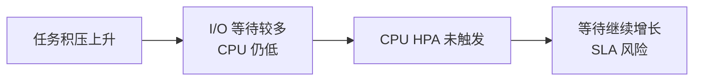
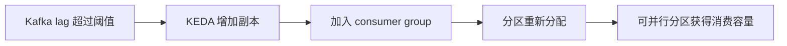
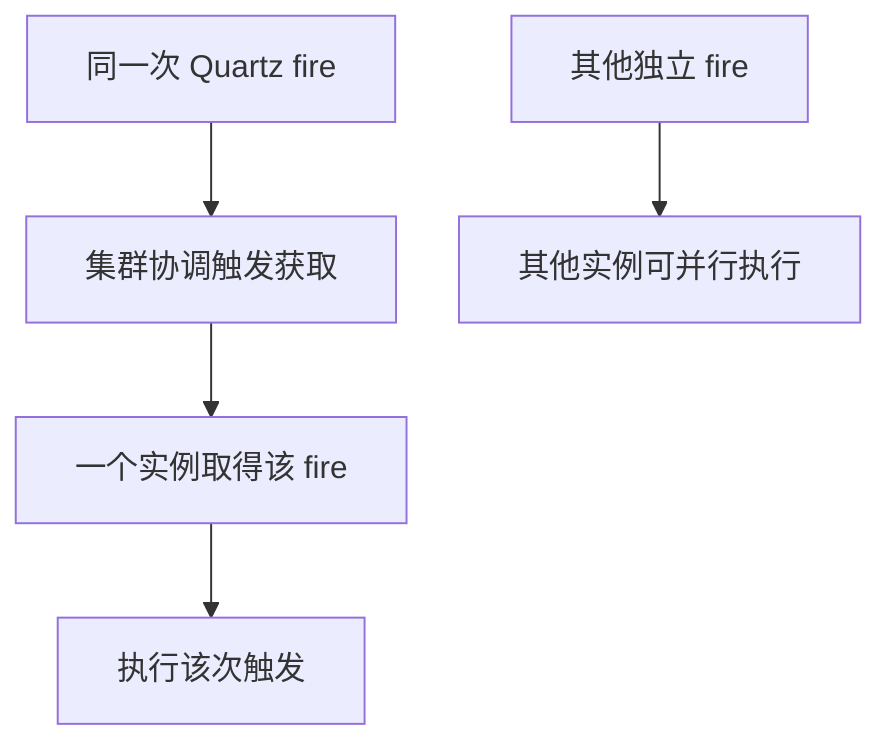
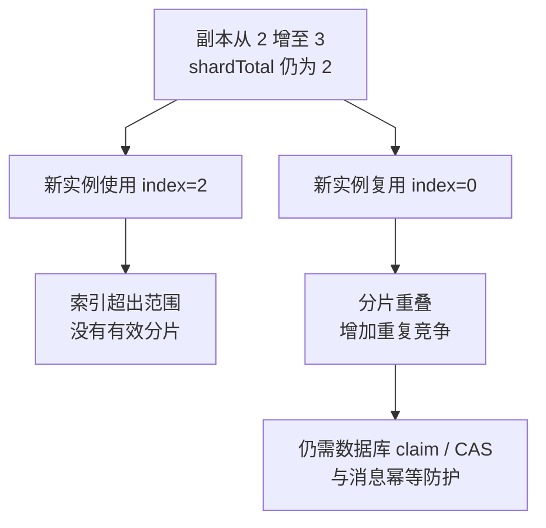
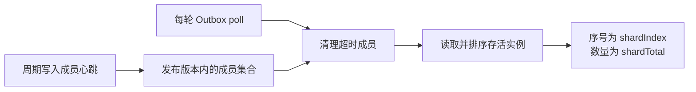

# 弹性伸缩策略

本文讲清楚各应用模块采用的扩缩机制、适用条件与运维边界。

## 一张总表

| 模块 | 扩缩机制 | 触发信号 | 默认 | 说明 |
|---|---|---|---|---|
| **console-api** | CPU HPA | CPU 使用率 > 70% | `enabled: false` | BFF 无状态，CPU 随流量线性涨；标准做法 |
| **worker-import** | **KEDA** by Kafka lag | consumer lag > 20 | `enabled: false` | KEDA 直接读消费滞后，比 CPU 准 |
| **worker-export** | **KEDA** by Kafka lag | consumer lag > 20 | `enabled: false` | 同上 |
| **worker-process** | **KEDA** by Kafka lag | consumer lag > 20 | `enabled: false` | SQL 加工任务,可能较长(staging publish)阈值同 import |
| **worker-dispatch** | **KEDA** by Kafka lag | consumer lag > 10 | `enabled: false` | 单 dispatch 较重，阈值更小 |
| **orchestrator** | **静态分片（默认）/ DYNAMIC + CPU HPA 或 KEDA Postgres backlog** | CPU % 或 Outbox 积压 | 2 副本 | 切到 `sharding.mode=dynamic` 才能安全自动扩，下文详述 |
| **trigger** | **静态 HA 2 副本** | — | 1 副本（生产改 2） | 基线以 HA 为主；容量结合触发延迟评估 |

扩缩策略应按负载与协调机制选择：Worker 优先观察消费积压，Console 观察服务负载；Orchestrator 先确认分片模式，Trigger 结合触发延迟与数据库协调成本评估。

## 为什么 Worker 优先观察 Kafka 积压

Worker 的 CPU 使用率不能独立代表消费积压；I/O 等待、下游限流或分区不均时，lag 可以持续增长而 CPU 仍低。只用 CPU HPA 可能出现：



**KEDA by Kafka lag** 直接读 consumer group 的未消费消息数：



这是**业务感知**的伸缩，不是机器指标的伸缩。

## Trigger 的扩容边界

Trigger 使用 **Quartz JDBC 集群模式**，通过数据库协调触发获取，保证同一次 fire 由一个实例取得；该次执行期间不意味着其他实例必须空转。



增加副本可提高可用性并分担不同 fire，但不会把同一次 fire 拆成多份执行。是否扩容应结合触发延迟、各实例线程池和数据库锁等待评估；CPU 不能单独代表调度容量。

当前基线以静态副本提供 HA；增加副本前先验证调度积压和数据库承载，再确定是否需要自动扩缩。副本数不能替代同次触发的幂等与并发控制。

## 为什么 orchestrator 默认静态分片

orchestrator 默认用 `BATCH_OUTBOX_SHARD_INDEX` 按租户哈希静态分片 Outbox：

```
shardTotal=2
  orch-0: 处理 hash(tenant_id) % 2 = 0 的 outbox 记录
  orch-1: 处理 hash(tenant_id) % 2 = 1 的 outbox 记录
```

自动扩容会撞上一致性问题：



因此 STATIC 模式只允许通过 `helm upgrade --set orchestrator.replicaCount=N` 扩缩。需要自动扩缩时，切换到下节已落地的 Redis 成员租约动态重排；模板会阻止 STATIC 与 HPA/KEDA 组合。

## Option B 已落地（Phase 1+2）：动态 shard 协调

**代码中已实现**（见 `batch-orchestrator/src/main/java/.../infrastructure/sharding/`），通过
开关切换，默认保持 STATIC 模式不影响现有部署。

### 新配置项

```yaml
batch:
  outbox:
    sharding-mode: static      # static（默认） | dynamic
    sharding:
      members-key: batch:orchestrator:members # Helm 默认按 namespace/release 隔离
      heartbeat-interval-ms: 5000
      member-ttl-ms: 30000
      member-id: ""            # 空则从 POD_NAME / hostname 自动解析
```

### 工作机制（dynamic 模式）



**rebalance 触发**：成员心跳超时或新 Pod 加入后，各实例在后续 poll 中读取并重算成员视图与 shardIndex；不是跨实例同时生效的强一致屏障。重排期间仍依赖数据库 claim、CAS 和消息幂等防护。

### 切换步骤（零宕机灰度）

1. 先 `helm upgrade --set orchestrator.replicaCount=2`（保留现状 2 副本）
2. 灰度开启：`--set orchestrator.sharding.mode=dynamic`
3. 观察 log 确认 "Outbox sharding mode=DYNAMIC"；从日志取得 `membersKey` 后用 `redis-cli ZRANGE <membersKey> 0 -1` 看是否 2 个成员
4. 如果正常，保留配置；有问题通过 `--set orchestrator.sharding.mode=static` 回退并执行滚动更新

### 切换后能带来的自动化

- 扩容：`kubectl scale sts batch-orchestrator --replicas=4` 后 30s 内新 Pod 心跳注册，所有 Pod 自动重算 shard
- 正常缩容：Pod 销毁回调主动从 Redis 注销，其他 Pod 下一轮轮询即重排
- 异常退出：成员无法主动注销时由 30s TTL 回收，随后其他 Pod 吸收该 shard 的数据
- **HPA 已接入 Helm 模板**（默认 `enabled: false`，开 dynamic 后打开即可）：
  - CPU HPA：`orchestrator.hpa.enabled=true`（min 2 / max 6 / CPU 70%）
  - KEDA Postgres backlog：`orchestrator.keda.enabled=true`，按 `outbox_event` 中 `NEW+FAILED` 行数触发，阈值默认 200。需先创建 Secret：

    ```bash
    kubectl -n batch-prod create secret generic batch-keda-postgres \
      --from-literal=connection='host=postgresql port=5432 user=batch_user password=<pwd> dbname=batch_business sslmode=disable'
    ```

  - 守护：模板里 `hpa` / `keda` 渲染都带 `sharding.mode=dynamic` 前置判断，static 下不会创建（避免扩容失败分片）

### 保留 STATIC 为默认的理由

- 生产线上已跑的部署是 STATIC 模式，切换 DYNAMIC 前仍需灰度观察成员租约和 Outbox backlog
- STATIC 行为确定性强，合规场景更好审计
- 已验证的业务规模下 STATIC 足够

待业务场景（多租户 SaaS / 峰谷 10x+）到来再把 DYNAMIC 作为默认推送。

## orchestrator 3 种可选设计对比

| 维度 | A. 静态分片（当前） | B. Consumer Group 风格 | C. 无分片 + 每事件分布式锁 |
|---|---|---|---|
| **简单性** | ⭐⭐⭐⭐⭐ | ⭐⭐⭐ | ⭐⭐⭐⭐⭐ |
| **弹性** | ⭐⭐ | ⭐⭐⭐⭐⭐ | ⭐⭐⭐⭐⭐ |
| **吞吐** | ⭐⭐⭐⭐⭐ | ⭐⭐⭐⭐ | ⭐⭐（每事件一次锁往返） |
| **代码复杂度** | 极低 | 中（需写协调者或复用 Kafka CG） | 低 |
| **运维复杂度** | 低（helm upgrade）| 中（需协调服务）| 低 |
| **适合场景** | 负载可预测、合规型 | 多租户 SaaS、突发负载 | 低 TPS、简单优先 |

### A. 静态分片（当前方案）
- 扩缩容走 helm upgrade，分钟级响应
- 心智模型简单，审计友好
- 代价：平时需要冗余副本避免峰值压垮服务

### B. Consumer Group 风格
Pod 启动时向中央协调者（etcd / Redis）注册：「我活着，分配一片给我」。协调者根据活跃 Pod 数动态 rebalance。
- 类似 Kafka consumer group 机制
- 可以直接开 HPA，扩 Pod 后自动分到新 shard
- 代价：要写协调者（或用 Apache ZooKeeper 等第三方），或让 Outbox 消费走 Kafka 再分派（架构变动大）

### C. 无分片 + 每事件分布式锁
每个 outbox 事件处理前用 ShedLock 抢一个短锁（per-event key）。谁抢到谁处理。
- Pod 数任意，无状态
- 代价：每事件 1 次 Redis/DB 锁往返；lock TTL + 网络抖动可能导致重复处理
- 适合 TPS 不高（<1000/s）场景

## 当前设计的合理性评估

| 指标 | 评分 | 说明 |
|---|---|---|
| **console-api CPU HPA** | 10/10 | 标准做法，无争议 |
| **workers KEDA by Kafka lag** | 10/10 | 批处理 worker 的最优解 |
| **trigger 静态 HA** | 10/10 | 静态 HA 是当前基线，扩容需结合调度容量评估 |
| **orchestrator 静态分片** | **7-8/10** | 合理但保守 |

### 合理的理由

1. **业务负载可预测**：金融/企业批处理都有计划（每日 N 次定时批），不像秒杀那种尖峰；预算性扩容够用
2. **规模匹配**：代码架构目标日百万~千万任务，2-4 个 orch Pod 处理上亿 Outbox 没问题，自动伸缩 ROI 低
3. **合规留痕**：`helm upgrade` 有变更记录，对审计友好；自动扩容的"时间点 / 谁拍板"说不清

### 什么时候该升级

若业务演进满足以下任一条件，orchestrator 应该从 A → B：

- **变成多租户 SaaS**：不同租户负载不确定，静态分片迟钝
- **白天/夜间负载差 10x+**：白天 1k TPS，凌晨批处理 50k TPS → 8 小时过供给 5 倍副本，浪费
- **客户能触发突发**：用户上传大文件瞬间写满 Outbox

## 应用层面配置速查

启用所有应开的 autoscaling（叠加配置）：

```bash
helm upgrade batch helm/batch-platform/ -n batch-prod \
  --values helm/values-prod.yaml \
  --values /secure/path/site-values.yaml \
  --values helm/batch-platform/examples/values-autoscale.yaml
```

该 example 打开：
- console-api: CPU HPA（min 2, max 6）
- worker-import: KEDA Kafka lag（lagThreshold 20, max 8）
- worker-export: KEDA Kafka lag（lagThreshold 20, max 8）
- worker-process: KEDA Kafka lag（lagThreshold 20, max 8）
- worker-dispatch: KEDA Kafka lag（lagThreshold 10, max 6）

orchestrator / trigger 保持 values.yaml 里的 `replicaCount`，不动。

## 前置基础设施

| 组件 | 用途 | 安装方式 |
|---|---|---|
| **metrics-server** | 提供 Pod CPU/内存给 HPA | `kubectl apply -f https://github.com/kubernetes-sigs/metrics-server/releases/latest/download/components.yaml`（Docker Desktop 自签证书需加 `--kubelet-insecure-tls`）|
| **KEDA operator** | 提供 ScaledObject CRD + Kafka Scaler | `helm install keda kedacore/keda --namespace keda --create-namespace` |

无 metrics-server → HPA `TARGETS: cpu: <unknown>`（不工作）
无 KEDA operator → ScaledObject 资源创建失败（CRD 不存在）

## 相关文档

- [基础依赖部署方案](base-services-deployment.md) — 云原生能力评估
- [orchestrator StatefulSet 迁移](orchestrator-statefulset-migration.md) — 首次从 Deployment 换到 StatefulSet 的步骤
- [滚动升级 worker](rolling-upgrade-workers.md) — worker 灰度流程
