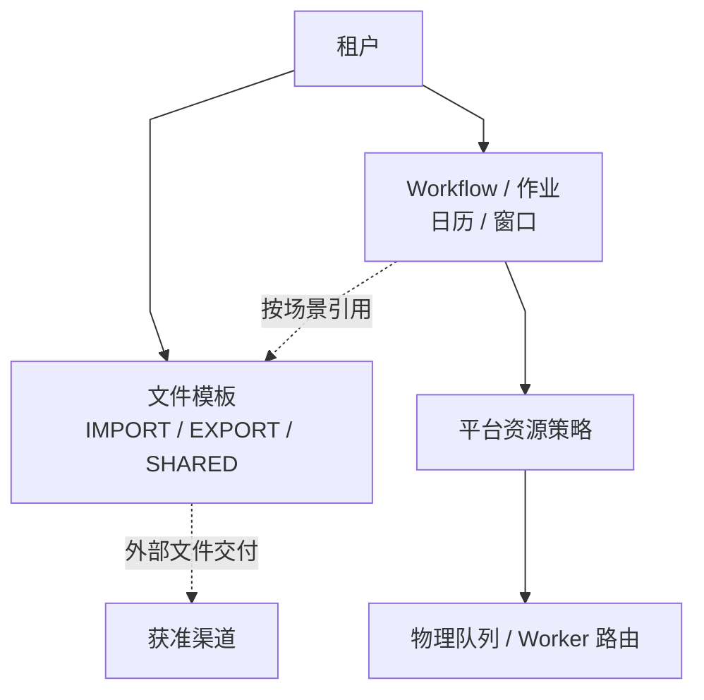

# 首个租户作业配置与运行自检

> 面向熟悉批量作业和运维流程的配置维护人员。本文聚焦首次配置、配置包校验和就绪问题定位；字段规则以 Console 当前生成的场景模板和预览结果为准。

---

## 0. 心智模型(先记这张图)



- **业务配置**:作业、文件模板、Pipeline/Workflow、日历和窗口按实际场景维护；按需生成单场景或组合配置包，不要求每个作业都维护无关 Sheet。
- **平台资源**:物理队列、容量、配额、Worker 分组和运行阈值由平台运维管理；租户配置包不能创建队列或指定物理路由。
- **渠道**:用于外部文件交付。业务配置只引用获准渠道；凭据和环境专属 endpoint 不应通过导出/跨租户复制传播。

租户负责描述业务意图和数据规则；平台负责资源供给与物理路由。就绪自检发现路由问题时，应由平台运维处理，而不是让租户绕过配置边界。

---

## 1. 建租户(顺手复制默认配置骨架)

`POST /api/console/tenants`,带 `initConfigFrom=default` 让系统**建租户 + 复制 default 模板租户的配置骨架 + 立刻做就绪自检**,一次返回:

```bash
curl -X POST /api/console/tenants \
  -H 'Authorization: Bearer <token>' -H 'Content-Type: application/json' \
  -d '{
    "tenantId": "acme",
    "tenantName": "ACME Corp",
    "adminUsername": "acme-admin",
    "adminPassword": "<首登后会提示改密>",
    "initConfigFrom": "default",
    "initMode": "SKIP_EXISTING"
  }'
```

返回里直接带 `readiness`(见下一步)。`initConfigFrom` 不填 = 不复制(空租户);`initMode` 默认 `SKIP_EXISTING`(不覆盖已存在配置)。

> 内置/新建账号首次登录会收到非阻断改密提醒(`must_change_password`),仍可继续使用控制台;改密接口为 `POST /api/console/auth/change-password`。

---

## 2. 看就绪自检:系统告诉你「还缺什么、去哪填」

`GET /api/console/tenants/acme/readiness`:

```jsonc
{
  "ready": false,
  "blocking": [
    {
      "item": "template",
      "reason": "template IMP-CUSTOMER-CSV missing field_mappings / query_param_schema",
      "ref": "IMP-CUSTOMER-CSV",
      "hint": "在配置模板 file_template_config sheet 填 field_mappings 和 query_param_schema,参考『五类Worker示例』",
      "docRef": "docs/runbook/first-tenant-config-quickstart.md#3-填模板核心"
    }
  ],
  "warnings": []
}
```

- `blocking` 非空 = **跑必失败**,挨个填掉。`hint`/`docRef` 告诉你**去哪填、抄哪份样例**。
- `warnings` = 可疑但能跑,可暂缓。
- 复制来的骨架模板 `field_mappings` / `query_param_schema` / `default_query_sql` 都是空的——这是**正常**,下一步就填它。

---

## 3. 填模板(核心)

下面两份是**可直接抄改**的真实样例(取自 e2e 金标准 fixture,字段名与 worker 实际解析一致)。把里面的表名/列名换成你的业务即可。

### 3a. CSV 导入 → 入库(最常见)

一个 IMPORT 模板要填三块:`field_mappings`(文件列→校验)、`validation_rule_set`(质量规则)、`query_param_schema.jdbcMappedImport`(**落哪张表、哪些列、冲突键**——全系统最关键的字段)。

```jsonc
// field_mappings:文件里有哪些列、各自类型/校验。注意 import 用 "targetColumn"。
[
  {"name":"customerNo",   "targetColumn":"customer_no",   "type":"STRING",  "required":true,  "maxLength":32},
  {"name":"customerName", "targetColumn":"customer_name", "type":"STRING",  "required":true,  "maxLength":128},
  {"name":"customerType", "targetColumn":"customer_type", "type":"STRING",  "required":true,  "allowedValues":["PERSONAL","CORPORATE"]},
  {"name":"creditLimit",  "targetColumn":"credit_limit",  "type":"DECIMAL", "required":true,  "minValue":0},
  {"name":"email",        "targetColumn":"email",         "type":"EMAIL",   "required":false, "maxLength":256},
  {"name":"status",       "targetColumn":"status",        "type":"STRING",  "required":true,  "allowedValues":["ACTIVE","INACTIVE","SUSPENDED"]},
  {"name":"openDate",     "targetColumn":"open_date",     "type":"DATE",    "required":true,  "format":"yyyy-MM-dd"}
]
```

```jsonc
// validation_rule_set:整体质量门槛。坏行率超阈值整批失败;重复键检测。
{"maxErrorRate":0.05, "stopOnFirstError":false,
 "duplicateKeyCheck":{"enabled":true, "keys":["customerNo"]}}
```

```jsonc
// query_param_schema:写入数据库映射。配合上面的 field_mappings,这里可极简。
{"jdbcMappedImport":{
  "schema":"biz", "table":"customer_account", "tenantColumn":"tenant_id",
  // ① columnMappings 可整段省略:留空时按 field_mappings 自动推断——
  //    to 取 field_mappings.targetColumn;没写 targetColumn 时对 name 做大小写/下划线归一
  //    (customerNo→customer_no)。只有"文件列名和表列名真不一样"才写差异项,例如文件叫
  //    phone、表列叫 mobile_no 时写:  "columnMappings":[{"from":"phone","to":"mobile_no"}]
  //    想"校验但不入库"的列,在 field_mappings 给它加 "persist":false。
  // ② conflictColumns:ON CONFLICT 幂等键(重跑不重复)。漏写 tenant_id 会被系统自动补到最前。
  "conflictColumns":["customer_no"],
  // ③ standardAuditBindings:true → 一键写入标准审计列(source_file_name / source_batch_no /
  //    source_trace_id / created_by / updated_by),免逐条手写 systemBindings;
  //    要自定义就写 systemBindings(显式项覆盖标准默认)。
  "standardAuditBindings": true
}}
```

> 字段速查:`schema/table`=落哪张业务表;`tenantColumn`=租户隔离列(几乎都是 `tenant_id`);`columnMappings`=**可省**(从 field_mappings 推断,只写差异列);`conflictColumns`=幂等键(自动补 tenant_id);`standardAuditBindings:true`=一键审计列。
>
> 注:上传配置包时**预览期**会校验 `jdbcMappedImport` 必含 `table`/`tenantColumn`、`field_mappings` 每项必含 `name`、CRON 作业必含合法 `schedule_expr`、DELIMITED 模板必含 `delimiter`、导出 SQL 禁 `SELECT *`——异常配置不会留到运行期才失败。

### 3b. 导出 → 文件(CSV / Excel)

一个 EXPORT 模板填两块:`default_query_sql`(取数 SQL,**用 `:tenantId` 命名参数**)、`field_mappings`(**注意 export 用 "sourceColumn" + "header"**,和 import 不同)。

```sql
-- default_query_sql::tenantId / :status 是命名参数(运行时绑定);别和文件命名的 ${bizDate} 混淆。
SELECT customer_no, customer_name, customer_type, credit_limit, currency_code, email, status, open_date
FROM biz.customer_account
WHERE tenant_id = :tenantId AND (:status IS NULL OR status = :status)
```

```jsonc
// field_mappings(export):sourceColumn=SQL 结果列;header=输出表头;DECIMAL/DATE 可给 format。
[
  {"name":"customerNo",   "sourceColumn":"customer_no",   "type":"STRING",  "header":"客户号"},
  {"name":"customerName", "sourceColumn":"customer_name", "type":"STRING",  "header":"客户名"},
  {"name":"creditLimit",  "sourceColumn":"credit_limit",  "type":"DECIMAL", "header":"授信额度", "format":"#,##0.00"},
  {"name":"openDate",     "sourceColumn":"open_date",     "type":"DATE",    "header":"开户日期", "format":"yyyy-MM-dd"}
]
```

```jsonc
// query_param_schema(export):声明 SQL 命名参数。
{"type":"object","properties":{
  "tenantId":{"type":"string","required":true},
  "status":{"type":"string","required":false}}}
```

- 导出 **Excel**:把模板 `file_format_type` 设 `EXCEL`。新增可选项:`field_mappings[*].type=NUMBER/DATE`(让数字/日期在 Excel 里是真类型可求和/筛选)、`rows_per_sheet`(超大结果集自动拆 sheet)、`header_style`(表头加粗/列宽/冻结)。不填 = 全文本单 sheet(向后兼容)。

> **import vs export 的 field_mappings 是两套结构**:import 用 `targetColumn`(文件→表列),export 用 `sourceColumn`+`header`(SQL 列→表头)。别抄错。

---

## 4. 按场景维护配置包

在 Console 配置包向导选择需要维护的场景，然后下载场景化空白模板。也可调用：

```text
GET /api/console/config/tenant-package/excel/scenario-template?scenarios=IMPORT&scenarios=EXPORT
```

场景模板只包含所选场景需要的 Sheet/列和填写指引，不包含平台资源分配字段。文件场景可进一步选择方向与格式；高级字段仍可按场景提供，不因模板精简而删除底层能力。完整导出是权限投影后的全量维护包，不等于快速模板，也不能用作不经预览的覆盖恢复。

导入流程为：

1. `POST /api/console/config/tenant-package/excel/upload`，以 multipart 字段 `file` 上传工作簿；需要代租户操作的全局角色应传 `tenantId`。
2. `GET /api/console/config/tenant-package/excel/preview/{uploadToken}` 检查字段、跨 Sheet 引用、权限和变更统计；错误行可通过 `POST .../preview/{uploadToken}/patch` 修正后重新预览，也可下载带批注工作簿。
3. 确认预览和影响范围后，带幂等键调用 `POST /api/console/config/tenant-package/excel/apply/{uploadToken}`。Apply 是单事务 MERGE；包中缺少的行/Sheet 不表示删除。若预览后配置已变化，服务端返回冲突，必须刷新预览并重新确认。

租户管理员提交的配置包若包含资源队列、物理 `queue_code` / `worker_group` 或平台运行阈值，会被整包拒绝；不要通过编辑 Excel 绕过限制。队列或路由异常请在就绪自检中复制作业编码和提示，交由平台运维核对。

---

## 5. 跑起来

- **再查一次就绪**:`GET /api/console/tenants/acme/readiness`,`ready:true` 即可跑。
- **触发导入**:把文件放进对象存储的 **`ingress/<tenantId>/` 前缀**(如 `ingress/acme/customer-20260601.csv`),启用扫描器并满足稳定性/完成标记条件后，扫描器只登记 `file_record`；还需配置匹配的 Workflow 触发或到达入口，由 Trigger/Orchestrator 调度 IMPORT Job。其固定阶段为 RECEIVE→PREPROCESS→PARSE→VALIDATE→LOAD→FEEDBACK。
- **触发导出 / Job**:经触发器 / 调度跑(详见 `docs/runbook/` 触发相关 + `system-flow-overview.md`)。

---

## 6. 填错了 / 卡住了怎么办

| 症状 | 系统给你的反馈 | 去哪看 |
|---|---|---|
| 漏填关键字段 | `readiness.blocking[].hint/docRef` 直接说"去哪填、抄哪份" | §2 |
| Excel 配置包填错 | upload→`preview` 一次性列出所有字段/SQL/引用错 | §4 |
| 导入有坏行 | `file_error_record` 写入数据库**带 Excel 物理行号 + 出错列**,能回原表定位 | 坏行治理 |
| 导入整列变 null | 多半是**表头名拼错**——现在 LOAD 前会校验表头存在性,fail-fast 报缺哪列 | §3a |
| 不确定某字段含义/格式 | 场景模板的字段说明、下拉选项和预览错误是当前契约；平台字段以权限提示为准 | §4 |

---

## 7. 下一步(进阶)

- 投递渠道(SFTP/API dispatch)、`config_json` 凭据:见 9+2 配置包设计 + `docs/runbook/biz-tenant-routing.md`(凭据隔离)。
- **各类凭据怎么存/怎么注入/谁负责**:见 [`credential-matrix.md`](./credential-matrix.md)(凭据矩阵:片级账密 / 渠道凭据 / 密码 / 内部密钥 / KMS / DB 连接一表打尽,标注 prod 强校验与上线必配项)。
- 队列 / 时间窗 / 日历调度、加密下载审批:见 `docs/design/` 数据模型 + 各 ADR。
- 完整可跑样例集:`batch-e2e-tests/src/test/resources/db/testdata/import-template-config-seed.sql` / `export-template-config-seed.sql`(全格式金标准)。
