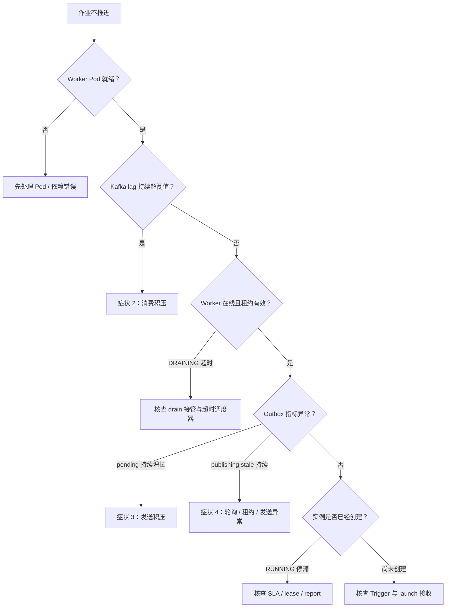
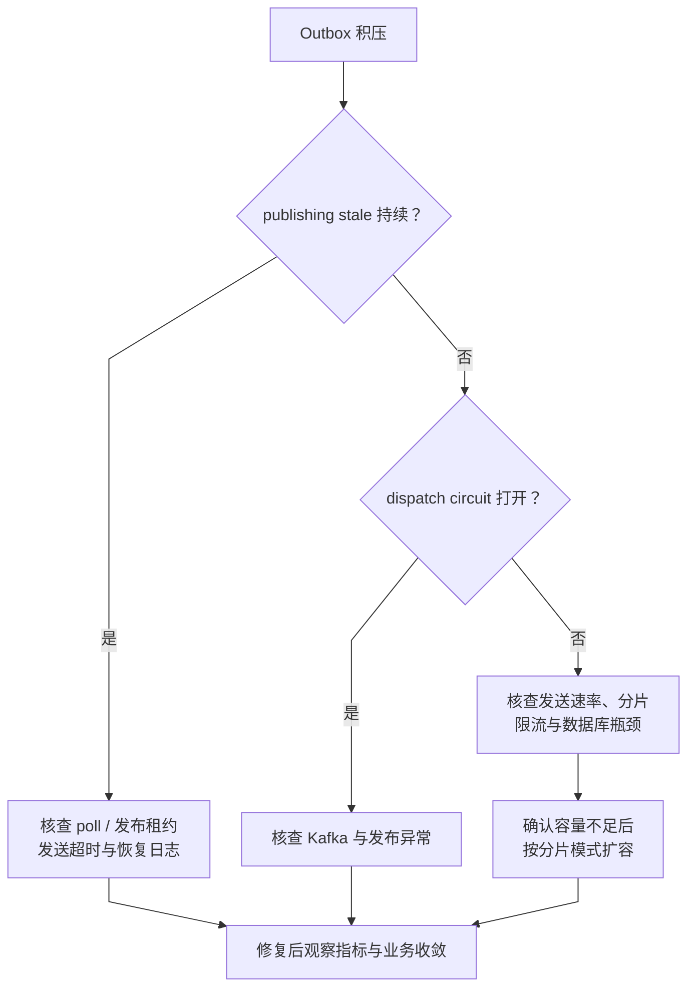
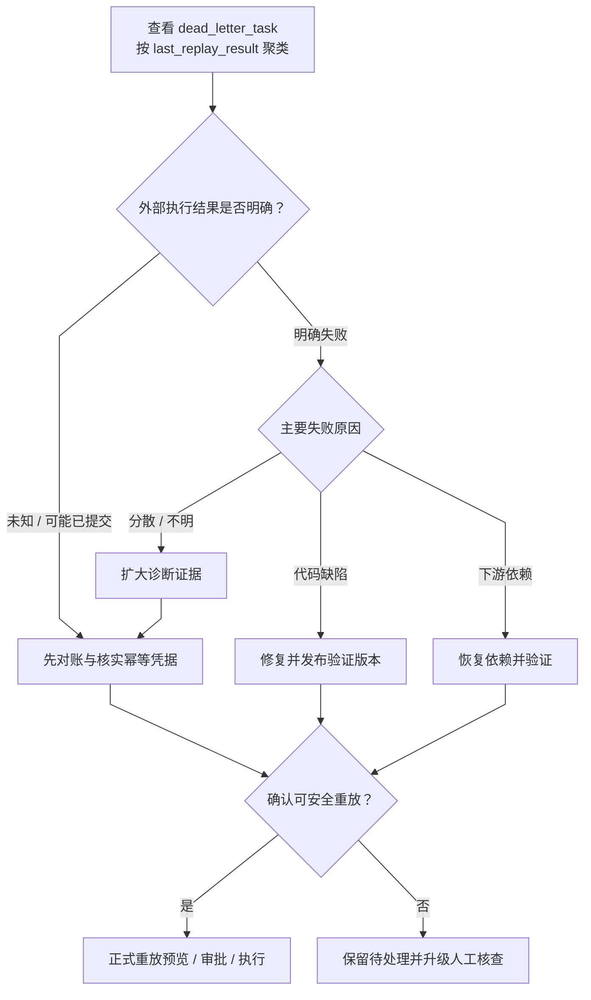
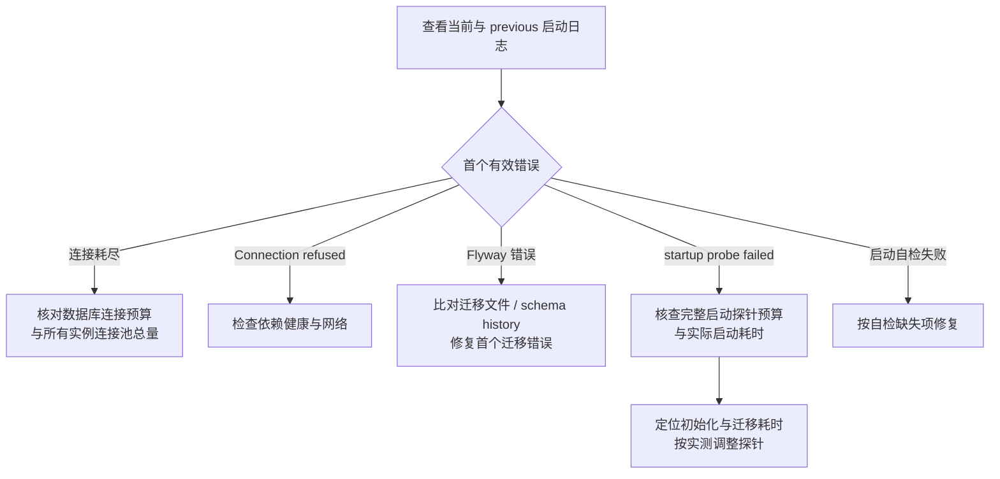

# 故障决策树 Runbook

> 症状 → 根因 → 动作。按"先看哪里、看到什么、做什么"组织。
> 配合 `docs/runbook/incident-response.md`（分级 + SLA）和 `make ops-inspect` 使用。

## 入口：先跑这两条命令

```bash
make ops-inspect                                        # 全量诊断（DB+Kafka+Worker+Outbox）
curl -s localhost:9090/api/v1/alerts | jq .data.alerts  # Prometheus 当前告警
```

输出对照下方症状定位。

---

## 症状 1：任务不执行 / worker 空转

### 现象
- 控制台看到任务"已派发"但 worker 不动
- 或任务停在 RUNNING 不推进

### 决策树



### 动作
- drain 超时 → `bash scripts/ops/heal-drain-timeout.sh`
- Outbox 堆积 → 见症状 3
- PUBLISHING 长期停滞 → 见症状 4
- SLA 违规 → 看告警原因，多数是 worker 吞吐不足或任务卡在某步；查 `job_execution_log`

---

## 症状 2：Kafka 消费堆积（`BatchKafkaConsumerLagHigh`）

### 根因可能性（从高到低）
1. Worker 实例数不够（扩容 / KEDA 未启用）
2. 消费处理慢（业务代码某步卡住，比如 SFTP / API 下游响应）
3. 某条毒丸消息让 consumer 反复 rebalance

### 动作

```bash
# 1. 看 worker 健康 + 实例数
kubectl get pods -n batch-prod -l app.kubernetes.io/component=worker-import
kubectl top pod -n batch-prod            # CPU / 内存是否打满

# 2. 看具体堆积 topic
kubectl exec -it batch-kafka-0 -- kafka-consumer-groups.sh \
  --bootstrap-server localhost:9092 --all-groups --describe

# 3. 如果 LAG 集中在某 partition，可能是单条毒丸 —
kubectl logs <worker-pod> --since=5m | grep -i 'failed\|exception' | head -20
# 如果有 poison message，查该 eventKey → 走症状 5（DLQ 排查）

# 4. 立即扩容（临时）
helm upgrade batch helm/batch-platform/ -n batch-prod \
  --values helm/batch-platform/examples/values-autoscale.yaml  # 打开 KEDA
# 或
kubectl scale deployment/batch-worker-import -n batch-prod --replicas=4
```

---

## 症状 3：Outbox 堆积（`BatchOutboxBacklogHigh` / `Critical`）

### 决策树



### 应急回退

```bash
# 只读检查 stale PUBLISHING 候选；脚本不会更新 outbox_event
bash scripts/ops/heal-stuck-outbox.sh --dry-run
# stale PUBLISHING 由 OutboxPollScheduler 回收；检查调度器和 provider 后按下方症状 4 处理。
# FAILED/GIVE_UP 重投使用 Orchestrator 的 /internal/outbox/republish 审计接口。
```

---

## 症状 4：PUBLISHING 长期停滞（`BatchOutboxStalePublishingStuck`）

### 根因
持续 stale PUBLISHING 可能来自轮询未运行、租约/回收异常、发送超时或反复失败。该指标不能单独证明调度器已停止；结合 poll 日志、租约状态与恢复记录判断。

### 排查

```bash
# 1. 看 OutboxPoll 启动日志（应有 "OutboxPollScheduler 已启动（自适应模式）"）
kubectl logs batch-orchestrator-0 | grep -i 'OutboxPoll'

# 2. JDBC provider 下只读查看 ShedLock 状态
kubectl exec -it batch-postgres-0 -- psql -U batch_user -d batch_platform -c \
  "SELECT name, lock_until, locked_at, locked_by FROM batch.shedlock \
   WHERE name LIKE 'outbox_poll%' ORDER BY lock_until DESC"
# 已过期的 lock_until 可由下一次 acquire 接管；这不证明有残留锁。

# 3. 如果 lazy-init 相关（罕见）→ 看 spring.main.lazy-initialization
kubectl exec batch-orchestrator-0 -- printenv | grep -i lazy
```

### 动作

不要手工删除 ShedLock 锁记录或 Redis key；过期租约由 provider 回收，强删可能导致重复调度。只有核实进程故障、确认目标集群上下文并经过变更审批后，才受控重启 orchestrator。

---

## 症状 5：DLQ 堆积（`BatchDeadLetterBacklogHigh`）

### 原则
**不自动重放**——先查根因。批量 heal 会把同一个 bug 触发 N 次。

### 决策树



样本查询保持只读：

```sql
SELECT * FROM batch.dead_letter_task
 WHERE replay_status IN ('NEW', 'FAILED')
 ORDER BY created_at DESC LIMIT 20;
```

### 手动重放

先在 Console 的死信列表核对来源任务、错误原因和外部副作用状态，再提交 `DLQ_REPLAY` 审批申请，由独立管理员批准后执行。若任务为 `EXTERNAL_OUTCOME_UNKNOWN`，必须确认外部动作未执行并提交证据引用；批准后只允许一次性恢复。已执行或仍无法确认时保持阻塞。

运维脚本只读列出候选项：

```bash
bash scripts/ops/inspect-dead-letters.sh --tenant t1 --dry-run
```

---

## 症状 6：Pod 启动就失败（CrashLoopBackOff）

### 决策树



---

## 症状 7：分片不均衡（DYNAMIC 模式）

### 现象
kubectl scale 扩容后，新 Pod 没分到活。

### 排查

```bash
# 1. 看 Redis 成员注册
redis-cli -h batch-redis -p 6379 ZRANGE batch:orchestrator:members 0 -1 WITHSCORES
# 预期：活跃 Pod 数 = StatefulSet replicas

# 2. 看某 Pod 当前分到的 shard
kubectl logs batch-orchestrator-2 --since=2m | grep 'shard='
# 正常格式："shard=2/3"

# 3. 看启动模式是否 DYNAMIC
kubectl exec batch-orchestrator-0 -- printenv | grep SHARDING
# 必须 BATCH_OUTBOX_SHARDING_MODE=dynamic
```

### 动作

- Redis ZSET 少成员 → 该 Pod 心跳没发出去 → 看 Pod 日志 Redis 连接状态
- SHARDING_MODE=static → 扩容前要先切 dynamic（`helm upgrade --set orchestrator.sharding.mode=dynamic`）
- 模式对但 shard 不重算 → 等 heartbeat TTL（30s）过期后其他 Pod 下一轮 poll 会自动重算

---

## 症状 8：分布式锁冲突 / 定时任务不执行

### 排查

```sql
-- 活跃锁清单
SELECT name, lock_until, locked_at, locked_by,
       EXTRACT(EPOCH FROM (lock_until - locked_at)) AS hold_seconds
  FROM batch.shedlock
 WHERE lock_until > timezone('utc', NOW())
 ORDER BY lock_until - locked_at DESC
 LIMIT 20;

-- 对照 lockAtMostFor 与时钟状态；本查询只能用于观察 JDBC provider，不足以证明持锁进程已失效。
-- Redis provider 下 batch.shedlock 表不代表 Redis 锁状态。
```

### 动作

不要手工删除锁行或 Redis 锁 key。租约到期后由 ShedLock 自然回收；先核实 provider 和持锁实例。

---

## 附录：常用 Prometheus 查询

```text
# Outbox 积压
batch_outbox_pending_events
# PUBLISHING 长期停滞
batch_outbox_publishing_stale_events
# DLQ 积压
batch_dead_letter_tasks_pending
# 熔断器
batch_dispatch_circuits_open
# SLA 违规
batch_job_sla_violation_count
# Kafka 消费 lag
kafka_consumergroup_lag{consumergroup=~"batch-worker-.*"}
# 各模块 CPU / 内存
rate(process_cpu_seconds_total{job=~"batch-.*"}[1m])
jvm_memory_used_bytes{area="heap"} / jvm_memory_max_bytes{area="heap"}
```

## 附录：运维脚本速查

| 脚本 | 用途 | 何时用 |
|---|---|---|
| `scripts/ops/inspect-all.sh` | 全量诊断 | 告警响起第一时间跑 |
| `scripts/ops/heal-stuck-outbox.sh` | 只读统计 stale `PUBLISHING` Outbox | 核对调度器与 Kafka；不直接修改 Outbox |
| `scripts/ops/heal-drain-timeout.sh` | 强制下线排水超时 Worker | WorkerDrainTimeoutScheduler 没跑时 |
| `scripts/ops/inspect-dead-letters.sh` | 只读检查 DLQ 候选项 | 人工重放经 Console 审批；UNKNOWN 仅核实未执行后一次性恢复 |
| `scripts/ops/heal-retry-tasks.sh` | 批量重放 FAILED 任务 | 确认非代码 bug |
| `scripts/ops/heal-retry-partitions.sh` | 重试 FAILED 分区 | 分区集中失败 |
| `scripts/ops/trigger-compensation.sh` | 手工补偿命令 | 定向修复单条任务 |

## 禁止清单

以下操作**永远不要**自动化：
- DLQ 自动重放（会掩盖真实 bug 并放大故障）
- Outbox 堆积时自动重建 consumer（可能双消费）
- 自动 `DELETE FROM shedlock`（可能删掉正在运行中的锁）
- 自动 `force-offline` worker（会丢失 in-flight 任务）

所有恢复动作必须人工 review 根因后再执行。
