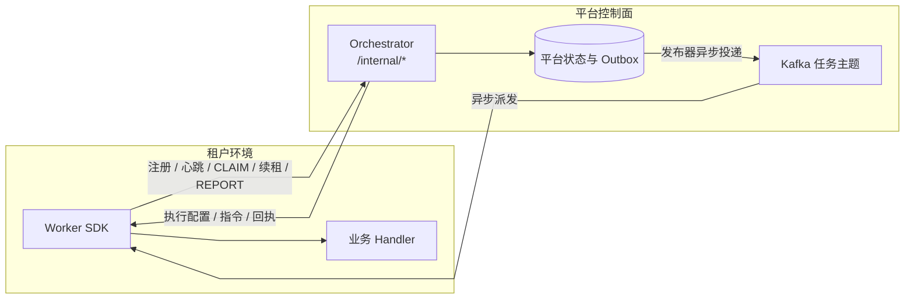

# SDK ↔ Orchestrator 通讯协议 / 故障感知

> **协议契约权威源(双轨)**:本文与 [`docs/api/orchestrator-internal.openapi.yaml`](../api/orchestrator-internal.openapi.yaml) 是 wire 层协议的两份权威源 ——
> 本文给**读者视图**(故障感知矩阵 + 时序约束 + 错误码语义 + 重试退避规则),yaml 给**机器视图**(端点 / schema / response code)。
> Java SDK、仓库内其它四语言 SDK 及外部 BYO(Bring-Your-Own)SDK必须基于这两份生成 / 校验实现。BYO 接入指南见
> [`docs/sdk/byo-sdk-guide.md`](byo-sdk-guide.md);language-agnostic 契约 fixtures 见 [`docs/api/sdk-contract-fixtures/`](../api/sdk-contract-fixtures)。

> 配套 [`docs/sdk/quickstart.md`](quickstart.md) 与 [`docs/sdk/troubleshooting.md`](troubleshooting.md)。本文是「运行期视图」:把 ADR-035 的协议节、配置节、生命周期节合成一张全景图,让租户接入或调参时不需翻多处。

## 1. 双通道分工



SDK 在 CLAIM 成功并确认当前执行入口后调用业务，REPORT 由 Orchestrator 收敛平台状态；租户 SDK 不直连平台数据库。

| 通道 | 方向 | 谁主动 | 频次 | SDK 实现 | Orch 实现 |
|---|---|---|---|---|---|
| `POST /internal/workers/register` | SDK → orch | SDK start 一次 | 1 | `PlatformHttpClient.register()` | `WorkerController:35` |
| `POST /internal/workers/{code}/heartbeat` | SDK → orch | `HeartbeatScheduler` | 30s 默认 | `HeartbeatScheduler.tick()` | `WorkerController:42-45` |
| `POST /internal/workers/{code}/deactivate` | SDK → orch | SDK `stop()` | 1 | `BatchPlatformClient.stop()` 收尾 | `WorkerController.deactivate()` |
| `POST /internal/tasks/{id}/claim` | SDK → orch | 收 Kafka 消息后 | 每 task 1 | `TaskDispatcher.claim()` | `TaskController.claim()` |
| `POST /internal/tasks/{id}/report` | SDK → orch | task 终态时 | 每 task 1 | `TaskDispatcher.report()` | `TaskController.report()` |
| `POST /internal/tasks/{id}/renew` | SDK → orch | 业务入口确认及周期续租 | 入口一次，周期默认 60s | 各语言派发器/执行桥与 `LeaseRenewalScheduler` | `TaskController.renew()` |
| Kafka `batch.task.dispatch.<taskType>[.<route>][.node.<workerId>]` | orch → SDK | orch 投递 → SDK poll | 持续 | `KafkaTaskConsumer.poll()` | producer in `*OrchestratorService` |

注册体中的可选 `maxConcurrent` 是 Worker 本地执行器的物理并发上限。五语言 SDK 的默认
注册路径都会从 `maxConcurrentTasks` 上报该值，平台据此初始化或重注册校准
`worker_registry.max_concurrent`；旧 SDK 未携带时继续使用平台默认值。周期心跳不更新该字段，
避免覆盖平台通过 heartbeat directive 临时下调的运行容量。

**为什么 HTTP + Kafka 不合并?** ADR-035 §3:
- HTTP 同步天然适合 register / claim / report 这类「需要返回值」的控制流(orch 给 SDK effective config、cancel flag)
- Kafka 异步天然适合 dispatch:orch 不关心 SDK 何时拿到,Kafka 保留 + at-least-once + tenant 隔离 + 横向扩展
- 反向 push 故意没做:避免每个租户 SDK 暴露入向端口,降低边界面积

### 路由与执行配置

上述方括号表示可选后缀，不是可直接使用的订阅正则。`BatchTopicResolver` 先按 taskType 选择 base，再按部署模式追加租户或优先级；`KafkaOutboxPublisher` 在定向派单时追加 `.node.<selectedWorkerId>`，命名空间由部署配置统一提供。SDK 必须配置与发布端一致的正则与 ACL，不能使用租户在 taskType 之前的旧示例。

CLAIM 返回完整 `EffectiveTaskConfig`：身份/任务载荷取自持久化任务，执行模式、重试、超时来自实例冻结快照，分区计划包含 shard/range/expectedRows，数据区间沿根运行继承。`dependencyResultSnapshot` 是闸门证据，业务消费者须显式固定/校验读取版本。

批量 claim/report 保留逐项身份与结果；服务端上报逐项独立事务，不能把 HTTP 200 当整批业务成功。平台 Worker 当前只合并 CLAIM，执行和上报仍逐任务进行；五语言 SDK 的实际支持以支持矩阵为准。批量优化与 Workflow 多选运行、BUNDLE manifest 分区分别属于不同层次，详见 [ADR-046](../architecture/adr/ADR-046-file-bundle-aggregation.md)。

### Kafka 消费确认与背压

可提交的任务消息必须先取得持久化 CLAIM 归属或明确的幂等/终结处置。仅创建后台协程、加入本地队列,
不能确认消费。认领失败且请求未落库时不存在可供超时恢复的租约, 必须保留原 offset 的重读入口。
Python 消息入口等待 CLAIM 屏障后返回, 业务处理仍异步; 并发重复消息共享认领结果。

容量背压必须保留已经取出的消息, 不能仅 Pause 后继续拉取并提交后续 offset。Go Worker 在当前记录处
等待既有低水位条件, 恢复后优先处理该记录; 停机退出等待并保留未提交状态。

### 实际执行入口计时

Job 的 `started_at` 保留派发时间；`execution_started_at` 由执行入口确认首次写入。SDK 在执行线程或业务协程即将调用处理器时，向原 `POST /internal/tasks/{id}/renew` 提交当前租户、Worker、CLAIM 返回的当前 `partitionInvocationId`，并携带 `details: {"executionStarted": true}`。认领成功、消息入队或等待执行名额均不能提前提交该标记。无当前响应身份时，仅按该 SDK 已支持的非分区任务兼容规则处理，不能用旧消息身份覆盖 CLAIM 当前身份。

服务端先确认租约及当前所有者，再记录首次入口。开始确认被拒绝、传输失败或响应未知时，SDK 不调用业务处理器，也不将其转换为业务失败 REPORT；原租约恢复机制继续负责收敛。明确返回取消指令时不进入业务，并通过既有取消结果路径收敛任务。续租的 HTTP 409 表示租约失效，不能套用 CLAIM 的幂等成功语义。

计时信号与 `non-idempotent-started` 的外部副作用证据独立：安全 GET、带业务幂等键的处理和普通业务同样需要执行计时，但不能因此被标为非幂等动作。Java、Go、Python、TypeScript 的默认派发器已接入；Rust 自定义执行桥应在 CLAIM 载荷应用到 `TaskContext` 后使用 `execute_after_start_confirmation`，并分别处理执行结果、取消结果和控制面错误，见 [Rust 接入说明](../../sdk/rust/README.md)。这项改造不意味着通用 Replay 能力已经开放。

### Replay 的附加能力合同

平台注册 DTO 接受可选 `replayCapabilities`，CLAIM 可返回 `replayExecutionGuard`。声明含 pluginId/version、外部副作用类别、幂等能力/键域、恢复协议与合同版本。执行前须核对批准声明与实际插件；未知、NONE 或不匹配不能授权安全重放。非幂等执行器在副作用前调用开始标记入口，外部结果未知时先对账。

这些是平台新增合同，不代表仓库内五语言 SDK 均已实现。当前 SDK 源码未消费上述 Replay 字段，基础 30 份 conformance fixture 也未覆盖它们；通用 SDK 路径应保持未知能力失败关闭。支持矩阵与补充验证见 [sdk-parity-matrix.md](sdk-parity-matrix.md)。

## 2. 控制反向回流(orch → SDK)

### 心跳进度契约

行级进度仅使用 `pipelineProgress` 列表，每项包含 `taskId`、`pipelineInstanceId`、
`stageCode`、`rowsProcessed` 和可选 `totalRowsHint`。未提供或空列表表示本轮没有活跃的
stage 进度，并清理该 worker 上一轮的快照；它不改变持久化 checkpoint。

2026-10-04 移除心跳顶层 `rowsProcessed` / `totalRowsHint`、DTO 旧构造器以及
按 `workerCodes` 查询进度的旧入口。Java/Python SDK 同步移除标量载荷，不保留兼容回退。
未发布的系统无需维持这条无法隔离并发任务的旧契约；已有本地调用代码需同步更新。
正式查询为 `/internal/pipeline-progress/by-pipeline` 和
`/api/console/queries/pipeline-progress?pipelineInstanceId=...`。
SDK 通用任务进度回调不属于这一心跳协议，本次不删除。

Orch 不主动 push 任何指令。所有"平台→worker"信号搭便车在两个响应体里:

### 2.1 心跳响应 `WorkerHeartbeatResponse`

```java
{
  "platformStatus": "NORMAL" | "DEGRADED" | "PAUSED" | "DRAINING",
  "shouldDrain": true,                     // 平台要求 worker 进 DRAINING
  "desiredMaxConcurrent": 4,               // 平台动态压并发(可比 SDK 配的小)
  "pausedTaskTypes": ["http", "shell"],    // 临时屏蔽某些 type
  "nextHeartbeatHint": "PT15S"             // 平台建议的心跳间隔;Java SDK 会重排下一次心跳
}
```

SDK 收到后 `TaskDispatcher.applyPlatformDirective()`:
- `PAUSED` / `DRAINING` → `KafkaTaskConsumer` pause assignment,新 task 不再投
- `pausedTaskTypes` 命中 → `onMessage()` 直接 drop(返 Kafka offset 不 commit,后续平台撤销后还能 redeliver)
- `desiredMaxConcurrent` 当场调整(原子)

### 2.2 lease 续约响应

```java
{
  "cancelRequested": true     // 平台要求取消该 task
}
```

`cancelRequested=true` → SDK 调 `dispatcher.markCancelRequested(taskId)` → handler 通过 `CancellationSignal.isCancellationRequested()` 检测。

> **关键延迟**:cancel 信号最大延迟 = `leaseRenewInterval`(默认 60s)。**没有更快的反向 push channel**,这是 ADR-035 §11 的设计权衡。

## 3. 故障感知矩阵(谁感知 / 多久感知 / 反应)

| 故障类型 | 谁感知 | 时延上界 | 反应 |
|---|---|---|---|
| **HTTP 401/403**(凭据失效) | SDK | 立刻 | `TaskDispatcher` 置 `fatal`,后续 `onMessage` 拒收,等 K8s liveness 重启 |
| **HTTP 5xx / 网络抖动** | SDK | 立刻 | 指数退避(200ms 基,默认 3 次)→ 仍失败 log + drop;下次 tick 再来 |
| **HTTP 409**(idempotent 冲突) | SDK | 立刻 | log INFO 视为成功,不重试 |
| **持续 4xx 活锁** | SDK | `clientErrorFailFastThreshold` 次后 | 累计 5 次(默认)4xx 后 fail-fast |
| **worker 心跳停更**(JVM 卡 / 网络隔离 / 容器迁移) | orch | `timeoutSeconds(90) + graceSeconds(30) = 120s` | `WorkerHeartbeatTimeoutScheduler` 每 30s 扫,`ONLINE → OFFLINE`,`DefaultWorkerSelector` 不再选中 |
| **僵尸 worker 抓任务**(被选中后 OFFLINE) | orch | partition rebalance 触发 | partition 自动释放 → 其他 ONLINE worker 接 |
| **单 task lease 失效**(orch 已回收) | SDK | `leaseRenewInterval`(60s) | `renew` 收 404 / 410 → 翻转本地取消信号，要求 handler 停止以避免旧租约继续执行 |
| **Kafka in-flight 满**(SDK 处理跟不上) | SDK | 下一次 poll | `KafkaTaskConsumer.applyBackpressure()` pause assignment,Kafka 不再投,直到 in-flight 降回 |
| **Kafka SASL 凭据错** | SDK | 第一次 poll | Java SDK 将认证异常转为 fatal 并以非零退出；其他 SDK 按各自客户端的认证异常策略实现 fail-fast |
| **平台主动取消任务** | SDK | `leaseRenewInterval`(60s) | `cancelRequested` 经 renew 响应回来,handler 通过 `CancellationSignal` 检测 |
| **SDK 优雅停止** | orch | `deactivate` 调用立刻 + 心跳停更回退 | DB `status → DRAINING → OFFLINE` |
| **SDK 进程崩(SIGKILL)** | orch | 心跳停更 120s | `OFFLINE` + Kafka partition rebalance |

## 4. 典型调用顺序(完整生命周期)

```
启动:
  SDK ──register──► orch  落 worker_registry, status=ONLINE
  SDK ──Kafka.subscribe──► broker  (wildcard `batch.task.dispatch.<taskType>[.<route>][.node.<workerId>]`)
  SDK 启 HeartbeatScheduler  (30s 周期, fixedDelay)
  SDK 启 LeaseRenewalScheduler  (60s 周期, fixedRate)

每个任务:
  orch ──Kafka dispatch──► SDK
  SDK 收到 → claim ──HTTP POST /internal/tasks/{id}/claim──► orch
                              ◄── EffectiveTaskConfig (含可选 dependencyResultSnapshot)
  SDK handler.execute(ctx)    (ctx 持有 CancellationSignal + ProgressReporter + 依赖闸门观察到的版本引用)
  SDK ──report──► orch        SUCCESS / FAILED / TERMINATED 终态

心跳(每 30s):
  SDK ──POST /heartbeat──► orch
       ◄── WorkerHeartbeatResponse(directive 5 字段)
       SDK 应用 directive: 改 maxConcurrent / 进 PAUSED / drain 等

续约(每 60s,遍历 in-flight):
  for each in-flight taskId:
    SDK ──POST /tasks/{id}/renew──► orch
         ◄── { leaseUntil, cancelRequested }
         true → markCancelRequested(taskId) → handler 自检

停止(SDK 端 stop(timeout) 触发):
  → draining=true        立刻拒新消息
  → kafkaConsumer.wakeup()
  → 等 in-flight drain (timeout 40%)
  → executor.awaitTermination (timeout 60%)
  → ──POST /deactivate──► orch   DB status=OFFLINE
```

## 5. 配置与时序对齐(运维必读)

| 配置项 | 默认 | 必须满足 |
|---|---|---|
| `heartbeatInterval` | 30s | < orch `timeoutSeconds`(90s) / 3 |
| `leaseRenewInterval` | 60s | < orch lease ttl / 2(避免 lease 提前回收) |
| `httpTimeout` | 10s | < `heartbeatInterval` / 3(避免心跳堆积) |
| `kafkaPollInterval` | 200ms | 看场景,IO 密集可加大 |
| orch `timeoutSeconds` | 90s | — |
| orch `graceSeconds` | 30s | + `timeoutSeconds` 留 5-12 次漏跳容忍 |

**最常见配错**:`leaseRenewInterval >= orch lease ttl`,可能导致任务被回收。Java SDK 启动时会校验 heartbeat、lease renew 和 HTTP timeout 之间的时序关系，但 SDK 不知道服务端实际 lease TTL，无法跨服务校验该值；部署时仍须按服务端 TTL 配置并复核。运维排查见 [`troubleshooting.md`](troubleshooting.md)。

## 6. 已知限制与持续治理项

当前能力与差异对照[SDK 支持矩阵](sdk-parity-matrix.md)维护，历史审查结果不直接表示当前状态。

| 短板 | 现状 | 改进进度 |
|---|---|---|
| Kafka SASL 凭据错时 fail-fast | Java SDK 已实现 | `KafkaTaskConsumer` 捕获 Kafka `AuthenticationException` 后进入 fatal 状态并退出；以 SDK 测试和当前实现为准 |
| cancel 信号无主动 push,延迟 60s | 设计权衡(避免反向 channel)| 不动 |
| `nextHeartbeatHint` 动态调节心跳 | Java SDK 已实现 | `HeartbeatScheduler` 消费 hint 并重排下一次心跳；其他 SDK 以各语言实现和 conformance 结果为准 |
| 客户端周期与服务端 lease TTL 无法交叉校验 | 服务端 TTL 不在 SDK 配置中，无法由客户端启动校验 | SDK 会校验本地 heartbeat / lease renew / HTTP timeout 的时序关系；服务端 TTL 仍需按部署配置核对，排查见 `troubleshooting.md` |
| worker fingerprint console 看板 | BE 端点(PR #240 Lane D)+ **FE 看板已做**(`WorkerFingerprintBoard.vue`,`/ops/worker-fingerprints`) | ✅ 完成 |
| 租户自助「我的 Worker」页(ADR-035 P4) | BE `ConsoleMyWorkerController`(`/api/console/my-workers`)+ **FE 自助页已做**(`MyWorkers.vue`,`/workers/my-workers`) | ✅ 完成 |
| 凭据走 parameters / descriptor 泄露 | 已有入口校验 | Orchestrator 注册 descriptor/defaults 与 Atomic shell/sql/stored-proc/http/spark 执行入口使用 `SensitiveDataValidator`；随新增执行器和敏感键规则复核覆盖范围 |

## A. 协议版本与 schemaVersion(BYO SDK 兼容矩阵)

派单消息 `TaskDispatchMessage.schemaVersion`(Phase 0 起携带)是协议演进的主版本锚。SDK 侧 [TaskDispatchMessage.java](../../sdk/java/core/src/main/java/io/github/pinpols/batch/sdk/dispatcher/TaskDispatchMessage.java):

```java
public static final Set<String> SUPPORTED_MAJOR_VERSIONS = Set.of("v1", "v2");
// 缺字段时 fallback 主版本(老 orchestrator 没填 schemaVersion 时按 v1 解析)
```

**BYO SDK 必须等价实现**:

| schemaVersion 取值 | BYO SDK 行为 |
|---|---|
| 缺字段 / null | 当 `v1` 解析(老 orchestrator 兼容) |
| `v1`、`v2`、`v2-rc`(任何已知 major) | 正常处理 |
| `v3+` / 未知 major | **直接 reject 消息**(log error, 不 commit Kafka offset),避免按错版本反序列化字段错乱 |

**Jackson 反序列化策略**:所有 DTO 必须 `@JsonIgnoreProperties(ignoreUnknown = true)` 等价行为 ——
平台 forward 加新字段时旧 BYO SDK 不能崩。Phase 0 引入新字段只能是 nullable optional,绝不删除老字段。
重命名 / 删除走 [`docs/runbook/sdk-dual-rollout.md`](../runbook/sdk-dual-rollout.md) 双轨纪律(平台先双写,SDK 全量升级后再删旧字段)。

## B. 错误码语义(BYO SDK 必须等价分类)

### HTTP `/internal/*` 端点状态码(对照 [PlatformHttpException.java](../../sdk/java/core/src/main/java/io/github/pinpols/batch/sdk/internal/PlatformHttpException.java))

| HTTP code | 语义 | BYO SDK 必须实现的行为 |
|---|---|---|
| `200` | 成功 | 正常解包 |
| `401` / `403` | 凭据失效 / tenant 越权 | **fail-fast**:`TaskDispatcher` 置 fatal,后续 onMessage 拒收,等容器重启;**不重试** |
| `404` | workerCode / taskId 不存在 | log warn,放弃当前请求;后续心跳如继续 404 视为被运维清掉,fail-fast |
| `409` | 任务已被他 worker 认领 / lease 已回收 | **当幂等成功处理**:log INFO,**不报告失败**,不影响后续认领 |
| 其他 4xx | 客户端构造错(参数缺失 / schema 错) | log error,放弃;**累计 5 次(默认 `clientErrorFailFastThreshold=5`)后 fail-fast** —— 防活锁 |
| `5xx` | 平台侧问题 | **指数退避重试**(详见 §C) |
| 传输层错(socket / DNS / timeout) | 网络问题 | 走与 5xx 等价的指数退避 |

### task 执行结果错误码(report body `errorCode` 字段)

Java SDK 端 `SdkTaskResult.fail(throwable)` 默认填 `throwable.getClass().getSimpleName()`(如 `IllegalStateException`),但 atomic executors / 业务 handler 可填业务码。**BYO SDK 必须等价支持**以下规范分类(对应 atomic Lane K + ADR-012 FailureClass):

| 推荐 errorCode | 语义 | failureClass(可选,ADR-012) |
|---|---|---|
| `SUCCESS` | 成功(对应 `success=true`,errorCode 通常空) | — |
| `TIMEOUT` | 执行超 task 配置 timeout | TRANSIENT |
| `KILLED` / `CANCELLED` | cancelRequested 触发的主动停 | TERMINAL_USER |
| `SECURITY_REJECTED` | SensitiveDataValidator 拦截 / 凭据放在 parameters | TERMINAL_CONFIG |
| `EXECUTION_FAILED` | 业务逻辑抛(默认回退分类) | BUSINESS |
| `CONFIG_INVALID` | EffectiveTaskConfig 校验失败 / 缺必填 | TERMINAL_CONFIG |
| `RESOURCE_EXHAUSTED` | 内存 / 磁盘 / 连接池耗尽 | TRANSIENT |

> **字段名红线**:report body 必须用 `errorCode`(不是 `errorClass`)、`outputs`(不是 `output`)、`resultSummary`(不是 `errorMessage`)。
> 平台端 `TaskExecutionReportDto` 只读这三个名字,错名 = 字段被静默丢弃。

## C. 重试与退避(BYO SDK 必须等价实现)

Java SDK 端默认值(`BatchPlatformClientConfig`):

| 配置项 | 默认值 | 适用错误 |
|---|---|---|
| `retryBaseDelayMs` | 200ms | 5xx / 传输层错 |
| `retryMaxAttempts` | 3 | 5xx / 传输层错的最大尝试次数(含首发) |
| `retryBackoffStrategy` | 指数(2^n × base) | attempt 1 = 200ms,attempt 2 = 400ms,attempt 3 = 800ms |
| `clientErrorFailFastThreshold` | 5 | 累计 4xx(401/403 除外,那俩立即 fail-fast)达 5 次后置 fatal |
| `authFailFastImmediate` | true | 401/403 一次就 fail-fast,**不走指数退避** |

**BYO SDK 必须实现的等价规则**:

```
on http-call(endpoint, body):
  for attempt in 1..retryMaxAttempts:
    status = invoke(endpoint, body)
    match status:
      200..299      → return success
      401, 403      → MUST fail-fast, mark dispatcher fatal, stop polling
      404           → return not-found (caller decides)
      409           → return idempotent-success (log INFO)
      other 4xx     → increment clientErrorCounter; if >= 5: fail-fast; else: return failure
      5xx, transport-err →
        if attempt < retryMaxAttempts:
          sleep( base * 2^(attempt-1) )  # 200, 400, 800 ms
          continue
        else:
          return failure (caller log + drop; next tick retries)
```

**心跳 / lease renew 特殊豁免**:这俩是周期性 tick,单次失败可以等下一 tick 自然重试,**不必内部指数退避**(防 tick 之间累积阻塞)。
但 **register / claim / report** 是单次性、丢了就丢任务的关键调用,**必须**走完整 retryMaxAttempts。

**Kafka SASL/SCRAM 凭据错**:Java SDK 会对 Kafka `AuthenticationException` fail-fast；其它 BYO SDK 需按所用 Kafka 客户端的错误类型实现等价处理，不能对认证失败无限重试。

## 7. 引用

- 协议规范源头:**ADR-035** [`docs/architecture/adr/ADR-035-tenant-self-hosted-worker-sdk.md`](../architecture/adr/ADR-035-tenant-self-hosted-worker-sdk.md) §3(协议)/ §4(配置)/ §11(运行期)
- SDK HTTP 封装:`sdk/java/core/src/main/java/io/github/pinpols/batch/sdk/internal/PlatformHttpClient.java`
- SDK Kafka:`sdk/java/core/src/main/java/io/github/pinpols/batch/sdk/dispatcher/KafkaTaskConsumer.java`
- SDK 调度:`sdk/java/core/src/main/java/io/github/pinpols/batch/sdk/scheduler/{HeartbeatScheduler,LeaseRenewalScheduler}.java`
- Orch 接收:`batch-orchestrator/src/main/java/io/github/pinpols/batch/orchestrator/controller/{WorkerController,TaskController}.java`
- Orch 故障感知:`batch-orchestrator/.../scheduler/WorkerHeartbeatTimeoutScheduler.java`
- 排障:[`docs/sdk/troubleshooting.md`](troubleshooting.md)
- 上线流程:[`docs/runbook/per-tenant-worker-onboarding.md`](../runbook/per-tenant-worker-onboarding.md)
